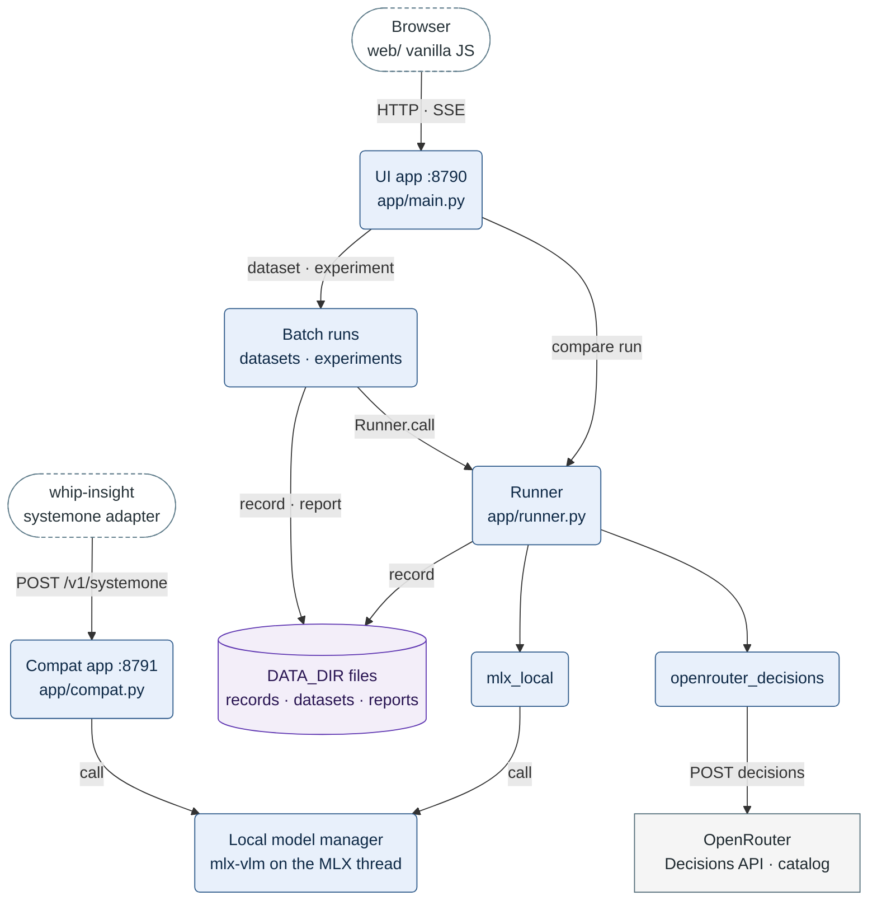
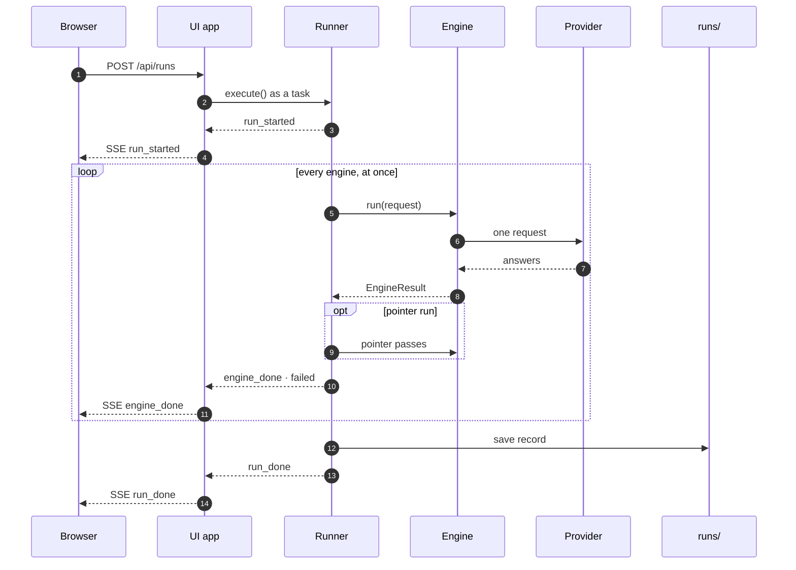

# Decision Models Playground — Architecture

> **Status.** The system as implemented through increment P6 (2026-11-09). P7 is not started; its scope is work-item
> WI-1 in [BACKLOG.md](BACKLOG.md).
>
> **Scope.** Structure, data, interfaces and runtime behaviour. Requirements, use cases and requirement risks
> (RQ-1…RQ-13) are in [TASK.md](TASK.md). Measurements come from [SPIKE.md](SPIKE.md) and [reviews/](reviews/).
> Every statement was checked against the P6 code; a `path:line` reference is followed by the symbol it names.

## 1. Task Description

Requirements: [TASK 001](TASK.md). A decision model reads a state (text, JSON, pictures, audio for d1-Omni) and
answers closed questions with probabilities. The playground runs such models side by side on one Mac.

| Goal | One line |
|---|---|
| G1 | Compare and calibrate: one call, one question set, several models' probabilities; thresholds from a labelled set |
| G2 | Local runtime for whip-insight: d1-2B and d1-Omni-2B on the Mac, served as `POST /v1/systemone` |
| G3 | New d1 capabilities: audio input, typed extraction with `span`, multiple choice |
| G4 | Decision model against an ordinary LLM: agreement, cost, latency on the same question |

Status:
- done 2026-11-09: P0 spike ([SPIKE.md](SPIKE.md)), P1 core and cloud engine, P2 local engine and compat server, P3
  probe and catalog, P4 datasets, P5 experiments, P6 research modes;
- not started: P7, the `systemone_http` engine and the `openrouter_llm` baseline, as WI-1 in [BACKLOG.md](BACKLOG.md).

G4 has no implementation in P0–P6. The engine kinds it needs are registered as planned (§3.5.7).

## 2. Functional Architecture

### 2.1. Functional Components

Use case ids are those of [TASK.md](TASK.md): UC-1 compare run, UC-2 experiments, UC-3 datasets and calibration,
UC-4 capability probe and matrix, UC-5 compat server, UC-6 audio, UC-7 extraction, UC-8 turn pointer.

| Id | Component | Functions: input → output | Use cases | Depends on |
|---|---|---|---|---|
| F1 | Comparison run | estimate; run: request, engines → SSE events and a `compare` record; rerun | UC-1, UC-6, UC-7, UC-8 | F2, F8, F9, F10 |
| F2 | Engine adapters | availability; profile; cost estimate; one request → `EngineResult` | all | F3, F7 (catalog) |
| F3 | Local model hosting | one model in memory: load, evict, unload; one call → result and timings | UC-1, UC-5, UC-6, UC-7 | — |
| F4 | Compat service | `POST /v1/systemone` → System One answers; `GET /health` | UC-5 | F3, F2 (precheck) |
| F5 | Batch evaluation | dataset run → `dataset` record and report files; experiment grid → `experiment` record | UC-2, UC-3 | F1, F6, F8, F9 |
| F6 | Datasets, presets, reports | JSONL or CSV → dataset; tag import, synthesis; record → calibration or stability report | UC-2, UC-3 | — |
| F7 | Probe and catalog | engine → profile and `probe` record; catalog refresh; matrix rows | UC-4 | F2, F8, F9 |
| F8 | Budget | reserve and release estimates; spend per day; charges of runs that were not saved | UC-1–UC-4, UC-8 | F9 |
| F9 | Run history | durable record and index; list, filter, read; index repair at start | UC-1–UC-4 | — |
| F10 | Research modes | turn pointer; RU normalization; `multi` threshold; media upload → stored path | UC-6, UC-7, UC-8 | F1, F2 |
| F11 | Browser UI | six screens: Workbench, History, Datasets, Experiments, Matrix, Local models | all but UC-5 | F1, F5, F7 |

- F2 is used by F1, F4, F5 and F7. F3 is used by F2 (`mlx_local`) and F4.
- F7's profiles filter questions in UC-1, UC-2 and UC-3 as well.
- For UC-5, F11 shows the compat address and whether a token is set.

## 3. System Architecture

### 3.1. Architectural Style

- One Python process runs one asyncio event loop with two ASGI applications: a modular monolith.
- Engines are adapters behind one base class (`BaseEngine`); the runner knows no provider protocol.
- Persistent state is JSON, JSONL and YAML files under `DATA_DIR`. There is no database server.
- The browser UI is static ES modules served by the same process, without a build step.

**Why.** One user works on one Mac ([TASK.md](TASK.md)). The UI and the compat server share one local model: d1-2B
takes 2.06 GB and d1-Omni 2.53 GB after load, plus about 1.1 GB of MLX cache ([SPIKE.md](SPIKE.md) §2.3). Two
processes would hold two copies or need an IPC layer. The OpenRouter Decisions API is alpha (RQ-4): one adapter per
provider keeps a change of its shape inside one module.

### 3.2. Components and Modules

**Backend, `app/` and `app/engines/`.**

| Module | Responsibility |
|---|---|
| `__init__.py` | Package; `__version__ = "0.1.0"` |
| `__main__.py` | Entry point `python -m app`: settings check, both uvicorn servers, signals, shutdown (§3.4) |
| `settings.py` | `.env` → `Settings`: hosts, token rules, budget, base-URL rule, `DATA_DIR` paths |
| `schemas.py` | Internal contract and config models: `Question`, `DecisionRequest`, `Answer`, `EngineResult`, `AppConfig` |
| `registry.py` | `config.yaml` → engine objects with a shared `EngineContext`; `PlannedEngine` for P7 kinds |
| `main.py` | UI app: `/api/*`, SSE streams, `web/` files, Host and Origin guards, security headers |
| `compat.py` | Compat app: `POST /v1/systemone`, `GET /health`, guards, image decoding |
| `runner.py` | Compare run: profile split, estimate, parallel engines, pointer passes, record, call ledger |
| `batch.py` | Many jobs on several engines under the budget: lanes and reservation rules (§3.8) |
| `dataset_run.py` | Dataset run over `batch.py`: `dataset` record, report files |
| `experiments.py` | Experiment grid (wordings × orders × repeats) over `batch.py`: `experiment` record |
| `datasets.py` | Dataset format, label normalization, JSONL and CSV parsing, `DatasetStore` |
| `presets.py` | Question presets under the repository's `presets/`, ids with one folder level |
| `metrics.py` | Calibration metrics: agreement, coverage and accuracy curve, Brier, ECE, suggested thresholds |
| `reports.py` | Calibration report of a dataset record: JSON and Markdown (RU, EN) |
| `stability.py` | Stability report of an experiment record: repeats, orders, first position, wordings, heatmap |
| `probe.py` | Capability probe, evidence rule, `ProbeStore`, matrix rows |
| `catalog.py` | OpenRouter catalog and ZDR list, cache `probes/catalog.json`, prices |
| `budget.py` | Daily limit: spent today, reserved, charges of runs that were not saved |
| `store.py` | Run records and `runs/index.jsonl`; ULIDs; `write_durably`, `full_fsync`, `reconcile` |
| `local_models.py` | Local model manager, MLX thread, MLX backend, snapshot dates, rendered-state length |
| `pointer.py` | Turn pointer: turns, instructions, blocks, pass requests |
| `normalize_ru.py` | Russian dates and numbers read from extraction text |
| `media.py` | Media upload: format by bytes, ffmpeg conversion, picture check, `MediaStore` |
| `check.py` | `python -m app.check`: engine availability, catalog summary, today's budget |
| `assets/probe_audio_ru.wav` | The probe's audio clip (step A) |
| `engines/__init__.py` | `KINDS` (implemented kinds) and `PLANNED` (kinds that arrive in P7) |
| `engines/base.py` | `BaseEngine`, `EngineFailure`, `normalize_answer`, `ANSWER_NAMES`, `truncate_raw` |
| `engines/openrouter_decisions.py` | `OpenRouterDecisions`: request body, error reading, cost |
| `engines/mlx_local.py` | `MlxLocal`: availability, precheck with token counting, call through the manager |

**Frontend, `web/`.** `index.html` holds six tabs and loads `js/app.js` as an ES module; `styles.css`; `favicon.svg`.

| Module (`web/js/`) | Responsibility |
|---|---|
| `app.js` | Wiring: tabs, deep links, Workbench draft, engines, estimate, run streams, budget header |
| `api.js` | JSON calls and the SSE reader over `fetch` streams; emits `fatal` when a stream breaks |
| `questions.js` | Question editor ⇄ `{key: question}` map; the `el()` DOM helper |
| `results.js` | Question × engine table: bars, top option, latency, cost, snapshot, span, pointer, `multi` threshold |
| `runview.js` | One stream's event handler, bound to the view it fills |
| `draft.js` | Workbench draft backup rule; `bodyState` (blank text with media → `state: null`) |
| `history.js` | History: list, tag and engine filters, open, rerun, compare two runs |
| `datasets.js` | Datasets: list, import, estimate, run, calibration report |
| `charts.js` | SVG threshold curve and reliability diagram |
| `experiments.js` | Experiments: grid setup, estimate, run, stability report, heatmap |
| `matrix.js` | Capability matrix and probe launch |
| `local.js` | Local models: state, unload, compat address, token flag |
| `i18n.js` | Russian and English strings; the language is kept in `localStorage` |

**Scripts, `scripts/`.**

| Script | Responsibility |
|---|---|
| `import_std_tags.py` | whip-insight standard tags → `presets/std_tags/<key>.yaml` and `DATA_DIR/datasets/<key>/` |
| `synth_dialogs.py` | A tag dataset's phrases inside neutral dialogues → `datasets/synth_<tag>` |
| `smoke_local.py` | Opt-in smoke test of the real local path; writes a JSON log |
| `spike/openrouter_spike.py`, `spike/mlx_spike.py` | P0 spike: recordings → `tests/fixtures/openrouter/`, `tests/fixtures/mlx/` |
| `spike/systemone_spike.py` | A running `/v1/systemone` server → `tests/fixtures/systemone/<name>/`; a P7 spike tool |
| `spike/make_audio.sh` | Synthetic Russian clips (`say` + ffmpeg) → `tests/fixtures/audio/` |

### 3.3. Components Figure

**Figure 1.** Components — who calls whom inside the one process and outside it (§3.2).



Legend:
- stadium with a dashed border — a client outside the playground; rounded box — a component of the playground;
- cylinder — files on disk; rectangle — an external service; arrow — a call from caller to callee;
- not drawn: the prober (`app/probe.py`) calls engines directly; the compat app also runs the `mlx_local` precheck;
  the UI app reads history, datasets and reports and refreshes the catalog.

### 3.4. Process Model

`python -m app` (`app/__main__.py`) runs these steps in order:
1. Exits when it runs outside a virtual environment (`app/__main__.py:24` `sys.prefix == sys.base_prefix`).
2. Reads `.env` into `Settings`; a rejected combination exits before any port opens (§7.1, §7.2).
3. Creates `runs/`, `datasets/`, `probes/`, `reports/`, `media/` under `DATA_DIR`; warns when `.env` grants any
   permission to group or others.
4. Loads `config.yaml` (else `config.example.yaml`) and builds one `LocalModels`; its MLX thread starts here.
5. Builds the UI app (`create_app`) with that manager, unless `--compat-only`.
6. Builds the compat app over its own `Registry` and `Catalog` with the same manager, unless `--no-compat`.
7. Installs SIGINT and SIGTERM handlers on the loop (`app/__main__.py:93`); uvicorn's signal capture is disabled.
8. Starts the idle-unload watcher and serves both apps with `asyncio.gather`.

| Thread or process | What runs there |
|---|---|
| Event loop thread | Both ASGI apps, run tasks, SSE streams, budget, record writes |
| MLX thread (`MlxThread`, daemon) | Every MLX operation: load, `system_one` call, unload, memory reading |
| Default executor (`asyncio.to_thread`) | Prechecks, compat JSON parsing and image decoding, media saves, reports, batch planning |
| ffmpeg subprocess | One per audio upload, at most two at once |

The UI lifespan (`app/main.py` `lifespan`) builds on start: catalog, registry, run store, budget, prober, runner,
dataset runner, experiment runner and media store. The media store deletes `.upload-*` temp files.
`Store.reconcile()` indexes records that lack an index line. A catalog older than 24 h is refreshed in the background.
On exit the lifespan closes the engines' HTTP clients.

A run, dataset run, experiment or probe is an `asyncio` task held in `app.state.tasks`. It continues after the browser
disconnects; the record is saved and billed either way.

Shutdown:
1. First signal: `LocalModels.begin_close()`; every server gets `should_exit`; uvicorn waits up to 5 s for open
   requests (`timeout_graceful_shutdown=5`).
2. Second signal: `force_exit` on both servers and a daemon `threading.Timer(3, os._exit, (1,))`
   (`app/__main__.py:86`).
3. After the servers stop: `LocalModels.aclose()` unloads within 5 s (0.5 s after a forced stop), then stops the MLX
   thread without joining it (`app/__main__.py:99`).

**Why.** A running MLX call cannot be interrupted. Its thread is a daemon, so it does not keep the interpreter alive.
The hard-exit timer is a thread, not a loop timer. A non-daemon executor worker stuck in a tokenizer kept the
interpreter alive after the loop closed, so a loop timer never fired (review P4, `app/__main__.py:80-83`).

### 3.5. Engines

#### 3.5.1. Engine Contract

There is no separate `Protocol` class for engines; `BaseEngine` (`app/engines/base.py:200`) is the contract.

| Method | Contract |
|---|---|
| `available()` | `(ok, reason)`; synchronous, called often |
| `default_profile()` | The kind's ceiling: types, option and level limits, media |
| `probed()` | The latest stored probe, only when it was taken on the kind and model that `config.yaml` names now |
| `profile()` | `default_profile()` narrowed by `probed()`; a probe confirms or narrows, never widens |
| `estimate_cost(req)`, `cost_of_tokens(n)` | Dollars before a call; the price of `n` input tokens; `0.0` for free engines |
| `context_limit_tokens()`, `max_text_bytes()` | Context and byte ceilings that the probe's long step fills |
| `run(req, opts)` | One request → `EngineResult`; failures are values, not exceptions |
| `describe()` | Row for `GET /api/engines` and the matrix |
| `post(url, body, headers, deadline)` | Shared HTTP call with one retry (§3.5.2) |

`normalize_answer(q, raw, names)` turns one provider answer into an `Answer` or a question failure class (§4.1). It
never raises: an odd field costs that question, not the engine result.

#### 3.5.2. Retries, Deadlines, Concurrency

- Each engine holds `asyncio.Semaphore(concurrency)`; `concurrency` defaults to 4.
- `openrouter_decisions` starts its deadline after it gets a slot: `timeout_s × 2 + retry_delay_s`.
- One attempt waits at most `min(timeout_s, remaining)`.
- `post()` retries once after 2 s on a connect or pool timeout, another transport error, or HTTP ≥ 500, when more
  than 2 s remain.
- A read timeout is `timed_out` without a retry. A connection that never opened is `unreachable` after the retry.

**Why.** A deadline counted from the queue would time out calls that never left (review P1). After a read timeout
the provider may still be working, and a retry would double the wait.

#### 3.5.3. `openrouter_decisions`

- Endpoint: `POST <root>/api/alpha/decisions`, `Authorization: Bearer <OPENROUTER_API_KEY>`.
- `<root>` is the engine's `base_url` or `OPENROUTER_BASE_URL` (default `https://openrouter.ai`); the path is code.
- Body: `model`, `state`, `questions` in System One shape; `provider` is `{"zdr": true, "data_collection": "deny"}`, or
  `{"data_collection": "deny"}` for an engine with `zdr: false`.
- Default profile: `noul`, `choice`, `score`; 255 options; 10 levels; no media.
- `max_text_bytes()` is the smaller of `max_request_bytes` and 250 000 bytes.
- Error bodies are stored with `user_id` replaced by `<user_id>` (`scrub`).

| Condition or response | Result |
|---|---|
| `req.media` not empty; `zdr: false` without `allow_no_zdr`; no key | request `refused`, no call |
| Body over `max_request_bytes` | request `too_long`, no call |
| 200 with a JSON object | usage read first, then each answer through `normalize_answer`; `model` → `snapshot` |
| 400 naming question types (zod `path`, or `question N is a box`) | those keys `unsupported`; the rest sent once more |
| 400 or 422 containing `over the model's input limit` | request `too_long` |
| 413 / 429 / 408 | `too_long` / `rate_limited` / `timed_out` |
| Other 4xx | request `refused`, with `http_status` |
| 200 that is not a JSON object; 5xx after the retry | `provider_error` |

Cost:
- Estimate: `(tokens_per_char × text_size + overhead_tokens) × price`; defaults 1.5 tokens per character, 200 tokens.
- Price: the catalog's prompt price; else the highest decision-model price in the catalog; else
  `fallback_price_per_mtok` (0.2 $/M).
- Actual: `usage.cost` when finite and ≥ 0 (`provider`); else `input_tokens × price` (`price`); else `none`.

**Why.**
- `choice` with `multiple: true` answers 200 and drops the flag with no error (RQ-9, [SPIKE.md](SPIKE.md) §3.2). The
  cloud profile has no `multi`, so the runner never sends it.
- An unknown type fails the whole request with 400 ([SPIKE.md](SPIKE.md) §3.2); the second round keeps the rest.
- Jev billed 0.95–1.65 tokens per character in P0; the estimate rule is not below any billed P0 call
  (`tests/test_budget.py`).

#### 3.5.4. `mlx_local`

- Runs in process through `mlx-vlm ≥ 0.7.11`; every MLX operation goes through `LocalModels` (§3.6).
- Default profile: all seven types; 255 options; 10 levels; media `image`, plus `audio` when `audio: true`.
- Calls `model.system_one(state, questions, media, score_readout="mean")`; `expected` is computed from
  `probabilities` anyway.
- Cost is 0 (`cost_source: none`); `input_tokens` comes from the model's `usage`.
- `latency_ms` is the model call alone; `timings` holds `queue_ms`, `load_ms`, `call_ms`.
- Snapshot: `<repo>-<YYYYMMDD>` from the commit date of the cached revision, else the undated repo id (§3.6).

Request handling, in order:
1. A question whose `instructions` is not a string becomes `unsupported` and is not sent.
2. Each media item must resolve to a file under `DATA_DIR/media`; audio on a model without `audio: true` is
   `refused`.
3. `precheck()` before the queue (`app/engines/mlx_local.py:232`):
   1. mlx-vlm's own question checks (`check_question`, `as_question`), on a worker thread;
   2. JSON depth ≤ 32, and the rendered length, computed without rendering, ≤ 16 × `context_tokens`;
   3. on a worker thread: the rendered state plus the heaviest group of `d1_set_size` questions, escaped, counted.
4. The call goes through `LocalModels.call(repo, …, wait_s=timeout_s)`.

Counting rules of step 3.3:
- The state is rendered as mlx-vlm renders it: a string as is, other JSON with `indent=2`.
- Text is escaped as mlx-vlm's `plain()` escapes it; `<|pad|>` is 1 token raw and 5 escaped.
- The model's `tokenizer.json` counts tokens without loading the model; `d1_set_size` comes from `config.json`
  (default 4).
- Allowances: 32 tokens per question, 4 per option, 500 per audio clip. A picture takes
  `D1_VISION_MAX_PIXELS / 1024 + 100` tokens, about 1 700 by default.
- A count above `context_tokens` (default 32 768) is `too_long`.

**Why.** A JSON state of depth 32 and 0.5 M compact characters rendered to 11.8 M characters and +1.3 GB before a
later check refused it ([reviews/r3-response.md](reviews/r3-response.md)). A refused request must not load or evict a
model. `tests/test_mlx_backend.py` checks on the real tokenizer that the count is not below mlx-vlm's row.

Failure mapping (§4.2):
- a missing manager or a `LoadError`, an unreadable `tokenizer.json` included, gives `unreachable`;
- a count over the limit, or running out of memory while counting, gives `too_long`;
- an mlx-vlm capability refusal (`CAPABILITY_REFUSAL`) gives `refused` with `http_status` 400;
- `Busy` gives `rate_limited`; `WaitTimeout` gives `timed_out`; any other error gives `provider_error`.

#### 3.5.5. Registry and Availability

`Registry` (`app/registry.py`) builds one engine per `engines[]` entry. All engines share one `EngineContext`:
settings, catalog, budget config, local manager, probe store.
- A duplicate engine id stops the start with `ValueError`. `EngineSpec` forbids unknown keys: `timeout: 60` fails.
- A kind found in `KINDS` gets its class. A kind in `PLANNED`, or an unknown kind, gets `PlannedEngine`.

| Kind | Available when |
|---|---|
| `openrouter_decisions` | `enabled`; `model` set; `OPENROUTER_API_KEY` set |
| `mlx_local` | `enabled`; `repo` set; macOS on arm64; mlx-vlm ≥ 0.7.11; manager running; model in the HF cache |
| `systemone_http`, `openrouter_llm` | never; reason `engine kind … arrives in P7` |
| any other kind | never; reason `unknown engine kind` |

The download check (`disk_gb`) is cached for 60 s. An unavailable engine is listed with its reason; a run that names
it is refused with 400 before streaming.

#### 3.5.6. Answer-Name Table

`ANSWER_NAMES` (`app/engines/base.py:32`) maps internal fields to provider fields.

| Internal | `system_one` (OpenRouter, mlx-vlm `system_one`) | `mlx_decisions` (mlx-vlm `/v1/decisions`, unused) |
|---|---|---|
| P(true) of `noul` | `noul` | `probability` |
| chosen option | `choice` | `value` |
| distribution | `probabilities` | `probabilities` |
| vendor confidence | `confidence` | `metadata.confidence` |
| score level / legend | `score` / `legend` | `value` / `metadata.legend` |

Both implemented engines read with `system_one`. Extension answers are read by fixed names: `probabilities`, `found`,
`span`, `interval`, `text`, `unit`, and the type's own value field.

#### 3.5.7. Planned Kinds

`app/engines/__init__.py:12` `PLANNED` lists `systemone_http` and `openrouter_llm` with increment `P7`.
`config.example.yaml` carries disabled entries of both. Their design is WI-1
([backlog/wi-1-p7-systemone-http-and-llm-baseline.md](backlog/wi-1-p7-systemone-http-and-llm-baseline.md)).

### 3.6. Local Model Manager

`LocalModels` (`app/local_models.py`) holds at most one loaded model; `local.max_loaded_models` accepts only 1. The UI
app and the compat app use the same instance.

**Figure 2.** Local model lifecycle — the states of one model in `LocalModels`; transition labels name conditions.

```mermaid
%%{init: {"layout": "dagre", "look": "classic", "themeCSS": "foreignObject { overflow: visible; }"}}%%
stateDiagram-v2
  accTitle: Figure 2. Local model lifecycle
  accDescr: A model is unloaded, loads on the first call for it, is ready, is busy during a call, and is unloaded when idle, evicted or unloaded by the operator; a failed load returns it to unloaded.
  direction TB
  [*] --> unloaded
  unloaded --> loading: call for this repo
  loading --> ready: load succeeds
  loading --> unloaded: load fails
  ready --> busy: call starts
  busy --> ready: call ends
  ready --> unloaded: idle · evicted · unload
  classDef hold fill:#E8F0FB,stroke:#2E5A8A,color:#0F2A47,stroke-width:2px
  classDef wait fill:#FFFFFF,stroke:#607D8B,color:#263238
  class loading,ready,busy hold
  class unloaded wait
```



Legend: thick blue border — the model holds Mac memory; thin grey-blue border — it holds none.

`call(repo, fn, warm_audio, wait_s)`:
1. Raises `Busy` when shutdown began or `max_waiting` (8) callers already wait.
2. Waits for the one `asyncio.Lock` (FIFO) at most `wait_s`; past it raises `WaitTimeout`.
3. Raises `Busy` when shutdown began while it waited.
4. When another model is loaded, unloads it, then loads `repo` on the MLX thread.
5. Runs `fn(loaded)` on the MLX thread, then reads MLX memory there.
6. Returns the result, the loaded model and `timings`; releases the lock.

Rules:
- `_on_thread()` absorbs cancellation until the MLX work ends; the lock is never released while MLX is busy.
- A model loaded for a caller that was cancelled is adopted: tracked, unloadable, and not idle at once.
- After `begin_close()`, a cancel is not absorbed, and callers that pass `abandon_on_close` get `Busy` at once.
- A watcher runs every 30 s and unloads a model idle for `local.idle_unload_s` (600 s) when the lock is free.
- `POST /api/local/models/{id}/unload` waits at most 5 s for the lock, then answers 409.
- `MlxThread.submit()` after shutdown raises `RuntimeError`.

| `MlxBackend` operation | Behaviour |
|---|---|
| `load` | `snapshot_download(local_files_only=True)`, `mlx_vlm.load`; requires `system_one`; warms audio for audio models |
| `unload` | Drops references, clears mlx-vlm tokenizer caches, `gc.collect()`, `mx.clear_cache()` |
| snapshot date | `HfApi().model_info(repo, revision, timeout=5).last_modified`, cached in `probes/local_snapshots.json` |
| `disk_gb` | Size of the cached snapshot, cached 60 s; `None` when not downloaded |
| `count_tokens`, `set_size`, `validate` | `tokenizer.json`, `config.json`, mlx-vlm question checks; no model load |

- A model is never downloaded implicitly; `make models` downloads.
- Offline, or with `HF_HUB_OFFLINE` set, the snapshot stays undated; a failed date lookup is not repeated.
- A failed audio warm-up is logged and does not fail the load.
- `describe(repo)` returns state, last use, last error, calls, waiting callers, load time, snapshot and memory.

**Why.**
- MLX streams are tied to a thread, so all MLX work runs on one thread (`app/local_models.py:10-11`); a test checks
  the thread identity ([reviews/p2-response.md](reviews/p2-response.md)).
- Load takes 1.3–1.7 s ([SPIKE.md](SPIKE.md) §2.3). A FIFO queue alternating two models reloads at each switch; two
  8-bit models plus cache leave no room for a long state.
- A 27 765-token state peaked at 5.65–6.11 GB; 64 K tokens were forecast at about 20 GB on a 24 GB Mac
  ([SPIKE.md](SPIKE.md) §2.4). Hence `context_tokens: 32768` (RQ-10).
- The first audio call after load took 1.8 s, later ones 150–275 ms ([SPIKE.md](SPIKE.md) §2.5). Hence the warm-up.
- After `del`, `gc.collect()` and `mx.clear_cache()`, MLX memory returned to 0 ([SPIKE.md](SPIKE.md) §2.3).

### 3.7. Workbench Run Pipeline

**Figure 3.** One compare run — the messages of `POST /api/runs` from the request to `run_done`.



Legend: solid arrow — a call the sender waits for; dashed arrow — an event or a reply. The `opt` block runs only
when `pointer: true`.

Steps of `Runner.execute()` (`app/runner.py:232`):
1. Before the stream: unknown or unavailable engines and pointer input errors → HTTP 400; schema errors → 422.
2. One profile snapshot per engine; the estimate and the pointer passes read the same snapshot.
3. Estimate per engine: the main call on the questions its profile accepts, plus worst-case pointer passes.
4. Reservation. A total that is not finite, or a paid total the day cannot hold, ends with `budget_stop`: no call, no
   record. A run of free engines only proceeds whatever the day's spend.
5. `run_started`; a pointer run includes the request as sent, with its turns.
6. All engines run at once (`asyncio.gather(..., return_exceptions=True)`). Each emits `engine_started`. More turns
   than B² give request `too_long` without a call. Else `Runner.call()` runs, then the pointer passes (§3.10). Each
   ends with `engine_done`, or `engine_failed` when its status is `failed`.
7. Every call, main or pass, is appended to the run's ledger (`app/runner.py:41` `_LEDGER`).
8. After every engine ends, an exception from any engine gives `run_error`; no call runs after a terminal event.
9. The record is saved (§4.3), the reservation released, and `run_done` carries cost, day and budget.
10. A run that was not saved charges its whole ledger to the day (`app/runner.py:313` `charge_unsaved`).

`Runner.call()` wraps every engine call of a compare run and of a batch:

| Condition | Result |
|---|---|
| A media type outside the profile's `media` | request `refused`; engine not called |
| Questions the profile refuses (type, option count, level count) | those keys `unsupported`, not sent |
| No question left | `failed`, every key `unsupported`; engine not called |
| The engine raises | request `provider_error` |

The result always covers every key of the request (`EngineResult.build`).

### 3.8. Batch Engine

`Batch` (`app/batch.py`) runs `jobs × engines` for dataset runs and experiments. All jobs have the same question keys,
types and sizes; a mismatch raises `ValueError` at construction.

Money and order rules:
1. Up front, reserve the estimate of every job on every engine; each distinct request object is estimated once. A
   total that is not finite, or that the day cannot hold, stops the run with `budget_stop` before any call.
2. Each engine works through the jobs in its own lane: `concurrency` workers for a cloud engine, one for a local
   engine (`app/batch.py:61` `lane_width`).
3. Local engines take turns, one whole engine after another; cloud lanes run beside them in one `TaskGroup`.
4. Each lane's first call runs alone; the lane's workers start after it.
5. A call that has not finished holds the larger of its estimate and the engine's dearest call so far
   (`committed`).
6. When `committed` would pass the reservation, the batch reserves the difference; when the day refuses, `stopped` is
   set. After that, paid jobs become request `budget` without a call; free jobs continue.
7. Every call goes through `Runner.call()`. An error outside the engine (estimate, bug) is that job's
   `provider_error`; no lane stops.
8. `close(saved)`: a run that was not saved charges `max(spent, committed)`; the reservation is released either way.

**Why.** Interleaved jobs on two local models reloaded the model on every call: in live UC-3, 170 of 200 s were loads
(`app/batch.py:6-9`). The first call alone fixes the real cost before the lane widens, so a low estimate overshoots
the day by at most one call per paid engine ([reviews/p4-response.md](reviews/p4-response.md)).

Dataset run (`app/dataset_run.py`):
- One job per item (the first `limit` items): the item's state with the dataset's questions.
- Batch planning and the estimate run on a worker thread (up to 5 000 items).
- The `dataset` record is saved first. The report is then built and written on a worker thread to
  `reports/<dataset>-<day>-<run_id>.md|.json`. A report failure gives `report_error`; the record stays.
- Terminal event: `budget_stop` when `stopped`, else `run_done`.

Experiment (`app/experiments.py`):

| Axis | Rule |
|---|---|
| Wordings | The base questions plus up to 5 named wordings with the same keys, types, option ids, level counts (else 422) |
| Option orders | `choice` and `multi` only: every order up to 4 options, else `k` orders (default 6) from `seed` |
| Repeats | 1–20, default 5 |

- Each wording is put in the base's option order before the order axis applies. Order 0 is the original. Several
  ordered questions take order `i` each; a shorter list cycles.
- Grid size = wordings × orders × repeats × engines ≤ 2 000 calls, checked by arithmetic before the grid is built
  (400).
- Jobs run repeat-major: every cell's first repeat before any second one.

**Why.** Repeat-major order makes a budget stop thin the grid instead of dropping the last wordings. Estimating once
per cell, off the loop, removed a 4.7 s stall on a 435 KB state with 1 920 calls
([reviews/p5-response.md](reviews/p5-response.md)).

Report metrics:
- Calibration (`metrics.py`, `reports.py`), grouped per engine and answering snapshot. It reports the whip-insight
  threshold (highest agreement) and the selective threshold (smallest t with accuracy ≥ target on ≥ 10 decided
  items). It also reports Brier, ECE over 10 bins, the curve 0.50…0.99, and a confusion matrix for `choice`, `score`.
- Stability (`stability.py`): repeat spread and `diff_se`; order |ΔP| and top flips; first-position share against an
  order-invariant expectation, and lift; wording |ΔP| against the base; a heatmap.

### 3.9. Capability Probe and Catalog

`Prober.run()` (`app/probe.py`) sends a fixed request set to one engine and reads it into a profile.

| Step | Request | Measures |
|---|---|---|
| N, C, S | one `noul`; `choice` of 3; `score` of 4, on a short state | `types` |
| C24, C100, C240 / S10 | `choice` of that many options / `score` of 10 levels | `max_choice_options` / `max_score_levels` |
| every answer | `usage.cost` present; dated `model` | `reports_cost`, `reports_snapshot` |
| M, T, NUM, D | `multi`, `text`, `number`, `date`, for kinds whose ceiling has them | extension types |
| A | `noul` on `app/assets/probe_audio_ru.wav`, for audio models | `media: ["audio"]` |
| CAL, LONG | on request: N on filler; then a state of 90 % of the context with a fact at its end | `reads_full_context` |

| Outcome of one request | Reading |
|---|---|
| An answer, or a refusal answer | served |
| `unsupported`, `invalid_answer`, or `refused` with HTTP 400/422 | not served |
| Anything else: network, 401–404, timeouts, 429, `too_long`, `skipped` | unobserved; the stored value stays |

Profile rules:
- A size limit is the largest served size; a size not served closes all larger sizes.
- No 2xx answer at all gives no profile (`no_profile`) with the dominant failure class.
- `not_served` keeps types seen as not served until a probe serves them.
- The snapshot is the first dated `model`, else the configured model.
- `reads_full_context` belongs to one snapshot and is not carried to a new one; without LONG it is `null`.

LONG sizing:
- N and CAL fit `tokens = overhead + ratio × characters`; LONG fills 90 % of `context_limit_tokens()`.
- The state is capped by `max_text_bytes()`: `max_request_bytes`, or 250 000 bytes of text on OpenRouter.
- A LONG that read under 75 % of the context, without the byte cap, is unobserved.
- After `too_long`, one more attempt at 80 % runs under its own reservation. No token counts give `skipped`.

Runtime rules:
- Probe calls go to `engine.run()` directly, bypassing `Runner.call()` and the profile filter.
- The estimate (LONG at its token ceiling) is reserved. The run is saved as kind `probe`; an unsaved probe charges
  what it spent.
- One probe per engine at a time (409). Steps after 600 s are `skipped` (`app/probe.py:63` `PROBE_DEADLINE_S`).
- Only `openrouter_decisions` and `mlx_local` are probed (`PROBED_KINDS`). An engine with `zdr: false` needs
  `allow_no_zdr` (400).

**Why.** The step set and the evidence rule are whip-insight's (its SPEC §5.6.2, decision-service §5.3), so the two
profiles agree. A local probe holds the model and compat calls wait in the same queue; the deadline bounds that wait.

Catalog (`app/catalog.py`):
- Refresh sends three GETs to `<OPENROUTER_BASE_URL>` without a key, timeout 20 s:
  `/api/v1/models?output_modalities=decisions`, `/api/v1/endpoints/zdr`, `/api/v1/models` (LLMs).
- The ZDR list is filtered to the ids of the two model lists. The cache `probes/catalog.json` is stale after 24 h.
- Refresh runs at UI start when stale, on `POST /api/catalog/refresh`, and in `make check`. A failed refresh keeps
  the old cache and reports `error`.
- A model matches by `id` or `canonical_slug`. The ZDR flag is `None` for an alias (`~…`) or an empty cache.

Matrix (`GET /api/matrix`, `matrix_rows`):
- Rows: the configured probed engines with their latest profile, then catalog decision models not in `config.yaml`.
- Cells: yes, no, unchecked, or never (the kind cannot serve it); the UI draws `✓`, `✗`, `?`, `—`.
- A row is stale when its profile was taken on another kind or model, or when a later run answered as another dated
  snapshot.

### 3.10. Research Modes

Research modes are options of the compare run (§3.7), not separate pipelines.

**Turn pointer** (`app/pointer.py`, UC-8). The rules are whip-insight's route (SPEC §8.2.4, `decision-run.js`).
1. A transcript splits into turns `t0…t(N−1)`, one per non-empty line, on `\n` only. `Name: text` names the
   participant; a bare `Name:` line names the speaker of the next line.
2. Every call of the run, main calls included, sends `state = {"fragments": [{turn, participant, text}]}`. A
   `{"fragments": [...]}` state is checked and taken as is; the options are its distinct turns in turn order.
3. A pointer is asked only for the preferred answer: `noul` with P(true), rounded to 3 decimals, ≥ 0.5; the top
   option of `choice`; the top level of `score`.
4. Instruction: `В какой реплике видно, что <question>?` or `В какой реплике видно: <description>?`. The options are
   turns with `null` descriptions.
5. B = min(240, the profile's `max_choice_options`). One turn: no call, probability `null`. Up to B turns: one pass.
   Up to B² turns: pass 1 over blocks of ceil(N / B) turns, then pass 2 inside the chosen block. Over B²: the engine's
   whole request is `too_long` without a call.
6. A two-pass probability is the product of both passes.
7. A failed pass fails that pointer only. A bug in pointer code gives failure `internal`; answers and paid passes
   stay.
8. Pass costs join the engine's `usage`; the cost source is the weakest part's. A pass refused before sending is not
   counted in `passes`.
9. Media with the pointer → 400. A profile without `choice` → pointer `unsupported`.

**Why.** Turn labels are part of the model's input. Numbering from `t1` instead of `t0` moved d1-2B's pointer
probability on one call from 0.698 to 0.598 ([reviews/p6-response.md](reviews/p6-response.md)). The playground
numbers turns as whip-insight does, so a measurement here holds there.

**RU extraction normalization** (`app/normalize_ru.py`, UC-7):
- Runs inside `normalize_answer` for `text`, `number`, `date` answers whose own value is `null`, and writes
  `extract.normalized`. It never replaces the model's value; the UI marks the value as normalized.
- Dates: `12 ноября 2026 (года|г.)` with an optional weekday that must match; ISO; `ДД.ММ.ГГГГ`, `ДД/ММ/ГГГГ`.
- Numbers: digits and Russian number words in scale groups; `тыс.`, `млн`, `млрд`; a currency or unit around them.
- `null` for ambiguous input: no year, a two-digit year, `1.500`, digits and words mixed in one group, text over 80
  characters. Any error also gives `null`; the model's answer stays valid.

**Why.** mlx-vlm returned no value for Russian forms such as «12 ноября 2026 года» and «350 000 рублей», although the
model found the right span ([SPIKE.md](SPIKE.md) §2.2).

**`multi` threshold** (`web/js/results.js`). The table shows each option's P(yes) and the options at or above a
per-question threshold (default 0.5). The threshold is not sent. An empty or invalid field keeps the previous value.

**Span highlight.** The UI highlights `state[a:b]` only when the state is a string and the slice equals `text`.
Offsets are Python characters; JS counts code points. A JSON state gets no highlight.

**Media upload** (`app/media.py`, `POST /api/media`, UC-6):
1. The body is the file itself, at most 16 MiB, counted while it streams.
2. The format comes from the first bytes. Audio: WAV, MP3, M4A/MP4, OGG, FLAC, WebM/Matroska, AMR, AMR-WB. Pictures:
   PNG, JPEG, WebP. HEIC and AVIF (`ftyp` brands) get 400.
3. A picture is opened by Pillow limited to PNG, JPEG, WebP, checked against `compat.max_image_pixels`, verified,
   kept.
4. A recording is converted by ffmpeg (§7.5) to WAV, 16 kHz, mono, `pcm_s16le`, cut to `audio.max_seconds` (30).
   The output is checked with `wave`: mono, 16-bit, the sample rate, at least one frame.
5. The file is stored as `media/<sha256[:16]>.<ext>`. The response carries `type`, `path`, `sha256`, `bytes`, and
   `seconds`, `source_seconds`, `cut` or `width`, `height`. `cut: true` also when the source length is unknown and
   the clip is full.

The Workbench sends `media: [{type, path, sha256}]`, and `state: null` when the text is blank. `mlx_local` reads only
paths under `DATA_DIR/media`; the runner refuses audio for an engine whose profile lacks it.

**Why.** The model hears synthetic speech as `voice_robot` ([SPIKE.md](SPIKE.md) §2.5), so accuracy on Russian speech
needs the owner's recordings (RQ-3). The 30 s cap keeps a clip small: a 30 s clip with the `call_kind` question
measured 503 input tokens and 273 ms warm ([SPIKE.md](SPIKE.md) §2.5).

## 4. Data Model

### 4.1. Internal Contract

The internal request is a superset of System One (`app/schemas.py`). Request models refuse unknown keys.

| `Question` field | Rule |
|---|---|
| `type` | `noul`, `choice`, `score` (System One); `multi`, `text`, `number`, `date` (local d1 only) |
| `instructions` | non-empty string, or a dict or list; engines send only strings to a local d1 |
| `criteria` | `noul`: `{true?, false?}`; `choice`/`multi`: 2–255 ids → description or `null`; `score`: 2–10 levels |
| `range`, `step`, `unit` | `number` only; `range` runs low to high; `step` > 0 needs `range` |
| `multiple` | input only: `choice` + `multiple: true` becomes `multi`; must be a JSON boolean |

| `DecisionRequest` field | Rule |
|---|---|
| `state` | string, JSON object or array; `null` only with `media`; JSON depth ≤ 32 |
| `questions` | 1–64 entries; keys match `^[a-z][a-z0-9_]{0,63}$` with `fullmatch`; option ids too |
| `media` | `MediaItem {type: image \| audio \| video, path, sha256?}` |

`text_size()` counts the characters of state, keys, instructions and criteria; a `null` description counts as 4. The
cost estimates use it.

`Answer` fields: `type`, `probabilities`, `top`, `top_p`, `expected`, `vendor_confidence`, `extract`. Validation in
`normalize_answer`:

| Type | Accepted when | Derived fields |
|---|---|---|
| any | `{"type": "refusal"}` → question `refused` | — |
| `noul` | P(true) is a finite number in [0, 1] | `{true: p, false: 1 − p}`; `top` = `true` iff p ≥ 0.5 |
| `choice`, `score` | keys equal the options; each in [0, 1]; sum 1 ± 0.001; no `choices` field | `top` = argmax, ties by request order |
| `choice` | the provider's `choice`, when present, is one of the options | — |
| `score` | as above | `expected` = Σ i·pᵢ, computed here |
| `multi` | keys equal the options; each in [0, 1]; no sum rule | `top` = argmax |
| `text`, `number`, `date` | `found` in [0, 1] or absent; `span` `[a, b]`, 0 ≤ a ≤ b; `interval` of 2 finite numbers | `extract`; `probabilities = {found}` |

Any other shape is question `invalid_answer`. `vendor_confidence` is stored and never used in metrics: its meaning
differs between providers ([SPIKE.md](SPIKE.md) §3.5).

`EngineResult` fields:
- `engine_id`, `status` (`ok` | `partial` | `failed`), `answers`, `question_failures`, `request_failure`;
- `detail` (short, no keys), `http_status`, `snapshot`, `latency_ms`, `timings`, `pointers`;
- `usage {input_tokens, output_tokens, cost_usd, cost_source: provider | price | none}`;
- `raw`: finite numbers only, at most 64 KiB serialized.

`EngineResult.build()`:
1. Without a request failure, every requested key lands in exactly one of `answers` and `question_failures`; a
   missing key becomes `invalid_answer`.
2. With a request failure, keys without an answer or their own failure are covered by it.
3. `status` is `failed` on a request failure or with no answers, `partial` with some failures, else `ok`.

`PointerResult`: `turn`, `probability`, `instruction`, `passes`, `failure`, `detail`, `latency_ms`, `cost_usd`.
`CapabilityProfile`: `types`, `max_choice_options`, `max_score_levels`, `media`, `source`, `probed_at`; `refuse(q)` is
true for a type outside `types` or a size over a limit.

### 4.2. Failure Classes

| Class | Level | Set when |
|---|---|---|
| `unsupported` | question | The profile refuses it; a provider 400 names its type; local `instructions` not text |
| `refused` | question | The provider answered `{"type": "refusal"}` |
| `invalid_answer` | question | The answer failed §4.1 validation, or is missing from a 200 answer |
| `unreachable` | request | No connection after the retry; local model not downloaded or not loadable |
| `timed_out` | request | Read timeout; deadline passed; HTTP 408; local wait past `timeout_s` |
| `rate_limited` | request | HTTP 429; local queue full or shutting down |
| `refused` | request | Other 4xx; media or ZDR consent rule; mlx-vlm capability refusal (`http_status` 400) |
| `too_long` | request | Over `max_request_bytes`; HTTP 413; input-limit 400/422; local precheck; pointer over B² |
| `provider_error` | request | 5xx after the retry; unreadable 200; engine crash; batch error outside the engine |
| `budget` | request | A batch job not sent because the day's budget refused it |
| `skipped` | request | A probe step after the deadline, or LONG without a token fit |
| `internal` | pointer | A bug in pointer code after the main call |

The probe reads `refused` with `http_status` 400 or 422 as "not served" (§3.9).

### 4.3. Run Records and the Index

A record is one JSON file `runs/<day>/<id>.json`. `id` is a ULID: 26 Crockford base32 characters, ordered by
millisecond. `day` is the Mac's local date when the run ended; the budget counts the record on that day.

Fields of every record: `id`, `created_at` (UTC start), `day`, `kind`, `title`, `tags`, `request`, `options`,
`engines[{engine_id, kind, model, zdr}]`, `estimate_usd`, `cost_usd`, `versions{app, mlx_vlm, models}`.

| Kind | Additional fields | Call text kept |
|---|---|---|
| `compare` | `state_sha256`, `pointer`, `results[]`: full `EngineResult` with `raw`, `detail`, `pointers` | state, answers |
| `dataset` | `dataset{name, items, total_items, limit, label_source, question_set, items_sha256}` | none |
| `dataset` | `items[{id, labels, results{engine: compact}}]`, `budget_stopped`; `request` has questions only | none |
| `experiment` | `state_sha256`, `experiment{base, formulations, orders, n_orders, repeats, k, seed, orders_enabled}` | state |
| `experiment` | `calls[{key, formulation, order, repeat, results{engine: compact}}]`, `budget_stopped` | — |
| `probe` | `probe{engine_id, steps, long_context, allow_no_zdr}`, `results[]` as `<engine>#<step>`, `profile`, `error` | synthetic |

- A compact answer (`app/batch.py` `compact`): `status`, `answers{probabilities, top, top_p}`, `question_failures`,
  `request_failure`, `http_status`, `snapshot`, `latency_ms`, `timings`, `cost_usd`, `cost_source`. No `raw`, no
  `detail`.
- A pointer run's `request.state` is the `{"fragments": …}` that was sent; a rerun sends the same turns.
- Media are referenced by `path` and `sha256`, never copied. No record holds a key.

**Why.** A provider's error message can quote the request. Dataset and experiment records drop `detail` and `raw`, so
the call text stays in the dataset ([reviews/p4-response.md](reviews/p4-response.md)).

Index `runs/index.jsonl`, one line per record: `id`, `created_at`, `day`, `kind`, `title`, `tags`, `engines`,
`questions`, `cost_usd`, `status{engine: ok | partial | failed}`, `snapshots{engine: snapshot}`, and `dataset` for
dataset runs.
- For dataset and experiment records `status` aggregates per engine over items or calls; for a probe it is `ok` when
  a profile was written.
- `Store.rows()` caches the parsed index until its mtime or size changes and skips a torn line.
- `Store.list()` filters by tag, engine and kind, newest first. `Store.spent_on(day)` sums `cost_usd`.

### 4.4. Datasets and Presets

Dataset `datasets/<name>/` (`app/datasets.py`):
- `dataset.yaml`: `name`, `title`, `language`, `source`, `description`; exactly one of `question_set` (a preset id or
  path) and inline `questions`; `label_source`, `test_phrases` or `manual`.
- `items.jsonl`: one `{"id", "state", "labels": {key: label}, "meta"}` per line.

| Rule | Value |
|---|---|
| Name / item id | `[a-z0-9][a-z0-9_.-]{0,63}` / `[A-Za-z0-9][A-Za-z0-9_.:-]{0,99}`, unique |
| Items | ≤ 5 000; non-empty state; JSON depth ≤ 32 |
| `noul` / `choice` / `score` label | true/false, yes/no, да/нет, 1/0, y/n / an option id / a level index or the level's text |
| Other types | refused: labels exist for `noul`, `choice`, `score` only (`app/datasets.py:32` `LABELLED_TYPES`) |
| Errors | all at once, ten listed |
| CSV | `state` column; `id`; `label` or `label:<key>`; other columns → `meta` |
| CSV parsing | delimiter `,`, `;` or tab, the most frequent in the header; field ≤ 16 MiB; extra fields are errors |

`DatasetStore.create()` writes `items.jsonl` first, then `dataset.yaml`, both durably, so a `dataset.yaml` never names
missing items.

Preset `presets/<id>.yaml` or `presets/<folder>/<id>.yaml` in the repository (`app/presets.py`):
- Fields: `title`, `questions`, optional `state`, `source`, `tag{key, name, folder, folder_name, speaker?}`.
- The id matches `[a-z0-9_]{1,64}(/[a-z0-9_]{1,64})?`. `presets/synth/` holds synthesis templates, not presets.
- Questions are validated on read; `choice` + `multiple` becomes `multi`.
- `presets/std_tags/` holds 56 generated tag presets with one `noul` question `is_tag`.

### 4.5. Probe Profiles and Caches

| File | Content | Write |
|---|---|---|
| `probes/<engine_id>/<snapshot>.json` | Profile of one probe | `write_durably` |
| `probes/<engine_id>/latest.json` | The same; the file engines read | `write_durably` |
| `probes/catalog.json` | `fetched_at`, `decisions[]`, `llms[]`, filtered `zdr[]` | temp file + rename |
| `probes/local_snapshots.json` | `"<repo>@<revision>": "YYYYMMDD"` | plain write |

Profile fields (`StoredProfile`):
- identity: `engine_id`, `kind`, `model`, `snapshot`, `probed_at`;
- capabilities: `types`, `not_served`, `max_choice_options`, `max_score_levels`, `max_choice_probed`,
  `max_score_probed`, `media`;
- reporting: `reports_cost`, `reports_snapshot`, `reads_full_context`, `long_context_tokens`;
- provenance: `observed{step: reading, latency, failure, status, tokens}`, `run_id`, `cost_usd`, `app_version`.

A `latest.json` of another shape is ignored with a warning; the engine uses its default profile. `engine_id` must
match `[A-Za-z0-9._-]{1,100}` and not be only dots. The snapshot file name is sanitized and never `latest`.

### 4.6. Media, Reports and On-Disk Layout

All paths are under `DATA_DIR` (default: the repository root); all five directories are in `.gitignore`.

```text
DATA_DIR/
├── runs/
│   ├── index.jsonl                 one line per record
│   └── <YYYY-MM-DD>/<ULID>.json    records of kind compare | dataset | experiment | probe
├── datasets/<name>/                dataset.yaml + items.jsonl
├── probes/
│   ├── <engine_id>/latest.json     + <snapshot>.json
│   ├── catalog.json
│   └── local_snapshots.json
├── reports/                        <dataset>-<day>-<run_id>.md | .json
└── media/                          <sha256[:16]>.<wav|png|jpg|webp>, probe/probe_audio_ru.wav, .upload-* temp files
```

- A media file holds one upload; the same content gives the same name. Uploads are never pruned automatically,
  because records reference them; `make clean-media` deletes `media/`. Temp files are deleted at UI start.
- `media/probe/probe_audio_ru.wav` is a copy of the probe clip, made before step A.
- A report file holds ids, labels, probabilities and metrics of one dataset run. Experiment reports are built on
  request (`GET /api/reports/{id}`) and not written to disk.
- Question presets stay in the repository's `presets/`, not under `DATA_DIR`.

## 5. Interfaces

### 5.1. UI and API Endpoints

The UI app listens on `APP_HOST:APP_PORT` (default `127.0.0.1:8790`); routes are in `app/main.py`.

| Method and path | Purpose; errors |
|---|---|
| `GET /`, `GET /static/*` | `web/index.html`; files of `web/` with `Cache-Control: no-cache` |
| `GET /api/engines` | Engines with availability, profile, price; catalog summary; config file name |
| `GET /api/catalog`, `POST /api/catalog/refresh` | Catalog summary and decision models; refresh, 502 on failure |
| `GET /api/budget` | `day`, `spent_usd`, `reserved_usd`, `limit_usd`, `remaining_usd` |
| `POST /api/estimate` | `RunIn` → `per_engine`, `total_usd`, `budget`, `pointer{turns, per_engine}`; 400 |
| `POST /api/runs` | `RunIn` → SSE (§5.2); 400 engines or pointer input; 422 schema |
| `GET /api/runs` | Index rows newest first; `limit` 1–1000 (100), `tag`, `engine`, `kind` |
| `GET /api/runs/{id}` | The record; 404 |
| `POST /api/runs/{id}/rerun` | Body `RunOptions` → SSE; 404; 400 for a record that is not `compare` |
| `POST /api/media` | Raw file body → stored media (§3.10); 400 format; 413 over 16 MiB; 503 no ffmpeg |
| `GET /api/media/{name}` | An upload by `<16 hex>.<wav\|png\|jpg\|webp>`; 404 |
| `GET /api/local/models` | `mlx_local` engines with manager state; compat `url`, `lan`, `token_set`, `default_model` |
| `POST /api/local/models/{engine_id}/unload` | `{unloaded}`; 404 not a local engine; 409 busy after 5 s |
| `GET /api/datasets` | Dataset summaries |
| `POST /api/datasets` | `DatasetUpload` → 201 summary; 400 what to fix; 409 exists without `overwrite` |
| `GET /api/datasets/{name}` | Summary, questions, `preview` (0–200), items by `ids`; texts cut to 300 chars; 404, 422 |
| `POST /api/datasets/{name}/estimate` | `DatasetRunIn` → `per_engine`, `total_usd`, `calls`, `items`, `budget` |
| `POST /api/datasets/{name}/run` | `DatasetRunIn` → SSE |
| `POST /api/experiments/estimate` | `ExperimentIn` → estimate and grid; 400 over 2 000 calls |
| `POST /api/experiments` | `ExperimentIn` → SSE; 400 engines or size; 422 wordings, repeats over 20 |
| `GET /api/reports/{id}` | Report of a `dataset` or `experiment` record; `format`, `lang`, `target`; 400, 404 |
| `POST /api/probe/estimate` | `ProbeIn` → estimate, steps, budget; 400 |
| `POST /api/probe` | `ProbeIn` → SSE; 400 engine, availability or ZDR consent; 409 probe running |
| `GET /api/matrix` | Matrix rows and catalog summary |
| `GET /api/presets`, `GET /api/presets/{id:path}` | Preset list with groups and keys; one preset, 404, 422 when it does not read |

- `GET /api/reports/{id}`: `format` is `json` (default), `md`, or `kind` (the kind, read from the index only);
  `lang` is `ru` (default) or `en`; `target` is 0.5–0.99, default 0.9, for dataset reports.
- The FastAPI defaults `/docs` and `/openapi.json` stay enabled on the UI app.
- A 422 body is `{"detail": [{loc, msg, type}]}`, at most 20 entries, without the input value.
- Deep links: `/?run=<id>`, `/?compare=<id1>,<id2>`, `/?report=<id>`, `/?tab=history|local|matrix|datasets|experiments`.

| Body model | Fields |
|---|---|
| `RunIn` | `request`, `engines` (≥ 1), `tags`, `title`, `options{allow_no_zdr}`, `pointer` |
| `DatasetRunIn` | `engines`, `limit` (1–5 000), `options`, `title`, `tags` |
| `ExperimentIn` | `request`, `base_name`, `formulations`, `orders{enabled, k 2–24, seed}`, `repeats`, `engines`, `options` |
| `ProbeIn` | `engine_id`, `long_context`, `allow_no_zdr` |

**Why.** FastAPI's default 422 body echoes the input recursively; a deeply nested state raised `RecursionError`
([reviews/r2-response.md](reviews/r2-response.md)).

### 5.2. SSE Events

Streams are `text/event-stream` POST responses, read with `fetch` (`web/js/api.js`). Frames are serialized with
`allow_nan=False`.

| Stream | Events in order | Terminal set |
|---|---|---|
| `POST /api/runs`, rerun | `run_started`; per engine `engine_started`, then `engine_done` or `engine_failed` | `run_done`, `budget_stop`, `run_error` |
| `POST /api/datasets/{name}/run` | `run_started`; `progress` per call | `run_done`, `budget_stop`, `run_error` |
| `POST /api/experiments` | `run_started` with the grid; `progress` per call | `run_done`, `budget_stop`, `run_error` |
| `POST /api/probe` | `probe_started`; `step_done` per step | `probe_done`, `budget_stop`, `probe_error` |

- `progress`: `done`, `total`, `engine_id`, `item_id`, `status`, `request_failure`, `cost_usd`.
- `run_done` of a compare run: `run_id`, `cost_usd`, `day`, `budget`. A batch adds `summary` and `report_error`; a
  dataset run adds `report_files`.
- `budget_stop` before any call carries `estimate_usd` and the budget status, without `run_id`. A batch stopped
  mid-run sends `budget_stop` with the `run_done` payload after the record is saved.

Terminal-event rule:
1. Every stream ends with exactly one event of its terminal set; `emit` drops events after it.
2. A task that ends without a terminal event (bug, cancel) makes `stream_events` send `run_error` or `probe_error`
   with `the server's work …`.
3. The client emits `fatal` when the HTTP status is not 2xx, the stream ends without a terminal event, or `fetch`
   fails. `fatal` after a terminal event has no effect.

**Why.** A stream that never ends leaves the UI in its running state (reviews P1, P3).

### 5.3. Compat Server Contract

The compat app listens on `COMPAT_HOST:COMPAT_PORT` (default `127.0.0.1:8791`). It has no UI, no `/docs`, no
`/openapi.json` and no CORS.

| `POST /v1/systemone` | Content |
|---|---|
| Headers | `Authorization: Bearer <SYSTEMONE_TOKEN>` when a token is set; optional `X-Playground-Extensions: 1` |
| Body | `{model?, state, questions, images?}`; other fields ignored; `media` refused (OQ-A4) |
| `model` | An `mlx_local` engine id; absent → `compat.default_model` |
| `questions` | 1–64 (`compat.max_questions`); keys by the key pattern; `instructions` non-empty text |
| Types | `noul`, `choice`, `score`; extension types only with the header value `1` |
| `state` | string, JSON object or array; required unless `images` is present; depth ≤ 32 |
| `images` | ≤ 4 base64 strings; PNG, JPEG or WebP; ≤ 16 MP by header, before decoding |
| 200 body | `{id: "so-<ULID>", model: <snapshot>, provider: "local-mlx", answers, usage}` |
| `usage` | `{input_tokens, output_tokens: 0, cost: 0}` |

- `answers` are mlx-vlm's System One answers with `score_readout="mean"`, converted to plain JSON.
- Check order: Host, `Origin`, token (POST), `Content-Length`, streamed size, JSON parse (worker thread), model and
  availability, questions, state, images, `media`.
- Then: the 1-token-per-character estimate of the compact state and the heaviest question group (worker thread),
  depth, image decoding (worker thread), the engine precheck, the queue and call, the finite-value check.
- Compat calls create no run record and do not touch the budget.

Error body: `{"error": {"code": …, …}}`. Echoed request values are strings of at most 64 characters.

| HTTP | `code` | When |
|---|---|---|
| 400 | `forbidden_host` | `Host` not allowed (§7.2); any method |
| 403 | `forbidden` | An `Origin` header is present |
| 401 | `unauthorized` | POST without the right bearer token while a token is set |
| 413 | `too_large` | Body over `compat.max_body_mb` (6 MB), by header or while streaming; carries `limit_bytes` |
| 400 | `invalid_json` | The body is not JSON |
| 400 | `invalid_request` | Shape, key, instructions, state, images, `media`, depth, decoding, an mlx-vlm `ValueError` |
| 404 | `model_not_found` | `model` is not an `mlx_local` engine id |
| 503 | `model_unavailable` | Engine unavailable; load failed; tokenizer unreadable |
| 400 | `unsupported_question_type` | A type outside the allowed set; carries `type` and `question` |
| 413 | `too_long` | The character estimate or the token count is over `context_tokens` |
| 429 | `busy` | Queue full, a wait past `timeout_s` (30 s), or shutting down |
| 500 | `model_error` | Any other call or precheck failure; empty or non-finite answers |

`GET /health` needs no token. It returns `status` (`ok` | `degraded` | `unavailable`), `model` (engine id), `state`,
`mlx_vlm_version`, and `error: "load_failed"` when degraded. It returns no paths, repositories or error texts.

**Why.** whip-insight reads a 400 that names a type as `unsupported` for that question (its AD-18), 429 as
`rate_limited` and 503 as `provider_error`. mlx-vlm accepts an empty question set and 300 options
([SPIKE.md](SPIKE.md) §2.6), so the compat server applies System One's limits itself.

### 5.4. Outbound Interfaces

| Target | Call | Used by |
|---|---|---|
| OpenRouter Decisions | `POST <root>/api/alpha/decisions`, bearer key | `openrouter_decisions` |
| OpenRouter catalog | `GET <root>/api/v1/models?output_modalities=decisions`, `/api/v1/endpoints/zdr`, `/api/v1/models` | `Catalog` |
| Hugging Face Hub | `snapshot_download(local_files_only=True)`; `HfApi().model_info`, 5 s timeout | `MlxBackend` |
| Hugging Face Hub | `snapshot_download(repo)` of both 8-bit models | `make models` |
| mlx-vlm, in process | `mlx_vlm.load(path)` → `(model, processor)`; `model.system_one(...)` → `{answers, usage}` | `MlxBackend`, `MlxLocal` |
| mlx-vlm internals | `d1_lfm3_vl.prompt.check_question`, `as_question`; prompt caches cleared on unload | `MlxBackend` |
| MLX, tokenizers | `mlx.core.get_active_memory`, `clear_cache`; `tokenizers.Tokenizer.from_file` | `MlxBackend` |
| ffmpeg | subprocess with an argv list, no shell (§7.5) | `MediaStore` |
| macOS | `scutil --get LocalHostName`, 2 s, when `COMPAT_HOST=0.0.0.0` | `GET /api/local/models` |

### 5.5. Integration with whip-insight

| What | Direction | How |
|---|---|---|
| Dev profile | whip-insight → playground | Its `systemone` adapter calls `POST /v1/systemone` (§5.3) |
| Wire contract | shared | System One names; whip-insight's adapter maps them to its `decision/1` |
| Tag presets | whip-insight → playground | `scripts/import_std_tags.py` reads `taxonomy/standard-dictionaries/tags/*.json` |
| Probe | shared rule | The same step set and evidence rule (§3.9) |
| Pointer | shared rule | Turns from `t0`; the same instruction, B and rounding (§3.10) |
| Findings | playground → whip-insight | Thresholds and measurements, carried by the owner by hand |

The dev-profile row on whip-insight's side is a work item of that project. Its expected values:

| Field of `cvj.decision_configs` | Value |
|---|---|
| `adapter`, `api_url` | `systemone`, `http://<mac-name>.local:8791/v1/systemone` |
| `api_auth_header` | `SYSTEMONE_TOKEN` (whip-insight builds `Bearer`) |
| `require_zdr`, `input_price_per_mtok`, `context_tokens` | `false`, `0`, `32768` |

The playground writes nothing into whip-insight. Reachability of `*.local` from whip-insight's container is RQ-6.

## 6. Technology Stack

### 6.1. Backend

| Component | Version |
|---|---|
| Python | 3.14.8 in the owner's pyenv (`Makefile`); the code needs ≥ 3.11 (`asyncio.timeout`, `TaskGroup`, `datetime.UTC`) |
| FastAPI (Starlette), uvicorn | `fastapi>=0.115`, `uvicorn[standard]>=0.32` |
| pydantic, pydantic-settings | `>=2.9`, `>=2.6` |
| httpx, PyYAML | `>=0.27`, `>=6.0` |
| Pillow | `>=11.3`; picture checks of uploads and compat images; `app/media.py` imports it at start |
| mlx-vlm | `>=0.7.11` in `requirements-mlx.txt`, Apple Silicon only; 0.7.12 installed |
| mlx, huggingface_hub, tokenizers, numpy | in `requirements-mlx.txt`, versions set by mlx-vlm; imported lazily on the local path |

**Why.** The stack follows the owner's decision D-4 in [TASK.md](TASK.md). LM Studio did not load d1-Omni
([TASK.md](TASK.md), "Why not LM Studio"). Both d1 MLX checkpoints answer through mlx-vlm's in-process `system_one`
method ([SPIKE.md](SPIKE.md) §2.1).

### 6.2. Frontend, Storage, Tools

- Frontend: vanilla JavaScript ES modules, one HTML page, one stylesheet; no framework, bundler or CDN. Charts are
  small SVG functions (`web/js/charts.js`). `localStorage` keys: `draft.v1`, `draft.backup.v1`, `lang`.
- Storage: JSON, JSONL and YAML files under `DATA_DIR` (§4.6); no database server.
- Platform: macOS on Apple Silicon for local models; ffmpeg on `PATH` or at `FFMPEG_BIN` (8.1.2 on the owner's Mac).
- Tests: `pytest>=8.3`, `pytest-asyncio>=0.24`, `pytest-timeout>=2.3`; Node.js `node --test` (v24 on the owner's Mac).

**Why.** One process writes, and records are append-only. The index is one JSONL file read through an mtime cache.

## 7. Security

### 7.1. UI Server

The UI has no authentication. Its protection is the loopback boundary and same-origin rules.

| Rule | Implementation |
|---|---|
| Loopback only | `APP_HOST` must be `127.0.0.1` or `localhost`; any other value stops the start (`Settings._hosts`) |
| DNS rebinding | `TrustedHostMiddleware` accepts `Host` `127.0.0.1` or `localhost` only (`app/main.py:122`) |
| Cross-site writes | Non-GET/HEAD with a foreign `Origin` (`null` included) or `Sec-Fetch-Site: cross-site` → 403 |
| Body size | `Content-Length` over 16 MiB, or not digits → 413; `POST /api/media` also counts the stream |
| Framing | `X-Frame-Options: DENY`; CSP `frame-ancestors 'none'` |
| Content | CSP `default-src 'self'; base-uri 'none'; form-action 'none'`; `nosniff`; `Referrer-Policy: no-referrer` |
| Errors | A 422 body carries location and message, never the input |

Allowed origins: `http://127.0.0.1:<APP_PORT>`, `http://localhost:<APP_PORT>`.

**Why.** A run spends money and has no authentication. Without these rules any page in the owner's browser could post
runs to loopback (review P1).

### 7.2. Compat Server

| Rule | Implementation |
|---|---|
| Bind | `COMPAT_HOST` defaults to `127.0.0.1`; outside loopback the start requires `SYSTEMONE_TOKEN` |
| Token quality | ≥ 32 characters, ≥ 10 distinct, no surrounding whitespace; checked on loopback too |
| Address form | `COMPAT_HOST` is IPv4 or a name; an IPv6 literal stops the start |
| Authentication | With a token set, every POST needs `Authorization: Bearer`, checked before the body is read |
| Token comparison | Scheme case-insensitive; `hmac.compare_digest`; 401 without details |
| Host | `compat.allowed_hosts` plus `COMPAT_HOST` (unless `0.0.0.0`), case-insensitive; else 400 `forbidden_host` |
| Host patterns | `*.suffix` needs a non-empty name before the suffix; a bare `*` is not honoured |
| Browsers | Any `Origin` header → 403 |
| Surface | No UI, `/api/*` or docs; `/health` returns no paths, repositories or messages |
| Input | `instructions` text only; images PNG, JPEG, WebP within the pixel bound; `media` refused |

`compat.allowed_hosts` defaults to `127.0.0.1`, `localhost`, `*.local`.

**Why.**
- d1 reads a dict in `instructions` as a media item: mlx-vlm opens its `path` (any file of the Mac) or fetches a URL
  without a timeout ([reviews/p2-response.md](reviews/p2-response.md)).
- Pillow hands EPS to Ghostscript; hence the three-format list ([reviews/p2-response.md](reviews/p2-response.md)).
- The `Origin` rule keeps web pages out of the token-less loopback mode.

### 7.3. Secrets

- `OPENROUTER_API_KEY` and `SYSTEMONE_TOKEN` live only in `.env` and are held as `SecretStr`.
- A `.env` that grants any permission to group or others gives a warning at start; `make setup` creates it with mode 600.
- The OpenRouter key goes only in the `Authorization` header to the configured root. The root is `https`, or `http`
  to a loopback host, with no user, password, query or fragment (`check_base_url`). An engine's `base_url` follows
  the same rule.
- Records, index lines, SSE payloads and logs carry no key; `user_id` in OpenRouter error bodies is replaced.
- `GET /api/local/models` reports only whether the compat token is set.

### 7.4. ZDR and Consent

- Every OpenRouter call sends `provider.data_collection: "deny"`. An engine with `zdr: true`, the default, also sends
  `provider.zdr: true`.
- An engine with `zdr: false` runs only with `options.allow_no_zdr` for that run; otherwise its result is `refused`.
- Consent is per run. The Workbench clears its checkbox when a run starts. A rerun asks again and ignores the
  record's options. Datasets and Experiments ask in their confirmation. A probe needs `allow_no_zdr` (400).
- The UI shows whether OpenRouter's ZDR list has an endpoint for the model (`zdr_endpoint`).
- Safety Retention under ZDR is an OpenRouter account setting; the playground does not change it.

### 7.5. Media and ffmpeg

The ffmpeg argv (`MediaStore.command`):
- runs without a shell, with stdin closed and `-nostdin`, under `-protocol_whitelist file`;
- names the demuxer with `-f` from the detected format;
- maps `0:a:0`, drops metadata (`-map_metadata -1`), sets bit-exact flags;
- writes `-t audio.max_seconds`, `-ac 1`, `-ar 16000`, `-c:a pcm_s16le`.

Other rules:
- The format is detected from bytes; the file name is never used.
- ffmpeg runs at most 60 s, two conversions at once; its output is checked with `wave`.
- Pillow opens pictures limited to PNG, JPEG, WebP and checks the pixel bound before `verify()`.
- Stored names are content hashes; `GET /api/media/{name}` serves only names of that form.
- `mlx_local` resolves media paths and accepts only files under `DATA_DIR/media`.
- Upload error messages contain no server paths.

**Why.** Without `-f`, ffmpeg 8 detects an ffconcat script and reads the file it names
([reviews/p6-response.md](reviews/p6-response.md), F11).

### 7.6. Untrusted Call Text

- `state` may hold text written by the person on the call. It is sent as data and never placed into `instructions`.
- Exception: the pointer's instruction embeds the owner's question or option description, never call text.
- Dataset and experiment records keep no `raw` and no `detail` (§4.3). Calibration reports hold ids, labels,
  probabilities and metrics only.
- The Workbench draft (transcript and questions) is kept in the browser's `localStorage`; `make clean-runs` does not
  remove it.
- The playground does not encrypt data under `DATA_DIR`.

## 8. Scalability and Performance

### 8.1. Concurrency

| Path | Bound |
|---|---|
| Compare run | All selected engines at once; one call per engine, then sequential pointer passes |
| Cloud engine | `asyncio.Semaphore(concurrency)` per engine (default 4); a batch lane runs `concurrency` workers |
| Local engines | One call at a time across both servers; ≤ 8 waiting; each waits ≤ `timeout_s` |
| Batch | Local lanes one after another; cloud lanes beside them |
| Probe | One per engine; steps within 600 s |
| Media | Two conversions at once (`MEDIA_SLOTS`) |

The playground serves one user. There is no horizontal scaling and no multi-process mode.

### 8.2. One Local Model

- A request for another model waits for the running call, then evicts the loaded model.
- A batch runs each local engine's jobs as one block, so a model loads once per engine.
- A UI run and a compat request on different models alternate the loaded model; each switch costs one load
  (1.3–1.7 s, [SPIKE.md](SPIKE.md) §2.3).
- A local probe holds the model for its duration; compat requests queue behind it.

### 8.3. Event-Loop Protection

Both servers share one event loop. Work measured in seconds runs on a worker thread or on the MLX thread.

| Work | Where it runs |
|---|---|
| Every MLX operation | MLX thread (§3.6) |
| mlx-vlm question checks, tokenizer counting | `asyncio.to_thread` (`MlxLocal.precheck`) |
| Compat JSON parsing (up to 6 MB, about 0.4 s) | `asyncio.to_thread` ([reviews/r3-response.md](reviews/r3-response.md)) |
| Compat character estimate, depth walk, image decoding | `asyncio.to_thread` |
| Batch planning and estimate (5 000 items, 2 000 calls) | `asyncio.to_thread` ([reviews/p5-response.md](reviews/p5-response.md)) |
| Calibration and stability reports, Markdown | `asyncio.to_thread` ([reviews/p4-response.md](reviews/p4-response.md)) |
| Media save and ffmpeg | `asyncio.to_thread` |
| `scutil` lookup | `asyncio.to_thread`, cached |

Bounded rendering: JSON depth ≤ 32 at the input (`DecisionRequest`: 422; compat: 400). The rendered length is computed
without building the string and stops at 16 × `context_tokens`.

**Why.** A nested state of 40 KB rendered to 800 M characters and +1.7 GB in the loop before any limit applied
([reviews/r2-response.md](reviews/r2-response.md)).

Work that stays on the loop:
- record saves with `F_FULLFSYNC` (`Store.save` in the runner, the batch runners and the prober);
- probe profile writes;
- dataset upload parsing and dataset loading (`POST /api/datasets`, `GET /api/datasets*`, the run's dataset load);
- compare-run estimates and matrix rows.

OQ-A1 asks whether these move off the loop.

### 8.4. Limits

| Limit | Value | Where |
|---|---|---|
| UI request body / media upload | 16 MiB / 16 MiB | `MAX_UI_BODY` / `MAX_UPLOAD` |
| Compat body | 6 MB | `compat.max_body_mb` |
| Questions per request | 64 | `MAX_QUESTIONS`, `compat.max_questions` |
| Options / levels | 255 / 10 | `MAX_CHOICE_OPTIONS` / `MAX_SCORE_LEVELS` |
| JSON state depth | 32 | `MAX_STATE_DEPTH` |
| Local context | 32 768 tokens | `context_tokens` per engine |
| OpenRouter text | 250 000 bytes; per engine `max_request_bytes` (Jev: 32 000) | `TEXT_BYTES`, `config.yaml` |
| Dataset items | 5 000 | `MAX_ITEMS` |
| Experiment | 2 000 calls; ≤ 20 repeats; ≤ 6 wordings | `MAX_CALLS`, `ExperimentIn` |
| Pointer turns | B² with B ≤ 240 (57 600) | `MAX_TURNS` |
| Stored `raw` | 64 KiB | `RAW_LIMIT` |
| Audio clip | `audio.max_seconds` 30, at most 600 | `AudioConfig` |
| Compat images | 4, each ≤ 16 MP | `compat.max_images`, `compat.max_image_pixels` |

## 9. Reliability and Fault Tolerance

### 9.1. Retries and Deadlines

- Cloud calls: one retry after 2 s on transport errors and 5xx (§3.5.2), within a per-call deadline.
- A retried 5xx may have been billed on the first attempt; only the second attempt's `usage` is counted.
- Local calls: no retry. `timeout_s` and `max_waiting` bound the wait; a running MLX call cannot be interrupted.
- Probes: a 600 s deadline; later steps are `skipped` and keep stored values.
- A failure is a value in `EngineResult`. An engine exception becomes `provider_error` in the runner, the batch and
  the prober, and the other engines continue.
- An answer with an odd field fails that question only (`normalize_answer` never raises).

### 9.2. Durable Writes

`write_durably(path, text)` (`app/store.py:46`):
1. writes `<path>.tmp`, flushes it and calls `full_fsync`;
2. renames it over `path`;
3. calls `full_fsync` on the directory.

`full_fsync` (`app/store.py:37`) uses `fcntl(F_FULLFSYNC)` and falls back to `fsync` where the call is refused.

| Writer | Durable |
|---|---|
| Run record; probe profiles; dataset files; report files | `write_durably` |
| Index line | append, flush, `full_fsync` |
| Catalog cache | temp file and rename, no fsync |
| Snapshot dates cache | plain write |

- A torn last index line gets a newline before the next row; `rows()` skips lines that do not parse.
- At UI start `Store.reconcile()` appends index lines for records that lack one (a crash between the two writes).

**Why.** On macOS `fsync(2)` does not flush the drive's write cache; `F_FULLFSYNC` does
([reviews/r3-response.md](reviews/r3-response.md)). After a power loss a file holds the old text or the new one.

### 9.3. Budget Accounting

- Spent today = `cost_usd` of today's index rows + today's in-memory `unsaved` charges.
- `reserve()` refuses non-finite amounts, and amounts that would bring spent + reserved over the limit.
- A compare run that was not saved charges every call in its ledger: engine crashes, a failed write, a cancel
  ([reviews/p6-response.md](reviews/p6-response.md)).
- A batch that was not saved charges `max(spent, committed)`, which covers calls not yet finished. A probe that was
  not saved charges its steps.
- `unsaved` charges live in process memory; a restart forgets them (OQ-A3).
- `DAILY_BUDGET_USD` must be finite and ≥ 0, else the start stops; the same holds for the `budget` config values.

### 9.4. Stream Termination

- Every stream ends with exactly one terminal event (§5.2), also after a cancel or a bug.
- A run continues and is saved when the browser leaves; the client emits `fatal` on transport failures.
- `pytest.ini` sets a 60 s timeout per test, so a lost terminal event fails the suite instead of hanging it.

### 9.5. Shutdown with a Hung MLX Call

| Event | Effect |
|---|---|
| First SIGINT or SIGTERM | No new local calls; waiting and running local callers get `Busy` (compat 429 `busy`); servers drain ≤ 5 s |
| After the servers stop | Unload within 5 s, else abandon it; the MLX thread is shut down without a join |
| Second signal | Forced server exit; a daemon timer calls `os._exit(1)` after 3 s |

`tests/test_entrypoint.py` checks both signal paths with `tests/hang_app.py`, whose model call never returns.

**Why.** Before review round 2 a process with a hung call ignored both SIGTERM and SIGINT
([reviews/r2-response.md](reviews/r2-response.md)).

## 10. Deployment and Configuration

### 10.1. Environment

- One environment: the owner's Mac. The repository has no staging, container or CI configuration.
- Ports: UI `127.0.0.1:8790`, compat `127.0.0.1:8791`.
- For whip-insight over the LAN: `COMPAT_HOST=0.0.0.0` with `SYSTEMONE_TOKEN`; the UI shows `<LocalHostName>.local`.
- `python -m app` refuses to run outside a virtual environment; Makefile targets use `.venv/bin/python`.

### 10.2. `.env`

| Key | Default | Purpose |
|---|---|---|
| `OPENROUTER_API_KEY` | — | Cloud engines |
| `OPENROUTER_BASE_URL` | `https://openrouter.ai` | Root for calls and catalog; https, or http on loopback |
| `SYSTEMONE_TOKEN` | — | Compat bearer token; required outside loopback |
| `APP_HOST`, `APP_PORT` | `127.0.0.1`, `8790` | UI; the host must be `127.0.0.1` or `localhost` |
| `COMPAT_HOST`, `COMPAT_PORT` | `127.0.0.1`, `8791` | Compat server |
| `HF_HOME` | system default | Hugging Face cache; exported to the process environment |
| `DAILY_BUDGET_USD` | `1.0` | Daily limit of paid calls |
| `FFMPEG_BIN` | `ffmpeg` | Audio conversion |
| `DATA_DIR` | repository root | Root of `runs/`, `datasets/`, `probes/`, `reports/`, `media/` |
| `CONFIG_PATH` | `<repo>/config.yaml` | Engine registry file; commented out in `.env.example` |

Read from the process environment, not from `.env`: `D1_VISION_MAX_PIXELS` (picture token allowance; an invalid value
is ignored with a warning) and `HF_HUB_OFFLINE` (no snapshot date lookups).

### 10.3. `config.yaml`

`config.yaml` is read once at start; without it `config.example.yaml` is used.

| Section | Keys (defaults) |
|---|---|
| `engines[]` | `id`, `kind`, `model`, `repo`, `base_url`, `enabled` (true), `zdr` (true), `max_request_bytes` |
| `engines[]` | `concurrency` (4), `timeout_s` (30), `context_tokens`, `audio` (false), `mode` |
| `budget` | `tokens_per_char` (1.5), `overhead_tokens` (200), `fallback_price_per_mtok` (0.2) |
| `local` | `max_loaded_models` (1, the only value), `idle_unload_s` (600), `max_waiting` (8) |
| `compat` | `default_model`, `max_questions` (64), `max_body_mb` (6), `max_images` (4), `max_image_pixels` (16 000 000) |
| `compat` | `extensions_header` (`X-Playground-Extensions`), `allowed_hosts` |
| `audio` | `max_seconds` (30, ≤ 600), `sample_rate` (16000 only) |

`config.example.yaml`:
- lists three OpenRouter engines, two `mlx_local` engines (`context_tokens: 32768`), and disabled `systemone_http`
  and `openrouter_llm` entries;
- sets the `budget`, `local`, `compat` and `audio` sections to the defaults above.

`AppConfig` accepts unknown top-level sections (`extra="allow"`) and reads none of them. The calibration target (0.9)
and thresholds (0.50–0.99) are constants in `app/metrics.py`. Experiment defaults (5 repeats, `k` = 6) are in
`ExperimentIn`.

### 10.4. Makefile Targets

| Target | Action |
|---|---|
| `setup` | Create `.venv`; install requirements (+ mlx on macOS arm64); create `.env` (mode 600) and `config.yaml` |
| `models` | Download `LiquidAI/d1-2B-MLX-8bit` and `LiquidAI/d1-Omni-2B-MLX-8bit` into the HF cache |
| `run` / `run-compat` | `python -m app` / `python -m app --compat-only`, foreground |
| `run-bg` / `stop` | Background run with a log file / kill what listens on both ports |
| `check` | `python -m app.check`: engines, catalog (refreshed when stale), today's budget |
| `test` | `pytest`, then `node --test tests/js/*.test.mjs` when Node is present |
| `smoke-local` | `scripts/smoke_local.py` on real models |
| `import-tags`, `synth` | Tag import from `WHIP=../whip-insight`; synthetic dataset for `TAG` |
| `clean-runs`, `clean-media` | Delete `runs/` or `media/` after a prompt |
| `spike`, `spike-openrouter`, `spike-mlx`, `spike-audio` | P0 spike scripts |
| `clean-venv` | Delete `.venv` |

### 10.5. Repository Layout

```text
decision-models-playground/
├── README.md, README.ru.md, Makefile, pytest.ini, requirements.txt, requirements-mlx.txt
├── .env.example, config.example.yaml
├── app/                    backend (§3.2)
│   ├── engines/            base, openrouter_decisions, mlx_local
│   └── assets/             probe_audio_ru.wav
├── web/                    index.html, styles.css, favicon.svg, js/ (13 modules)
├── presets/                call_kind, demo_bank_call, demo_extraction; std_tags/ (56); synth/neutral_ru
├── scripts/                import_std_tags, synth_dialogs, smoke_local; spike/
├── tests/                  test_*.py (22), conftest.py, hang_app.py; js/ (9); fixtures/
└── docs/                   TASK.md, ARCHITECTURE.md, BACKLOG.md, backlog/, SPIKE.md, DEVOPS_D1_OMNI.md, reviews/
```

`DEVOPS_D1_OMNI.md` describes a d1-Omni deployment behind llama-server and LiteLLM on Ubuntu; it is not part of the
playground's runtime.

## 11. Testing

`make test` runs 881 pytest tests (collected on the P6 tree), then the Node suite. No test needs the network, a key or
a model. Local-engine tests need mlx-vlm installed (`requirements-mlx.txt`): their fake backend calls mlx-vlm's own
question checks (`tests/conftest.py` `mlx_check`).

- On Apple Silicon a missing mlx-vlm fails these tests. **Why.** A renamed mlx-vlm module must not turn the strict fake
  into silent skips (review P2: lenient fakes hid bugs).
- Elsewhere, without mlx-vlm, `pytest_runtest_makereport` reports a failed test as skipped when it called `mlx_check`
  or failed on importing `mlx`, `mlx_vlm`, `huggingface_hub`, `tokenizers`, `transformers` or `numpy`. The run ends
  with a line that counts them.
- Two subprocess tests in `test_entrypoint.py` carry the `needs_mlx_vlm` mark: their child process sees no available
  local engine, which is an assertion failure, not an import error.

| Layer | Files | What is checked |
|---|---|---|
| Contract | `test_schemas.py`, `test_normalize.py` | Request validation; P0 answers → `Answer`; bad answers → `invalid_answer` |
| Cloud engine | `test_openrouter_engine.py`, `test_base_url.py` | Failure classes via `httpx.MockTransport`; base-URL rule |
| Local engine | `test_mlx_engine.py`, `test_local_models.py` | Engine over a fake MLX; queue, eviction, idle unload, cancels, MLX thread |
| MLX backend | `test_mlx_backend.py` | Load, unload, snapshot dates with fakes; count ≥ mlx-vlm's row on the real tokenizer |
| Compat | `test_compat.py` | whip-insight request fixture, type 400, token, Host, Origin, limits, error codes |
| API and runs | `test_api.py`, `test_store.py`, `test_budget.py` | SSE, records, index, durable writes, reconcile, guards, budget |
| Batch | `test_dataset_run.py`, `test_experiments.py` | Lanes, budget stop, unsaved charges, records without call text |
| Data | `test_datasets.py`, `test_synth_neutral.py` | Format, labels, CSV, presets, tag import; templates fire no standard tag |
| Reports | `test_metrics.py`, `test_stability.py` | Toy sets with hand-computed results |
| Probe | `test_probe.py` | Evidence rule, sizes, LONG sizing, profile store, matrix |
| P6 modes | `test_pointer.py`, `test_normalize_ru.py`, `test_media.py` | Pointer against the route; RU reading; uploads with real ffmpeg |
| Entry point | `test_entrypoint.py`, `hang_app.py` | Start refusal, both servers, SIGTERM, hung model call |
| Frontend | `tests/js/*.test.mjs` (9 files) | SSE reader, editor, draft, stream handler, results, datasets, experiments, matrix |

Skips: `test_media.py` without ffmpeg or a codec; `test_synth_neutral.py` without a whip-insight checkout
(`WHIP_INSIGHT` or `../whip-insight`); the real-tokenizer tests without d1-2B in the HF cache.

Fixtures: `tests/fixtures/openrouter/` and `mlx/` (P0 recordings without keys), `audio/` (synthetic clips),
`requests/` (`core_ru`, `extensions_ru`, `whip_insight_systemone`, `whip_insight_windows`).

Outside `make test`: `make smoke-local` runs the real mlx-vlm, models and tokenizer, with its log in
[reviews/p2-smoke.json](reviews/p2-smoke.json). Live acceptance runs per increment are recorded in
[reviews/](reviews/).

## 12. Open Questions

Architecture-level questions only. Requirement risks are RQ-1…RQ-13 in [TASK.md](TASK.md); this design addresses
RQ-3 (§3.10), RQ-4 (§3.1), RQ-6 (§5.5), RQ-9 (§3.5.3) and RQ-10 (§3.6).

- **OQ-A1** — Should record saves (`F_FULLFSYNC`), probe profile writes and dataset parsing move off the event loop
  that the compat server shares? Blocks: compat latency during a large dataset upload or a save. Owner: the owner.
- **OQ-A2** — resolved 2026-11-09. `app/media.py:27` imports Pillow at start; Pillow came only through mlx-vlm, so
  the UI did not start without `requirements-mlx.txt` (`No module named 'PIL'`). `requirements.txt` now lists
  `Pillow>=11.3`. Checked: `app.main`, `app.compat` and `app.__main__` import in a venv with `requirements.txt` only.
- **OQ-A3** — Should charges of runs that were not saved persist across restarts? They live in `Budget.unsaved`.
  Blocks: the daily limit after a crash that follows a failed save. Owner: the owner.
- **OQ-A4** — Should the compat server accept `media`, that is audio over the network? It answers 400 today. Blocks:
  UC-6 through whip-insight. Owner: the owner, with WI-1 or a later work-item.
- **OQ-A5** — moved to WI-1 on 2026-11-10: P7.1 step 6 and the memory measurement of the P7.2 spike
  ([backlog/wi-1-p7-systemone-http-and-llm-baseline.md](backlog/wi-1-p7-systemone-http-and-llm-baseline.md)). The
  question: how a `systemone_http` engine on loopback shares the local lane and Mac memory with `mlx_local`.
- **OQ-A6** — resolved 2026-11-10. Off Apple Silicon without mlx-vlm, a test that reached for mlx-vlm is reported as
  skipped; on Apple Silicon it still fails (§11). Checked with `requirements.txt` only and `platform.machine()` set to
  `x86_64`: 773 passed, 98 skipped for mlx-vlm, 0 failed.
