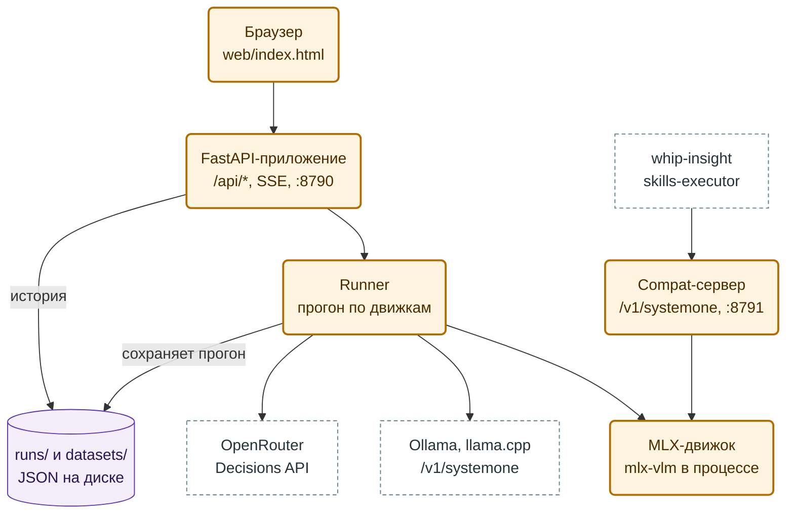
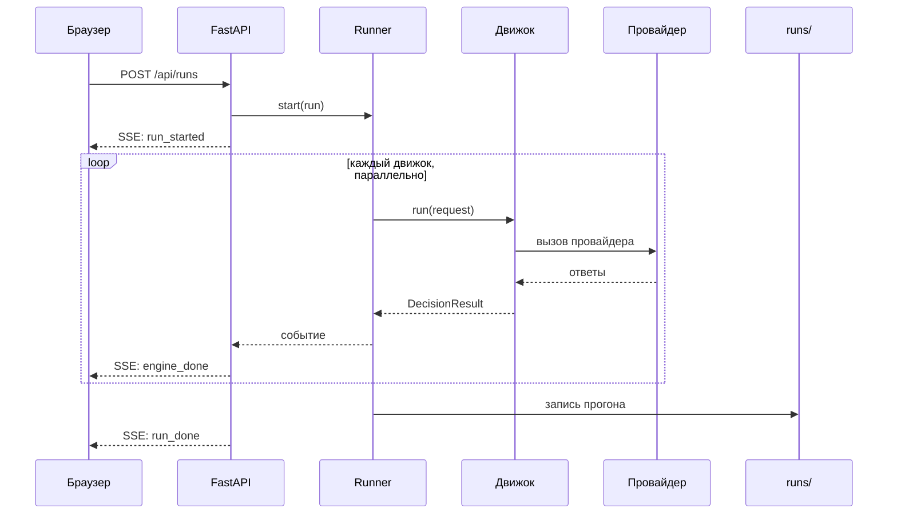

# Decision Models Playground — детальный дизайн

> **Статус.** Дизайн, кода нет. Написан 2026-11-09 по ответам владельца того же дня.
>
> **Источники фактов о моделях.** `whip-insight/docs/audit/decision-models-2026-10-16/README.md` §13 (модели,
> ZDR, сравнение возможностей), `whip-insight/docs/SPEC-decision-service.md` (контракт `decision/1`, проба
> возможностей §5.6, точки решения §8.5), карточки моделей Liquid на Hugging Face, документация OpenRouter. Факт,
> который на 2026-11-09 не проверен на живой системе, помечен **«проверить в P0»**.
>
> **Образец устройства.** `unlimited-ocr-demo` (OCR Playground): FastAPI, реестр движков в `config.yaml`, vanilla JS
> с SSE, история в `runs/`, Makefile.

## Содержание

1. [Зачем](#1-зачем)
2. [Решения владельца](#2-решения-владельца)
3. [Что не делаем](#3-что-не-делаем)
4. [Сценарии](#4-сценарии)
5. [Архитектура](#5-архитектура)
6. [Внутренний контракт](#6-внутренний-контракт)
7. [Движки](#7-движки)
8. [Локальные модели и память](#8-локальные-модели-и-память)
9. [Compat-сервер `/v1/systemone`](#9-compat-сервер-v1systemone)
10. [Прогоны и история](#10-прогоны-и-история)
11. [Эксперименты: формулировки, порядок, повторы](#11-эксперименты-формулировки-порядок-повторы)
12. [Наборы данных и калибровка](#12-наборы-данных-и-калибровка)
13. [Проба возможностей и каталог](#13-проба-возможностей-и-каталог)
14. [Исследовательские режимы](#14-исследовательские-режимы)
15. [HTTP API](#15-http-api)
16. [Интерфейс](#16-интерфейс)
17. [Конфигурация](#17-конфигурация)
18. [Безопасность и данные](#18-безопасность-и-данные)
19. [Стоимость и бюджет](#19-стоимость-и-бюджет)
20. [Структура репозитория](#20-структура-репозитория)
21. [Тестирование](#21-тестирование)
22. [Инкременты](#22-инкременты)
23. [Связь с whip-insight](#23-связь-с-whip-insight)
24. [Риски и открытые вопросы](#24-риски-и-открытые-вопросы)

---

## 1. Зачем

Decision-модель читает состояние (`state`: текст, JSON, картинки, у d1-Omni ещё аудио) и отвечает на закрытые
вопросы вероятностями, без генерации текста. Плейграунд решает четыре задачи владельца:

| # | Задача | Что даёт |
|---|---|---|
| G1 | Сравнение и калибровка | Один звонок и одни вопросы → вероятности разных моделей рядом; подбор порогов на размеченном наборе |
| G2 | Локальный рантайм для whip-insight | d1-2B и d1-Omni-2B на Mac отдаются наружу как `POST /v1/systemone`; стенд whip-insight подключает их как dev-профиль |
| G3 | Новые возможности d1 | Аудио на входе, извлечение значений со `span`, выбор нескольких вариантов: точки V, X, M из `SPEC-decision-service.md` §8.5 |
| G4 | Decision против LLM | Тот же вопрос через обычную LLM: согласие, цена, задержка |

**Почему не LM Studio.** 2026-11-09 LM Studio не загрузил d1-Omni-2B-MLX (`Model type lfm3_omni not supported`), а
его путь — генерация текста, тогда как карточки d1 пишут «chat apps and mlx_vlm.generate cannot run it» (аудит §13.7).
Плейграунд вызывает Python API `mlx-vlm` напрямую.

## 2. Решения владельца

От 2026-11-09:

| Вопрос | Ответ |
|---|---|
| Цели первой версии | G1, G2, G3, G4 — все четыре |
| Движки первой версии | OpenRouter Decisions; локальный MLX (`mlx-vlm`); Ollama и llama.cpp; LLM-базовая линия |
| Источники данных | вручную и файлами; синтетические примеры; пресеты из каталога тегов whip-insight |
| Стек | как OCR Playground: FastAPI + vanilla JS + SSE, `config.yaml`, `runs/`, Makefile |
| Память Mac | 16–24 ГБ: одна локальная модель в памяти, 8-bit по умолчанию |
| Реальные транскрипты в OpenRouter | да, с ZDR по умолчанию |
| LLM-базовая линия | список моделей в `config.yaml` |
| Compat-сервер | доступен стенду whip-insight по LAN, только с bearer-токеном |

Лицензия открытых d1 (LFM Open License v1.0): владелец разрешил их в разработке и в продакшене 2026-11-08
(whip-insight, OQ-3). Условие лицензии — годовая выручка компании меньше $10 000 000 — проверяется на каждой
инсталляции (whip-insight README § Third-party models).

## 3. Что не делаем

- Не продакшен-сервис: один пользователь, один Mac, UI только на `127.0.0.1`.
- Не заменяет replay-инструмент whip-insight (I3): replay — измеренный пакетный прогон по сохранённым задачам, по
  которому администратор переключает тип; плейграунд — исследование.
- Не пишет в whip-insight: не создаёт конфиги, типы, задания. Связь — compat-сервер и файлы пресетов (§23).
- Не импортирует задания со стенда whip-insight по API (владелец выбрал файлы и синтетику).
- Не обучает и не дообучает модели.

## 4. Сценарии

| Id | Сценарий | Цель |
|---|---|---|
| UC-1 | Вставить транскрипт, задать 1–5 вопросов, выбрать 3–6 движков, сравнить вероятности, задержку, цену | G1, G4 |
| UC-2 | Проверить устойчивость: RU/EN формулировка, перестановки вариантов, N повторов → разброс вероятностей | G1 |
| UC-3 | Загрузить размеченный набор (или сгенерировать из тегов whip-insight), прогнать по движкам, получить кривую «покрытие ↔ точность» и порог | G1 |
| UC-4 | Прогнать пробу возможностей по модели; увидеть матрицу «модель × возможность» вместе с каталогом OpenRouter | G1, G3 |
| UC-5 | Включить compat-сервер; стенд whip-insight шлёт `POST /v1/systemone` и получает ответы локальной d1 | G2 |
| UC-6 | Загрузить запись звонка, спросить d1-Omni «что на записи: человек, автоответчик, IVR…» | G3 |
| UC-7 | Извлечь дату следующего контакта, сумму, номер заказа со `span` в тексте | G3 |
| UC-8 | Найти реплику-доказательство: указатель по репликам (как в whip-insight §8.2.4) | G1 |

## 5. Архитектура

**Рисунок 1.** Компоненты плейграунда — кто кого вызывает.



- Оранжевая рамка: компоненты плейграунда. Пунктир: внешние сервисы. Цилиндр: файлы на диске.
- Не нарисованы: LLM-движок (идёт к OpenRouter, как OR), реестр движков `config.yaml` (читается при старте).

| Компонент | Модуль | Ответственность |
|---|---|---|
| FastAPI-приложение | `app/main.py` | `/api/*`, SSE, раздача `web/`; слушает только `127.0.0.1:8790` |
| Runner | `app/runner.py` | Раскладывает прогон по движкам, ограничивает параллелизм, собирает события, пишет прогон |
| Реестр движков | `app/registry.py` | `config.yaml` → объекты движков; доступность каждого |
| Движки | `app/engines/*.py` | Перевод внутреннего запроса в протокол провайдера и обратно (§7) |
| Менеджер локальных моделей | `app/local_models.py` | Загрузка, выгрузка, очередь к одной модели (§8) |
| Compat-сервер | `app/compat.py` | Отдельный uvicorn на `:8791`, `POST /v1/systemone` поверх того же менеджера (§9) |
| Хранилище | `app/store.py` | `runs/`, `datasets/`, `probes/`, `presets/` — JSON/JSONL/YAML на диске |
| Метрики | `app/metrics.py` | Точность, покрытие, Brier, ECE, кривые порога (§12) |
| Бюджет | `app/budget.py` | Оценка до прогона, учёт по `usage.cost`, дневной лимит (§19) |

Два процесса uvicorn в одном приложении: UI/API (`:8790`, loopback) и compat (`:8791`, LAN по токену). Они делят
один менеджер локальных моделей, поэтому модель в памяти одна на оба входа.

## 6. Внутренний контракт

Внутренний формат запроса — надмножество System One: те же `state`, `questions`, `criteria`, плюс `media` и
расширенные типы локальных d1. Ответ нормализован так, что любой движок даёт одни и те же поля.

### 6.1 Запрос

```python
class Question(BaseModel):
    type: Literal["noul", "choice", "score",          # System One: все движки
                  "multi", "text", "number", "date"]  # x-расширения: только локальные d1-2B / d1-Omni
    instructions: str | dict | list                   # строка или структурированная подсказка
    criteria: dict | list | None = None               # noul: {true, false}; choice: {id: описание|None}; score: [уровни, снизу вверх]
    range: tuple[float, float] | None = None          # number: диапазон (x-расширение)

class DecisionRequest(BaseModel):
    state: str | dict | None                          # текст, JSON или None (только media)
    questions: dict[str, Question]                    # ключ: ^[a-z][a-z0-9_]{0,63}$
    media: list[MediaItem] = []                       # image | audio (только d1-Omni) | video
```

- `multi` — внутреннее имя для `choice` с `multiple: true` у d1-2B/d1-Omni.
- Ключ вопроса и id варианта: `^[a-z][a-z0-9_]{0,63}$`, как в whip-insight `decision/1` (§4.1).
- `choice`: 2–255 вариантов; `score`: 2–10 уровней.

### 6.2 Ответ

```python
class Answer(BaseModel):
    type: str
    probabilities: dict[str, float]      # noul: {"true": p, "false": 1-p}; choice/score: по варианту/уровню; multi: P(yes) по варианту
    top: str | None                      # самый вероятный вариант (noul: "true"/"false")
    top_p: float | None
    expected: float | None               # score: взвешенный индекс уровня
    vendor_confidence: float | None      # как прислал провайдер; не используется в метриках
    extract: ExtractResult | None        # text/number/date: value, span, found, interval

class EngineResult(BaseModel):
    engine_id: str
    status: Literal["ok", "partial", "failed"]
    answers: dict[str, Answer]
    question_failures: dict[str, Literal["unsupported", "refused", "invalid_answer"]]
    request_failure: str | None          # unreachable | timed_out | rate_limited | refused | too_long | provider_error | budget
    snapshot: str | None                 # ответивший снимок модели
    latency_ms: int
    usage: Usage                         # input_tokens, output_tokens, cost_usd, cost_source: provider|price|none
    raw: dict | None                     # ответ провайдера без ключей, обрезан до 64 КБ
```

- Каждый ключ вопроса попадает ровно в один из `answers` и `question_failures`.
- Проверка ответа, как whip-insight `decision/1` §4.3: вероятности в [0, 1]; у choice/score сумма 1 ± 0.001;
  `top` — один из вариантов. Нарушение → `invalid_answer` для этого вопроса.
- `vendor_confidence` хранится, но метрики считаются только по `probabilities`: у TypeSafe, Ollama и OpenRouter
  `confidence` определён по-разному (аудит §3).

### 6.3 Классы отказа

| Класс | Уровень | Когда |
|---|---|---|
| `unsupported` | вопрос | Профиль движка не знает тип, или провайдер ответил 400 с именем типа (`box` вне Jev — так OpenRouter) |
| `refused` | вопрос | Ответ `{"type": "refusal"}` (схема OpenRouter `DecisionsRefusalAnswer`) |
| `invalid_answer` | вопрос | Ответ не прошёл проверку §6.2 |
| `unreachable`, `timed_out`, `rate_limited`, `provider_error` | запрос | Сеть, дедлайн, 429, 5xx после одного повтора |
| `refused` | запрос | Иной 4xx |
| `too_long` | запрос | Запрос больше лимита движка, или 413 |
| `budget` | запрос | Дневной лимит исчерпан (§19); вызов не отправлен |

Перед вызовом Runner сверяет вопросы с профилем движка (§13): неподдерживаемый вопрос не отправляется, остальные
идут. Это тот же принцип, что в whip-insight §5.6.4.

## 7. Движки

### 7.1 Протокол движка

```python
class Engine(Protocol):
    spec: EngineSpec                                  # id, kind, model, лимиты из config.yaml

    def available(self) -> tuple[bool, str]:          # ключ есть? модель скачана? сервер отвечает?
    def profile(self) -> CapabilityProfile:           # из последней пробы или из каталога (§13)
    async def run(self, req: DecisionRequest,
                  opts: RunOptions) -> EngineResult:  # один вызов; повтор и дедлайн внутри
    def estimate_cost(self, req: DecisionRequest) -> float | None
```

`BaseEngine` даёт общее: дедлайн, один повтор через 2 с на сеть/5xx/524/529, семафор по `concurrency`, нормализацию
по таблице имён (§7.7).

### 7.2 `openrouter_decisions`

- `POST https://openrouter.ai/api/alpha/decisions`, `Authorization: Bearer <OPENROUTER_API_KEY>`. Путь помечен
  alpha: «Alpha: the shape may change» (аудит §13.4).
- Тело: `model`, `state`, `questions` (System One), `provider: {"zdr": true, "data_collection": "deny"}` по
  умолчанию (§18).
- Ответ: `model` — датированный снимок (`typesafe/jev-1.13-20260917`); `answers` по ключам; `usage.input_tokens`,
  `usage.output_tokens`, `usage.cost` (аудит §3.1, §13.4).
- `box` принимает только Jev; иной провайдер отвечает 400 до вызова (схема `DecisionsBoxQuestion`). Плейграунд
  `box` в OpenRouter не шлёт.
- Модели первой версии: `typesafe/jev-1.14`, `liquid/d1.1`, `~liquid/d1-latest`; остальные — из каталога (§13.2).

### 7.3 `mlx_local`

- В процессе, через `mlx-vlm >= 0.7.11` (требование карточек d1-2B-MLX и d1-Omni-2B-MLX).
- Вызов: `model.system_one(state, questions, media=...)` после загрузки модели; аудио — элемент `media`
  `{"type": "audio", "path": "<wav>"}` или волна `{"type": "audio", "audio": clip, "sampling_rate": 16000}`.
  **Проверить в P0:** точные имена функций загрузки и вызова для d1-2B и d1-Omni — у d1-3B-MLX карточка показывает
  `predict(model, processor, state, questions)`, у d1-2B-MLX — `model.system_one(...)`.
- Ответ d1-2B/d1-Omni использует имена System One (`noul`, `choice` + `confidence` + `probabilities`, `score` +
  `legend`) и расширения: `choices` (multi), `text`/`number`/`date` со `span` и `found`, `number` с `interval`
  (аудит §13.5).
- Снимок: `<repo>-<ГГГГММДД даты ревизии HF>`, например `LiquidAI/d1-2B-MLX-8bit-20261027` — такой вид whip-insight
  читает как датированный (`-[0-9]{8}$`, решение OQ-2/M-9).
- Стоимость 0, `cost_source: none`; `input_tokens` из `usage` модели.
- Модели первой версии (16–24 ГБ, 8-bit по умолчанию): `LiquidAI/d1-2B-MLX-8bit` (2.22 ГБ), `LiquidAI/d1-Omni-2B-MLX-8bit`.
  fp16-варианты (`d1-2B-MLX-fp16` 3.84 ГБ, `d1-Omni-2B-MLX-fp16` 4.33 ГБ) включаются в `config.yaml`. Для d1-3B
  карточка измерила 8-bit против float32: 144 из 145 одинаковых лучших ответов (аудит §13.5).

### 7.4 `systemone_http` (Ollama, llama.cpp, будущие серверы)

- `POST <base_url>` в формате System One. Ollama: `http://127.0.0.1:11434/v1/systemone`, поле `model` (`d1`,
  `d1:2b`), до 64 вопросов, `images` в base64. llama.cpp: `llama-server -hf LiquidAI/d1-3B-GGUF:Q8_0`, `POST
  /v1/systemone`, версия ≥ 0.7.0 (аудит §13.5).
- Этот же движок подойдёт к любому будущему серверу с `/v1/systemone` (в том числе к LM Studio, если он добавит
  такой путь) и к compat-серверу самого плейграунда — для теста «как увидит whip-insight».
- Стоимость 0.

### 7.5 `openrouter_llm` (LLM-базовая линия)

- `POST https://openrouter.ai/api/v1/chat/completions`; модели — список в `config.yaml` (§17), стартовый набор
  «дешёвая и сильная» плюс модель LLM-арбитра whip-insight (id задаёт владелец).
- Каждый вопрос — отдельное сообщение с `state`, инструкцией и вариантами, помеченными буквами `A…Z`.
- Два режима:
  1. `logprobs` — если модель в каталоге OpenRouter объявляет `logprobs`/`top_logprobs` в `supported_parameters`:
     ответ одной буквой, вероятности из `top_logprobs`, нормированные по вариантам. Сравнимы с decision-моделями.
  2. `verbal` — иначе: JSON `{"answer": "<буква>", "confidence": 0..1}`. В UI и метриках помечается «словесная
     уверенность» и не смешивается с вероятностями.
- `score` в режиме `logprobs` — распределение по буквам уровней; `multi`, `text`, `number`, `date` — `unsupported`.
- Ответ LLM может служить эталонной меткой набора (§12.3), с явной пометкой источника.
- **Проверить в P0:** как OpenRouter отдаёт стоимость чат-вызова (`usage.cost`, нужен ли флаг учёта).

### 7.6 Реестр и доступность

| Kind | Готов, когда |
|---|---|
| `openrouter_decisions`, `openrouter_llm` | есть `OPENROUTER_API_KEY` |
| `mlx_local` | macOS на Apple Silicon, `mlx-vlm >= 0.7.11`, модель скачана в `HF_HOME` |
| `systemone_http` | `GET <base>/health` или пробный `POST` отвечает за 2 с |

Неготовый движок виден в UI серым с причиной, как в OCR Playground.

### 7.7 Таблица имён ответа

| Внутреннее | System One / OpenRouter / Ollama / d1-2B MLX | mlx-vlm `server` для d1-3B (`/v1/decisions`) |
|---|---|---|
| P(true) у noul | `noul` | `probability` |
| выбранный вариант | `choice` | `value` |
| распределение | `probabilities` | `probabilities` |
| уверенность вендора | `confidence` | `metadata.confidence` |
| уровень score | `score` (ожидаемый), `legend` | `value`, `legend` |

Вторая колонка нужна, только если подключат сервер `mlx_vlm server --decision-model` (аудит §13.5); в первой
версии он не используется.

## 8. Локальные модели и память

Mac с 16–24 ГБ держит одну локальную модель за раз. Менеджер выгружает модель по простою или когда нужна другая.

**Рисунок 2.** Локальная модель в памяти.

```mermaid
%%{init: {"layout": "dagre", "look": "classic", "themeCSS": "foreignObject { overflow: visible; }"}}%%
stateDiagram-v2
  accTitle: Рисунок 2. Локальная модель в памяти
  accDescr: Модель выгружена, загружается по первому запросу, готова, занята запросом и выгружается по простою или при вытеснении; ошибка загрузки возвращает её в выгруженное состояние.
  [*] --> unloaded
  unloaded --> loading: запрос
  loading --> ready: загружена
  loading --> unloaded: ошибка
  ready --> busy: запрос
  busy --> ready: ответ
  ready --> unloaded: простой, вытеснение
```



- `local.max_loaded_models: 1`; `local.idle_unload_s: 600`.
- Запросы к локальной модели идут по одному (очередь `asyncio.Lock`), из UI и из compat-сервера.
- Вытеснение: запрос к другой модели ждёт конца текущего вызова, затем выгружает текущую.
- Ошибка загрузки показывается в UI и в `GET /health`; модель остаётся `unloaded`.
- `GET /api/local/models` отдаёт состояние, объём на диске, время последнего вызова. Кнопка «Выгрузить» в UI.

## 9. Compat-сервер `/v1/systemone`

Отдельный uvicorn на `:8791` поверх менеджера локальных моделей. Нужен стенду whip-insight (G2) и тестам.

### 9.1 Контракт

- `POST /v1/systemone`, тело как у Ollama: `model` (алиас из `config.yaml`, по умолчанию `compat.default_model`),
  `state`, `questions`, `images` (base64), `media`.
- Принимаются только `noul`, `choice`, `score`. Иной тип → **400**
  `{"error": {"code": "unsupported_question_type", "type": "<тип>", "question": "<ключ>"}}`: whip-insight читает
  400 с именем типа как `unsupported` для этого вопроса (AD-18). Расширенные типы — только с заголовком
  `X-Playground-Extensions: 1`, который whip-insight не шлёт.
- Ответ: `id`, `model` (снимок вида §7.3), `provider: "local-mlx"`, `answers` в именах System One, `usage`
  (`input_tokens`, `output_tokens: 0`, `cost: 0`).
- Лимиты: тело ≤ 6 МБ; ≤ 64 вопроса; `state` ≤ `context_tokens` модели по оценке 1 токен на символ (как whip-insight
  §7.2); иначе 413.
- `GET /health`: `{status, model, state, mlx_vlm_version}` без токена.

### 9.2 Доступ

- По умолчанию `COMPAT_HOST=127.0.0.1`.
- `COMPAT_HOST=0.0.0.0` разрешён, только если задан `SYSTEMONE_TOKEN` (≥ 32 символа): иначе процесс не стартует.
- Каждый `POST` требует `Authorization: Bearer <SYSTEMONE_TOKEN>`; сравнение постоянного времени; 401 без деталей.
- CORS выключен. UI и `/api/*` на этом порту не отдаются.

### 9.3 Подключение стенда whip-insight

Строка dev-конфига в whip-insight (делается отдельным work-item, после task-049 и решения D35):

| Поле `cvj.decision_configs` | Значение |
|---|---|
| `adapter` | `systemone` |
| `api_url` | `http://<имя-Mac>.local:8791/v1/systemone` (mDNS, без IP) |
| `api_auth_header` | `SYSTEMONE_TOKEN` (голый токен; whip-insight строит `Bearer`) |
| `require_zdr` | `false` |
| `input_price_per_mtok` | `0` |
| `context_tokens` | `65536` |

- M-L1 (путь и имена ответа) выполняется по построению: путь System One, имена System One.
- M-L2 (достучится ли контейнер skills-executor на VM до `*.local`) остаётся замером того work-item.

## 10. Прогоны и история

**Рисунок 3.** Один сравнительный прогон.



Порядок шагов прогона:

1. Проверка бюджета: оценка стоимости по всем платным движкам (§19). Превышение → прогон не стартует.
2. Сверка вопросов с профилем каждого движка; неподдерживаемые вопросы получают `unsupported` без вызова.
3. Параллельный вызов движков: облачные — до `concurrency` каждый, локальные — по очереди (§8).
4. Событие `engine_done` по каждому движку сразу по готовности.
5. Запись прогона в `runs/` и строка в `runs/index.jsonl`.

### 10.1 Запись прогона

```json
{
  "id": "01JC...",                       
  "created_at": "2026-11-09T12:00:00Z",
  "kind": "compare | experiment | dataset | probe",
  "request": { "state": "...", "questions": {}, "media": [] },
  "state_sha256": "…",
  "engines": [{ "engine_id": "or-jev-1.14", "kind": "openrouter_decisions", "model": "typesafe/jev-1.14", "zdr": true }],
  "results": [ { "...": "EngineResult §6.2" } ],
  "cost_usd": 0.00002,
  "versions": { "app": "0.1.0", "mlx_vlm": "0.7.11", "models": { "mlx-d1-2b": "LiquidAI/d1-2B-MLX-8bit-20261027" } },
  "tags": ["call_kind", "ru"]
}
```

- Путь: `runs/<ГГГГ-ММ-ДД>/<id>.json`; индекс `runs/index.jsonl` (id, время, вид, движки, стоимость, теги).
- Ключей в записи нет никогда. `raw` обрезан до 64 КБ.
- Медиа не копируются: в записи путь и `sha256`.
- `runs/`, `datasets/`, `probes/` в `.gitignore`: там бывают реальные звонки.
- UI: список, фильтр по тегам и движкам, открыть, повторить, сравнить два прогона (разница вероятностей по вопросам).

## 11. Эксперименты: формулировки, порядок, повторы

Эксперимент — один `state` и сетка вариантов, каждый вариант — отдельный вызов.

| Ось | Значения | Метрика |
|---|---|---|
| Формулировка | наборы `instructions`/`criteria`, например RU и EN | разница вероятностей и смена лучшего варианта |
| Порядок вариантов | все перестановки при ≤ 4 вариантах, иначе k случайных (по умолчанию 6) | средний \|ΔP\| лучшего варианта, доля смены лучшего |
| Повторы | N раз одного запроса (по умолчанию 5) | размах P (max − min); у Jev два прогона давали до 0.04 (аудит §4.3) |

- `jev-1.13` «тянется к первому варианту» (аудит §4.4): ось порядка нужна именно для этого.
- Итог эксперимента — таблица «движок × ось → метрика» и тепловая карта вероятностей.
- Стоимость эксперимента оценивается до запуска (§19): число вызовов = формулировки × перестановки × повторы × движки.

## 12. Наборы данных и калибровка

### 12.1 Формат набора

`datasets/<имя>/dataset.yaml` + `items.jsonl`:

```yaml
name: std_answering_machine
question_set: presets/std_tags/std_answering_machine.yaml
label_source: test_phrases          # test_phrases | manual | llm:<engine_id>
language: ru
```

```json
{"id": "pos-01", "state": "Оставьте сообщение после звукового сигнала", "labels": {"is_tag": "true"}, "meta": {"split": "positive"}}
```

### 12.2 Источники

| Источник | Как попадает | Метка |
|---|---|---|
| Ручной файл | загрузка JSONL/CSV в UI | владелец |
| Тесты тегов whip-insight | `scripts/import_std_tags.py --whip-insight ../whip-insight` читает `taxonomy/standard-dictionaries/tags/*.json` | `tests.positive` → `true`, `tests.negative` → `false` |
| Синтетика | `scripts/synth_dialogs.py` по шаблонам из `presets/synth/*.yaml` (подстановка фраз тегов в нейтральные диалоги) | из шаблона |
| LLM-разметка | прогон `openrouter_llm` по набору без меток | `llm:<engine_id>`, в отчёте «согласие с LLM», не точность |

- В whip-insight 56 стандартных тегов; у `std_answering_machine` 31 позитивная и 28 негативных тестовых фраз — уже
  готовый размеченный набор на один тег.
- Вопрос пресета строится из `name` и `description` тега: `noul`, `instructions` — «Есть ли в звонке: <name>?»,
  `criteria.true` — `description`.

### 12.3 Метрики

Для `noul` с порогом t (как whip-insight §8.2.6):

- решено, если max(p, 1 − p) ≥ t; ответ — `p ≥ 0.5`;
- **покрытие** = решённые / все; **точность** = верные среди решённых;
- **Brier** = среднее (p − y)²; **ECE** по 10 корзинам; диаграмма надёжности.

Для `choice`/`score`: top-1 точность при `top_p ≥ t`, покрытие, матрица ошибок.

- Кривая «порог 0.50…0.99 шагом 0.01 → покрытие, точность» по каждому движку и снимку.
- Предложенный порог — наименьший t, при котором точность ≥ цели (по умолчанию 90 %, как whip-insight §12).
- Отчёт экспортируется в Markdown и JSON (`reports/<набор>-<дата>.md`): ни одного текста звонка, только id, метки,
  вероятности и метрики — как требует whip-insight §12 для своего replay.

## 13. Проба возможностей и каталог

### 13.1 Проба

Тот же набор, что whip-insight §5.6.2, плюс расширения локальных d1:

| Шаг | Запрос | Что выясняет |
|---|---|---|
| 1 | по одному `noul`, `choice` (3 варианта), `score` (4 уровня) на коротком state | типы |
| 2 | `choice` на 24, 100, 240 вариантов | `max_choice_options` |
| 3 | `score` на 10 уровней | `max_score_levels` |
| 4 | `usage.cost` и датированный `model` в ответе | `reports_cost`, `reports_snapshot` |
| 5 | (локальные d1) `multi`, `text`, `number`, `date`, аудио у Omni | расширения |
| 6 | (по кнопке) длинный state ≈ 90 % контекста с фактом в конце | `reads_full_context` |

- Правило доказательства, как whip-insight AD-18: возможность снимается только при `unsupported`, `invalid_answer`
  или `refused` с 400/422; сеть, 401–404 и таймауты — «не наблюдалось», профиль не меняется.
- Ответ-отказ доказывает, что тип поддержан.
- Профиль хранится в `probes/<engine_id>/<снимок>.json`.

### 13.2 Каталог OpenRouter

- `GET https://openrouter.ai/api/v1/models?output_modalities=decisions` — 35 id на 2026-11-08: контекст, цена,
  входы, `expiration_date` (аудит §13.10). Без ключа.
- `GET https://openrouter.ai/api/v1/endpoints/zdr` — ZDR-эндпоинты и `safety_retention` (аудит §13.9).
- Обновление по кнопке, кэш `probes/catalog.json`.
- Экран «Матрица возможностей»: строки — модели (каталог + локальные), столбцы — типы, лимиты, контекст, цена, ZDR,
  срок; клетка показывает «есть / нет / не проверено» и дату пробы.

## 14. Исследовательские режимы

| Режим | Движки | Что показывает |
|---|---|---|
| Указатель по репликам (UC-8) | все | Транскрипт → реплики `t1…tN`; `noul` + `choice` по репликам с `criteria: null`; при N > B два прохода (блок, затем реплика), B = min(240, `max_choice_options`); подсветка выбранной реплики и её P |
| Извлечение (UC-7) | d1-2B, d1-Omni | `text`/`number`/`date`: значение, `span` подсвечен в тексте, `found`; у `number` интервал p10–p90 |
| Несколько вариантов | d1-2B, d1-Omni | `multi`: P(yes) по каждому варианту, порог на вариант |
| Аудио (UC-6) | d1-Omni | Загрузка записи → ffmpeg в WAV 16 кГц моно 16-bit → `media`; по умолчанию первые 30 с (`audio.max_seconds`); пресет `call_kind` |

- Карточка d1-Omni предупреждает: «Long spoken passages lose much of their accuracy, most of all outside
  Latin-script languages»; Speech-MASSIVE на слух 63.4 против 85.2 текстом (аудит §13.5). Поэтому длина клипа —
  ось эксперимента (§11).
- Пресет `call_kind` — 7 вариантов whip-insight §8.4 (`conversation`, `answering_machine`, `ivr`, `voice_robot`,
  `network_message`, `no_speech`, `other`) с их описаниями.

## 15. HTTP API

UI/API (`127.0.0.1:8790`):

| Метод и путь | Назначение |
|---|---|
| `GET /api/engines` | Реестр, доступность, профили |
| `POST /api/runs` | Сравнительный прогон; ответ — поток SSE |
| `GET /api/runs`, `GET /api/runs/{id}` | История и запись |
| `POST /api/runs/{id}/rerun` | Повтор с теми же входами |
| `POST /api/experiments` | Эксперимент (§11), SSE |
| `GET /api/datasets`, `POST /api/datasets` | Список и загрузка набора |
| `POST /api/datasets/{name}/run` | Прогон набора по движкам, SSE |
| `GET /api/reports/{id}` | Отчёт калибровки |
| `POST /api/probe` | Проба движка (§13.1), SSE |
| `GET /api/catalog`, `POST /api/catalog/refresh` | Каталог OpenRouter и ZDR |
| `GET /api/presets`, `GET /api/presets/{id}` | Наборы вопросов |
| `GET /api/local/models`, `POST /api/local/models/{id}/unload` | Менеджер локальных моделей |
| `GET /api/budget` | Расход за день и лимит |
| `POST /api/media` | Загрузка картинки или аудио; ответ — id и путь |

События SSE: `run_started`, `engine_started`, `engine_done`, `engine_failed`, `progress` (наборы, эксперименты),
`run_done`, `budget_stop`.

Compat (`:8791`): `POST /v1/systemone`, `GET /health` (§9).

## 16. Интерфейс

Vanilla JS-модули, как в OCR Playground; графики — свои небольшие SVG-функции, без CDN.

| Экран | Содержимое |
|---|---|
| Workbench | Слева `state` (текст/JSON/файл/медиа) и редактор вопросов; справа движки и таблица «вопрос × движок» с полосами вероятностей, лучшим вариантом, задержкой, ценой, снимком |
| Эксперименты | Оси §11, тепловая карта, размах вероятностей |
| Наборы | Список, импорт, прогон, кривая порога, диаграмма надёжности, матрица ошибок, экспорт отчёта |
| Матрица возможностей | §13.2 |
| Указатель / Извлечение / Аудио | Режимы §14 |
| История | §10.1 |
| Локальные модели | Состояние, выгрузка, объём, compat-сервер: адрес, токен задан или нет |
| Язык интерфейса | Английский / Русский (в настройках) |

Деньги видны всегда: в шапке расход за день и лимит; перед прогоном — оценка.

## 17. Конфигурация

### 17.1 `.env`

| Ключ | По умолчанию | Назначение |
|---|---|---|
| `OPENROUTER_API_KEY` | — | Облачные движки |
| `SYSTEMONE_TOKEN` | — | Bearer compat-сервера; обязателен вне loopback |
| `APP_HOST`, `APP_PORT` | `127.0.0.1`, `8790` | UI и `/api` |
| `COMPAT_HOST`, `COMPAT_PORT` | `127.0.0.1`, `8791` | Compat-сервер |
| `HF_HOME` | системный | Кэш моделей Hugging Face |
| `DAILY_BUDGET_USD` | `1.0` | Дневной лимит платных вызовов |
| `FFMPEG_BIN` | `ffmpeg` | Конвертация аудио |
| `DATA_DIR` | `.` | Корень `runs/`, `datasets/`, `probes/`, `reports/` |

### 17.2 `config.yaml`

Реестр движков, локальные модели, compat, пресеты. Пример: `config.example.yaml` в корне репозитория.

## 18. Безопасность и данные

- Ключи только в `.env` (права 600); не попадают в записи прогонов, логи, ответы API и UI.
- OpenRouter: по умолчанию `provider.zdr: true` и `data_collection: deny`. Модель без ZDR-эндпоинта (по списку §13.2)
  помечена в UI и вызывается только с явной галкой на прогон.
- Self-serve аккаунт OpenRouter допускает Safety Retention под ZDR, пока в настройках приватности не выбрано «ZDR
  only» (аудит §13.9) — это настройка аккаунта, плейграунд её показывает, но не меняет.
- ZDR касается провайдера; копии звонков на диске — в `runs/` и `datasets/`, оба в `.gitignore`.
- Локальные движки и compat-сервер держат данные на Mac.
- UI без авторизации и только на `127.0.0.1`; compat — §9.2.
- В `state` бывает текст, написанный звонящим: он передаётся как данные, в `instructions` не подставляется.

## 19. Стоимость и бюджет

- Оценка до вызова: символы `state` и вопросов × цена за входной токен из каталога (1 токен на символ, консервативно,
  как whip-insight §7.2). LLM: плюс оценка выходных токенов.
- Факт: `usage.cost` ответа (`cost_source: provider`); иначе токены × цена каталога (`price`); иначе `none`.
- Дневной лимит `DAILY_BUDGET_USD`: прогон, чья оценка превышает остаток, не стартует; при достижении лимита во
  время набора — событие `budget_stop`, остальные элементы помечаются `budget`.
- Порядок цен (аудит §13.10): decision-модели $0.01–0.10 за 1M входных токенов, выход бесплатно; проба модели на
  262 144 токена стоит около $0.01.

## 20. Структура репозитория

```text
decision-models-playground/
├── README.md
├── Makefile                 setup / models / run / run-compat / check / test / clean-runs
├── requirements.txt         + requirements-mlx.txt (только Apple Silicon)
├── .env.example
├── config.example.yaml
├── app/
│   ├── main.py              FastAPI: /api, SSE, web/
│   ├── compat.py            /v1/systemone, /health
│   ├── settings.py          pydantic-settings из .env
│   ├── registry.py          config.yaml → движки
│   ├── schemas.py           §6
│   ├── runner.py            §10
│   ├── local_models.py      §8
│   ├── metrics.py           §12.3
│   ├── budget.py            §19
│   ├── store.py             runs/, datasets/, probes/, reports/
│   ├── probe.py             §13
│   ├── check.py             python -m app.check
│   └── engines/
│       ├── base.py          протокол, BaseEngine, таблица имён §7.7
│       ├── openrouter_decisions.py
│       ├── openrouter_llm.py
│       ├── mlx_local.py
│       └── systemone_http.py
├── web/                     index.html, js/*.js, styles.css
├── presets/                 call_kind.yaml, std_tags/*.yaml, synth/*.yaml, probe.yaml
├── scripts/                 import_std_tags.py, synth_dialogs.py, record_fixture.py
├── tests/                   fixtures/, test_*.py
└── docs/                    DESIGN.md, SPIKE.md (после P0)
```

## 21. Тестирование

| Слой | Что проверяется | Как |
|---|---|---|
| Нормализация | Ответы OpenRouter, Ollama, d1 MLX → `Answer` | Фикстуры из документации (пример ответа OpenRouter-тьюториала, пример Ollama) и записи P0 без ключей |
| Контракт | §6.2: вероятности, суммы, `top`, разбиение ключей | Табличные тесты с плохими ответами |
| Отказы | §6.3 по каждому классу | `httpx.MockTransport` с 400/401/413/429/5xx/таймаутом/refusal |
| Метрики | Brier, ECE, покрытие, кривая порога | Игрушечные наборы с известным ответом |
| Бюджет | Оценка, остановка, `budget_stop` | Фейковые цены |
| Compat | 400 с именем типа, 401 без токена, отказ старта на `0.0.0.0` без токена, 413, имена ответа System One | Тест-клиент FastAPI; заглушка MLX-модели |
| Совместимость с whip-insight | Тот же запрос, что шлёт адаптер `systemone` whip-insight, читается compat-сервером | Фикстура запроса из `whip-insight/docs/architectures/decision-service.md` §5.2 |
| Локальная модель | Загрузка, вызов, выгрузка, вытеснение | Ручной smoke на Mac (`make check`); в CI пропускается |

## 22. Инкременты

| Id | Содержание | Приёмка | Оценка |
|---|---|---|---|
| P0 | Спайк: `mlx-vlm` и d1-2B/d1-Omni (загрузка, вызов, имена ответа, аудио, память, задержка); OpenRouter Decisions для `jev-1.14` и `d1.1` с ZDR; Ollama `d1:2b` | `docs/SPIKE.md` и фикстуры без ключей; закрыты пометки «проверить в P0» | 0.5–1 дня |
| P1 | Ядро: схемы, протокол движка, `openrouter_decisions`, Runner + SSE, Workbench, история, бюджет | UC-1 на трёх облачных моделях | 1.5 дня |
| P2 | `mlx_local`, менеджер моделей, compat-сервер с токеном | UC-1 с локальной d1; UC-5 с `curl` и запросом-фикстурой whip-insight | 1 день |
| P3 | Проба и каталог, матрица возможностей | UC-4 на трёх облачных и двух локальных | 1 день |
| P4 | Наборы, импорт тегов whip-insight, синтетика, метрики, отчёт | UC-3 на `std_answering_machine` (59 фраз) | 1.5 дня |
| P5 | Эксперименты | UC-2 | 0.5 дня |
| P6 | Режимы: указатель, извлечение, multi, аудио | UC-6, UC-7, UC-8 | 1.5 дня |
| P7 | `systemone_http` (Ollama, llama.cpp), `openrouter_llm` (logprobs/verbal) | UC-1 с LLM и Ollama | 1 день |

Итого около 8–9 рабочих дней. Порядок P0 → P1 → P2 даёт compat-сервер для whip-insight на третьем шаге.

## 23. Связь с whip-insight

| Что | Направление | Как |
|---|---|---|
| Dev-профиль | whip-insight → плейграунд | Строка `cvj.decision_configs` на compat-сервер (§9.3), отдельный work-item после task-049 |
| Контракт | общий | Compat говорит на System One; адаптер `systemone` whip-insight переводит его в `decision/1` |
| Пресеты | whip-insight → плейграунд | Файлы `taxonomy/standard-dictionaries/tags/*.json` читаются скриптом импорта; стенд не трогается |
| Находки | плейграунд → whip-insight | Пороги по моделям, правила формулировок, порядок вариантов, точность указателя на русском — в замеры whip-insight `SPEC-decision-service.md` §15 руками владельца |
| Пробы | общий принцип | Тот же набор и то же правило доказательства (§13.1), чтобы профили совпадали |

## 24. Риски и открытые вопросы

| Id | Риск или вопрос | Как закрывается |
|---|---|---|
| RQ-1 | Точный Python API `mlx-vlm` для d1-2B/d1-Omni и имена полей ответа | P0 |
| RQ-2 | Объём памяти d1-Omni-8bit и задержка с аудио на этом Mac | P0, замер |
| RQ-3 | Точность d1-Omni на русской речи и предел длины клипа | Эксперимент §11 на записях владельца |
| RQ-4 | OpenRouter Decisions — alpha; форма может измениться | Движок изолирует перевод; фикстуры P0 ловят изменение |
| RQ-5 | Какие LLM дают `logprobs` через OpenRouter | Каталог `supported_parameters`; иначе режим `verbal` |
| RQ-6 | Достучится ли контейнер whip-insight на VM до `*.local` Mac (M-L2) | Work-item подключения dev-профиля |
| RQ-7 | LM Studio может добавить путь для решений | Тогда это ещё один `systemone_http` без кода |
| RQ-8 | Лицензия LFM на другой инсталляции | Проверка выручки по README whip-insight |
