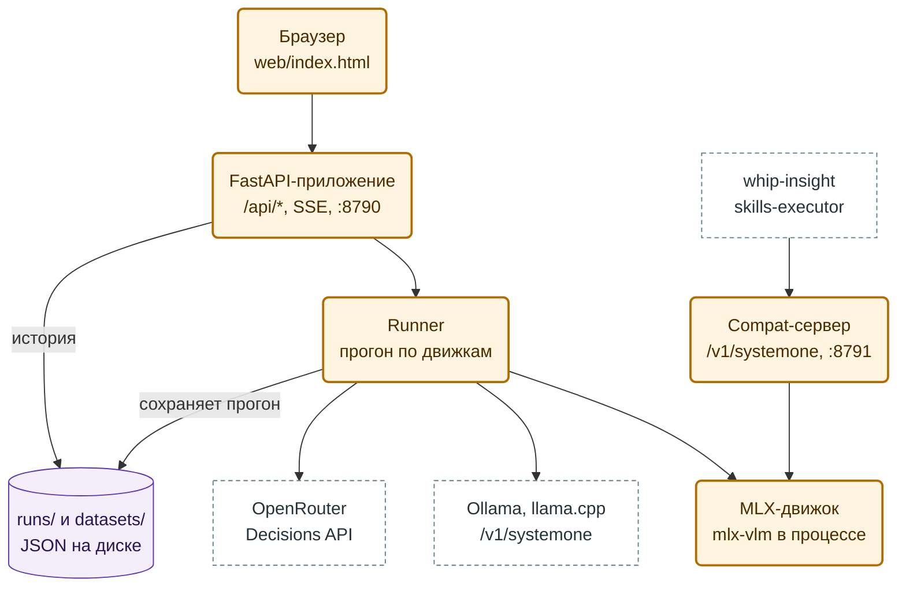
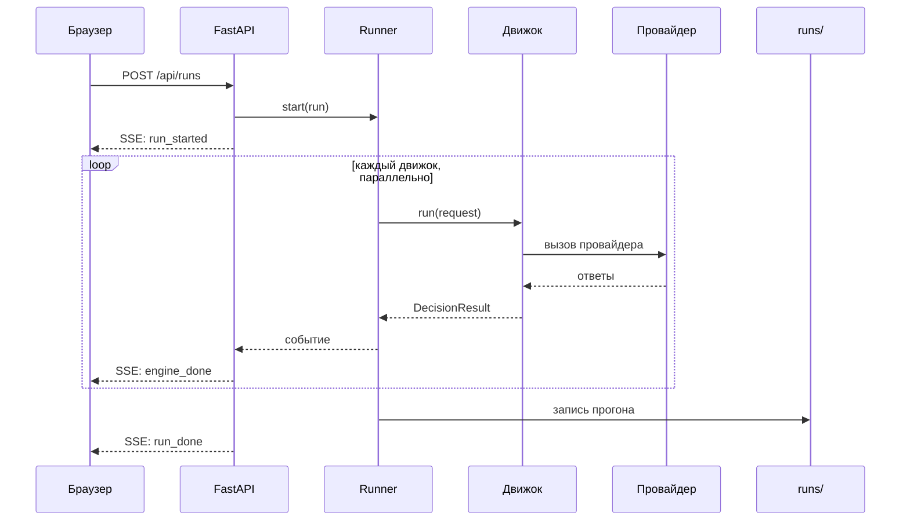

# Decision Models Playground — детальный дизайн

> **Статус.** Дизайн. Написан 2026-11-09 по ответам владельца того же дня. P0 (спайк) выполнен 2026-11-09:
> результаты и фикстуры — [SPIKE.md](SPIKE.md); пометки «проверить в P0» закрыты, найденные факты внесены в §6–§9,
> §13, §14, §22, §24. P1 (ядро, `openrouter_decisions`, Workbench, история, бюджет) выполнен 2026-11-09; уточнения —
> в §6.1, §15, §19, §20.
>
> **Источники фактов о моделях.** `whip-insight/docs/audit/decision-models-2026-10-16/README.md` §13 (модели,
> ZDR, сравнение возможностей), `whip-insight/docs/SPEC-decision-service.md` (контракт `decision/1`, проба
> возможностей §5.6, точки решения §8.5), карточки моделей Liquid на Hugging Face, документация OpenRouter. Факт,
> который на 2026-11-09 не проверен на живой системе, помечен **«проверить в P0»**.
>
> **Образец устройства.** `unlimited-ocr-demo` (OCR Playground): FastAPI, реестр движков в `config.yaml`, vanilla JS
> с SSE, история в `runs/`, Makefile.

## Содержание

1. [Зачем](#1-зачем)
2. [Решения владельца](#2-решения-владельца)
3. [Что не делаем](#3-что-не-делаем)
4. [Сценарии](#4-сценарии)
5. [Архитектура](#5-архитектура)
6. [Внутренний контракт](#6-внутренний-контракт)
7. [Движки](#7-движки)
8. [Локальные модели и память](#8-локальные-модели-и-память)
9. [Compat-сервер `/v1/systemone`](#9-compat-сервер-v1systemone)
10. [Прогоны и история](#10-прогоны-и-история)
11. [Эксперименты: формулировки, порядок, повторы](#11-эксперименты-формулировки-порядок-повторы)
12. [Наборы данных и калибровка](#12-наборы-данных-и-калибровка)
13. [Проба возможностей и каталог](#13-проба-возможностей-и-каталог)
14. [Исследовательские режимы](#14-исследовательские-режимы)
15. [HTTP API](#15-http-api)
16. [Интерфейс](#16-интерфейс)
17. [Конфигурация](#17-конфигурация)
18. [Безопасность и данные](#18-безопасность-и-данные)
19. [Стоимость и бюджет](#19-стоимость-и-бюджет)
20. [Структура репозитория](#20-структура-репозитория)
21. [Тестирование](#21-тестирование)
22. [Инкременты](#22-инкременты)
23. [Связь с whip-insight](#23-связь-с-whip-insight)
24. [Риски и открытые вопросы](#24-риски-и-открытые-вопросы)

---

## 1. Зачем

Decision-модель читает состояние (`state`: текст, JSON, картинки, у d1-Omni ещё аудио) и отвечает на закрытые
вопросы вероятностями, без генерации текста. Плейграунд решает четыре задачи владельца:

| # | Задача | Что даёт |
|---|---|---|
| G1 | Сравнение и калибровка | Один звонок и одни вопросы → вероятности разных моделей рядом; подбор порогов на размеченном наборе |
| G2 | Локальный рантайм для whip-insight | d1-2B и d1-Omni-2B на Mac отдаются наружу как `POST /v1/systemone`; стенд whip-insight подключает их как dev-профиль |
| G3 | Новые возможности d1 | Аудио на входе, извлечение значений со `span`, выбор нескольких вариантов: точки V, X, M из `SPEC-decision-service.md` §8.5 |
| G4 | Decision против LLM | Тот же вопрос через обычную LLM: согласие, цена, задержка |

**Почему не LM Studio.** 2026-11-09 LM Studio не загрузил d1-Omni-2B-MLX (`Model type lfm3_omni not supported`), а
его путь — генерация текста, тогда как карточки d1 пишут «chat apps and mlx_vlm.generate cannot run it» (аудит §13.7).
Плейграунд вызывает Python API `mlx-vlm` напрямую.

## 2. Решения владельца

От 2026-11-09:

| Вопрос | Ответ |
|---|---|
| Цели первой версии | G1, G2, G3, G4 — все четыре |
| Движки первой версии | OpenRouter Decisions; локальный MLX (`mlx-vlm`); Ollama и llama.cpp; LLM-базовая линия |
| Источники данных | вручную и файлами; синтетические примеры; пресеты из каталога тегов whip-insight |
| Стек | как OCR Playground: FastAPI + vanilla JS + SSE, `config.yaml`, `runs/`, Makefile |
| Память Mac | 16–24 ГБ: одна локальная модель в памяти, 8-bit по умолчанию |
| Реальные транскрипты в OpenRouter | да, с ZDR по умолчанию |
| LLM-базовая линия | список моделей в `config.yaml` |
| Compat-сервер | доступен стенду whip-insight по LAN, только с bearer-токеном |

Лицензия открытых d1 (LFM Open License v1.0): владелец разрешил их в разработке и в продакшене 2026-11-08
(whip-insight, OQ-3). Условие лицензии — годовая выручка компании меньше $10 000 000 — проверяется на каждой
инсталляции (whip-insight README § Third-party models).

## 3. Что не делаем

- Не продакшен-сервис: один пользователь, один Mac, UI только на `127.0.0.1`.
- Не заменяет replay-инструмент whip-insight (I3): replay — измеренный пакетный прогон по сохранённым задачам, по
  которому администратор переключает тип; плейграунд — исследование.
- Не пишет в whip-insight: не создаёт конфиги, типы, задания. Связь — compat-сервер и файлы пресетов (§23).
- Не импортирует задания со стенда whip-insight по API (владелец выбрал файлы и синтетику).
- Не обучает и не дообучает модели.

## 4. Сценарии

| Id | Сценарий | Цель |
|---|---|---|
| UC-1 | Вставить транскрипт, задать 1–5 вопросов, выбрать 3–6 движков, сравнить вероятности, задержку, цену | G1, G4 |
| UC-2 | Проверить устойчивость: RU/EN формулировка, перестановки вариантов, N повторов → разброс вероятностей | G1 |
| UC-3 | Загрузить размеченный набор (или сгенерировать из тегов whip-insight), прогнать по движкам, получить кривую «покрытие ↔ точность» и порог | G1 |
| UC-4 | Прогнать пробу возможностей по модели; увидеть матрицу «модель × возможность» вместе с каталогом OpenRouter | G1, G3 |
| UC-5 | Включить compat-сервер; стенд whip-insight шлёт `POST /v1/systemone` и получает ответы локальной d1 | G2 |
| UC-6 | Загрузить запись звонка, спросить d1-Omni «что на записи: человек, автоответчик, IVR…» | G3 |
| UC-7 | Извлечь дату следующего контакта, сумму, номер заказа со `span` в тексте | G3 |
| UC-8 | Найти реплику-доказательство: указатель по репликам (как в whip-insight §8.2.4) | G1 |

## 5. Архитектура

**Рисунок 1.** Компоненты плейграунда — кто кого вызывает.



- Оранжевая рамка: компоненты плейграунда. Пунктир: внешние сервисы. Цилиндр: файлы на диске.
- Не нарисованы: LLM-движок (идёт к OpenRouter, как OR), реестр движков `config.yaml` (читается при старте).

| Компонент | Модуль | Ответственность |
|---|---|---|
| FastAPI-приложение | `app/main.py` | `/api/*`, SSE, раздача `web/`; слушает только `127.0.0.1:8790` |
| Runner | `app/runner.py` | Раскладывает прогон по движкам, ограничивает параллелизм, собирает события, пишет прогон |
| Реестр движков | `app/registry.py` | `config.yaml` → объекты движков; доступность каждого |
| Движки | `app/engines/*.py` | Перевод внутреннего запроса в протокол провайдера и обратно (§7) |
| Менеджер локальных моделей | `app/local_models.py` | Загрузка, выгрузка, очередь к одной модели (§8) |
| Compat-сервер | `app/compat.py` | Отдельный uvicorn на `:8791`, `POST /v1/systemone` поверх того же менеджера (§9) |
| Хранилище | `app/store.py` | `runs/`, `datasets/`, `probes/`, `presets/` — JSON/JSONL/YAML на диске |
| Метрики | `app/metrics.py` | Точность, покрытие, Brier, ECE, кривые порога (§12) |
| Бюджет | `app/budget.py` | Оценка до прогона, учёт по `usage.cost`, дневной лимит (§19) |

Два сервера uvicorn в одном процессе и одном цикле событий (`python -m app`, P2): UI/API (`:8790`, loopback) и
compat (`:8791`, LAN по токену). Они делят один менеджер локальных моделей, поэтому модель в памяти одна на оба
входа. Сигналы SIGINT/SIGTERM ловит точка входа и останавливает оба сервера; `--no-compat` и `--compat-only`
запускают один из них.

## 6. Внутренний контракт

Внутренний формат запроса — надмножество System One: те же `state`, `questions`, `criteria`, плюс `media` и
расширенные типы локальных d1. Ответ нормализован так, что любой движок даёт одни и те же поля.

### 6.1 Запрос

```python
class Question(BaseModel):
    type: Literal["noul", "choice", "score",          # System One: все движки
                  "multi", "text", "number", "date"]  # x-расширения: только локальные d1-2B / d1-Omni
    instructions: str | dict | list                   # строка или структурированная подсказка
    criteria: dict | list | None = None               # noul: {true, false}; choice: {id: описание|None}; score: [уровни, снизу вверх]
    range: tuple[float, float] | None = None          # number: диапазон (x-расширение)

class DecisionRequest(BaseModel):
    state: str | dict | list | None                   # текст, JSON-объект или массив (массив — по справочнику API OpenRouter,
                                                      # не измерен в P0) или None (только media); глубина ≤ 32
    questions: dict[str, Question]                    # ключ: ^[a-z][a-z0-9_]{0,63}$
    media: list[MediaItem] = []                       # image | audio (только d1-Omni) | video
```

- `multi` — внутреннее имя для `choice` с `multiple: true` у d1-2B/d1-Omni. Запрос в форме d1 (`choice` +
  `multiple: true`) принимается и приводится к `multi`, поэтому JSON из карточек d1 вставляется как есть.
- Ключ вопроса и id варианта: `^[a-z][a-z0-9_]{0,63}$`, как в whip-insight `decision/1` (§4.1).
- `choice`: 2–255 вариантов; `score`: 2–10 уровней.

### 6.2 Ответ

```python
class Answer(BaseModel):
    type: str
    probabilities: dict[str, float]      # noul: {"true": p, "false": 1-p}; choice/score: по варианту/уровню; multi: P(yes) по варианту
    top: str | None                      # самый вероятный вариант (noul: "true"/"false")
    top_p: float | None
    expected: float | None               # score: взвешенный индекс уровня
    vendor_confidence: float | None      # как прислал провайдер; не используется в метриках
    extract: ExtractResult | None        # text/number/date: value, span, found, interval

class EngineResult(BaseModel):
    engine_id: str
    status: Literal["ok", "partial", "failed"]
    answers: dict[str, Answer]
    question_failures: dict[str, Literal["unsupported", "refused", "invalid_answer"]]
    request_failure: str | None          # unreachable | timed_out | rate_limited | refused | too_long | provider_error | budget
    snapshot: str | None                 # ответивший снимок модели
    latency_ms: int
    usage: Usage                         # input_tokens, output_tokens, cost_usd, cost_source: provider|price|none
    raw: dict | None                     # ответ провайдера без ключей, обрезан до 64 КБ
```

- Каждый ключ вопроса попадает ровно в один из `answers` и `question_failures`. Исключение (ревью P1): если упал
  весь запрос (`request_failure`), вопросы без ответа и без собственного отказа покрыты им и не помечаются
  `invalid_answer` — ответа не было. UI показывает в такой ячейке «запрос: <класс>».
- Проверка ответа, как whip-insight `decision/1` §4.3: вероятности в [0, 1]; у choice/score сумма 1 ± 0.001;
  `top` — один из вариантов. Нарушение → `invalid_answer` для этого вопроса.
- `vendor_confidence` хранится, но метрики считаются только по `probabilities`: у TypeSafe, Ollama и OpenRouter
  `confidence` определён по-разному (аудит §3). Замер P0: OpenRouter (Jev 1.14 и d1.1) считает его формулой TypeSafe
  (choice `(p_max − 1/n)/(1 − 1/n)`, score через MAD), локальные d1 в mlx-vlm — как `p_max`; у одной семьи d1 поле
  значит разное (SPIKE §3.5).
- `expected` у `score` движок считает сам из `probabilities` (Σ i·p_i). Поле `score` провайдера не берётся: OpenRouter
  отдаёт взвешенный индекс, а `system_one` в mlx-vlm по умолчанию — медианный уровень (`score_readout="median"`,
  SPIKE §2.2).
- Jev округляет вероятности до 0.01; суммы в P0 всё равно попали в 1 ± 0.001 (SPIKE §3.1).

### 6.3 Классы отказа

| Класс | Уровень | Когда |
|---|---|---|
| `unsupported` | вопрос | Профиль движка не знает тип, или провайдер ответил 400 с именем типа (`box` вне Jev — так OpenRouter) |
| `refused` | вопрос | Ответ `{"type": "refusal"}` (схема OpenRouter `DecisionsRefusalAnswer`) |
| `invalid_answer` | вопрос | Ответ не прошёл проверку §6.2 |
| `unreachable`, `timed_out`, `rate_limited`, `provider_error` | запрос | Сеть, дедлайн, 429, 5xx после одного повтора |
| `refused` | запрос | Иной 4xx |
| `too_long` | запрос | Запрос больше лимита движка, 413, или 400/422 «over the model's input limit» от OpenRouter |
| `budget` | запрос | Дневной лимит исчерпан (§19); вызов не отправлен |
| `skipped` | запрос | Проба не сделала вызов: истёк её срок, или длинному шагу нечем задать размер (§13.1) |
| — | — | Отказ вида «запрос» несёт `http_status`, когда он был; проба читает по нему 400/422 как «не обслужен» |

Перед вызовом Runner сверяет вопросы с профилем движка (§13): неподдерживаемый вопрос не отправляется, остальные
идут. Это тот же принцип, что в whip-insight §5.6.4.

Как OpenRouter отказывает на самом деле (P0, SPIKE §3.2):

- Неизвестный тип (`text`, `number`, `date`, любой иной) → 400 на **весь** запрос. `error.message` — JSON-строка
  ошибки zod `invalid_union` с `path: ["questions", "<ключ>", "type"]`: ключ вопроса извлекается из неё.
- `box` вне Jev → 400 `"Liquid does not accept box questions; question 1 is a box"`: номер вопроса с 1, не ключ.
- `choice` с `multiple: true` → **200**, флаг молча игнорируется, ответ — обычный `choice`. Отказа нет, поэтому
  `multi` в профиле облачного движка задан как «не поддержан» по построению и в OpenRouter не отправляется.
- Неверный ключ → 401 `{"error": {"message": "User not found.", "code": 401}}`.
- Слишком длинный запрос (P3, вживую 2026-11-09) → **422** `"The prompt for question `q` is over the model's input
  limit of 65536 tokens, images included, or 250000 bytes of text."` Это `too_long`, а не `refused`: 422 из таблицы
  чтения пробы сняла бы тип. Предел 250 000 байт текста — у самого API: для русского текста он наступает раньше
  65 536 токенов d1.1 (≈ 52 тыс. токенов).

## 7. Движки

### 7.1 Протокол движка

```python
class Engine(Protocol):
    spec: EngineSpec                                  # id, kind, model, лимиты из config.yaml

    def available(self) -> tuple[bool, str]:          # ключ есть? модель скачана? сервер отвечает?
    def profile(self) -> CapabilityProfile:           # из последней пробы или из каталога (§13)
    async def run(self, req: DecisionRequest,
                  opts: RunOptions) -> EngineResult:  # один вызов; повтор и дедлайн внутри
    def estimate_cost(self, req: DecisionRequest) -> float | None
```

`BaseEngine` даёт общее: дедлайн, один повтор через 2 с на сеть/5xx/524/529, семафор по `concurrency`, нормализацию
по таблице имён (§7.7). Уточнения ревью P1: дедлайн отсчитывается после получения слота семафора, а не в очереди;
таймаут соединения (`ConnectTimeout`, `PoolTimeout`) — сетевая ошибка с повтором, итог `unreachable`; таймаут ответа —
`timed_out` без повтора. Нормализация не бросает исключений: странное поле стоит вопросу `invalid_answer`, а не всему
результату; `usage` читается до ответов, чтобы стоимость не терялась.

### 7.2 `openrouter_decisions`

- `POST <корень>/api/alpha/decisions`, `Authorization: Bearer <OPENROUTER_API_KEY>`. Путь помечен
  alpha: «Alpha: the shape may change» (аудит §13.4).
- Корень — `OPENROUTER_BASE_URL` из `.env` (`https://openrouter.ai` по умолчанию) или `base_url` движка в
  `config.yaml` — для прокси или шлюза (LiteLLM). Путь остаётся в коде: это версия API, вместе с ней меняется и
  чтение ответа. Ключ уходит на корень, поэтому корень — только `https`, а `http` — лишь на 127.0.0.1 или
  `localhost` (локальный шлюз); без пользователя, пароля, запроса и фрагмента в адресе. Каталог (§13.2) читает
  тот же корень.
- Тело: `model`, `state`, `questions` (System One), `provider: {"zdr": true, "data_collection": "deny"}` по
  умолчанию (§18).
- Ответ: `model` — датированный снимок (`typesafe/jev-1.13-20260917`); `answers` по ключам; `usage.input_tokens`,
  `usage.output_tokens`, `usage.cost` (аудит §3.1, §13.4).
- `box` принимает только Jev; иной провайдер отвечает 400 до вызова (схема `DecisionsBoxQuestion`). Плейграунд
  `box` в OpenRouter не шлёт.
- Модели первой версии: `typesafe/jev-1.14`, `liquid/d1.1`, `~liquid/d1-latest`; остальные — из каталога (§13.2).
- Замер P0 (SPIKE §3):
  - `~liquid/d1-latest` отвечает датированным снимком той модели, что ответила: `liquid/d1.1-20261027`.
  - `usage`: `input_tokens`, `output_tokens`, `cost`, `is_byok`, `cost_details` — без флагов в запросе. d1.1:
    `output_tokens: 0`; Jev: 72 выходных токена при `upstream_inference_completions_cost: 0`.
  - Один и тот же запрос Jev считает в 950 входных токенов, d1.1 — в 394: цена между моделями не пропорциональна
    прайсу за токен.
  - `noul` приходит без `confidence`, хотя схема его допускает.
  - Задержка с этого Mac: Jev ≈ 250–470 мс, d1.1 ≈ 265–455 мс; три повтора сдвигают вероятности до 0.03 (Jev) и
    0.07 (d1.1).
  - `choice` на 255 вариантов принят обеими моделями.
  - Схема запроса шире, чем нужно P1: `assets` (картинки по ключу), медиа внутри `state` (`image_url`,
    `input_audio`, `video_url`), `session_id`, `trace`, `user` (справочник API на 2026-11-09).
- `provider.data_collection: "deny"` уходит всегда; `provider.zdr: true` — если у движка не `zdr: false` (тогда нужна
  галочка на прогон, §18). Тело ошибки хранится в `raw` без `user_id` аккаунта.
- `too_long` проверяется только по `max_request_bytes` из конфига. Сверка с `context_length` каталога не делается:
  консервативная оценка токенов для d1.1 завышена в 3.5 раза и отказывала бы в рабочих запросах; лишнее отвергнет
  сам OpenRouter (413 или 400).

### 7.3 `mlx_local`

- В процессе, через `mlx-vlm >= 0.7.11` (требование карточек d1-2B-MLX и d1-Omni-2B-MLX); P0 проверен на 0.7.12.
- Загрузка и вызов (P0, SPIKE §2.1) — одинаковы у d1-2B и d1-Omni:
  `from mlx_vlm import load; model, processor = load(path)`, затем
  `model.system_one(state, questions, media=None, score_readout="median", set_size=None)` →
  `{"answers": {...}, "usage": {"input_tokens": n, "output_tokens": 0}}`. `load()` сам подключает процессор и
  `calibration.json`. Вызов синхронный: `asyncio.to_thread` под общим `Lock` (§8). `predict(model, processor, …)` —
  общий decision-API mlx-vlm с другими именами полей, плейграунду не нужен.
- Аудио — элемент `media` `{"type": "audio", "path": "<wav>"}` (16-bit PCM WAV) или волна `{"type": "audio",
  "audio": clip, "sampling_rate": 16000}`; голосовой вопрос — такой же элемент в `instructions`. Всё проверено в P0.
- Ответ d1-2B/d1-Omni использует имена System One (`noul`, `choice` + `confidence` + `probabilities`, `score` +
  `legend`) и расширения: `choices` (multi), `text`/`number`/`date` со `span` и `found`, `number` с `interval`
  (аудит §13.5, подтверждено в P0). `span` — символьные смещения в строке `state`. `confidence` — `p_max`.
  `score` по умолчанию — медианный уровень (целое), поэтому `expected` движок считает сам (§6.2).
- Модель детерминирована: 10 повторов дали Δp = 0.
- Локально нет лимита 255 вариантов (300 приняты); пустой `questions` не вызывает ошибку. Проверки запроса — на
  стороне плейграунда (§9.1).
- Снимок: `<repo>-<ГГГГММДД даты ревизии HF>`, например `LiquidAI/d1-2B-MLX-8bit-20261105` — такой вид whip-insight
  читает как датированный (`-[0-9]{8}$`, решение OQ-2/M-9). Дата — `HfApi().model_info(repo, revision=sha).last_modified`
  для ревизии из кэша; без сети снимок пишется без даты, а не выдумывается.
- Стоимость 0, `cost_source: none`; `input_tokens` из `usage` модели.
- Модели первой версии (16–24 ГБ, 8-bit по умолчанию): `LiquidAI/d1-2B-MLX-8bit` (2.08 ГБ на диске),
  `LiquidAI/d1-Omni-2B-MLX-8bit` (2.54 ГБ).
- Защита по ревью P2 ([docs/reviews/p2-response.md](reviews/p2-response.md)):
  - `instructions` у локальной d1 — только текст. Словарь d1 читает как медиа и открывает его `path`: любой файл
    Mac или URL без таймаута. Такой вопрос — `unsupported`; голосовые вопросы — в P6, через `DATA_DIR/media`.
  - Предпроверка до очереди, по порядку, чтобы ничего большого не строилось по пути (ревью P2 и раунд 2):
    1. собственные проверки вопросов mlx-vlm (`refused`);
    2. глубина JSON-`state` ≤ 32 (уже на входе, в `DecisionRequest`: 422) и длина рендера ≤ 16 × `context_tokens`,
       вычисленная без рендера (`too_long`): рендер с `indent=2` растёт с квадратом глубины — 40 КБ вложенности были
       800 млн символов и +1.7 ГБ памяти в цикле событий (раунд 2), а состояние глубины 32 с 0.5 млн символов
       рендерилось в 11.8 млн и +1.3 ГБ перед отказом (раунд 3);
    3. в рабочем потоке: `state`, как его пишет mlx-vlm (строка как есть, остальное — JSON с `indent=2`), и самая
       тяжёлая группа из `d1_set_size` вопросов (16 у обеих моделей, `config.json`) — mlx-vlm пакует вопросы в
       строку группами. Текст экранируется как в `plain()` mlx-vlm (U+200B после первого символа строки спецтокена:
       `<|pad|>` — 1 токен как есть и 5 после экранирования) и считается токенизатором модели (`tokenizer.json`,
       без загрузки модели). Текст вопроса повторяет текст mlx-vlm с запасом (`question_block`, `suffix_layout`):
       вариант `choice` — `код описание-или-id`; вариант `multi` — `"id": описание-или-id` и маркер `"id":`, то есть
       без описания id трижды (раунд 3: считали дважды, недооценка 30 %); `Yes:`/`No:` у `noul`, `i уровень` у
       `score`, фраза сетки у `number` с диапазоном. Сверху — 32 токена на вопрос, 4 на вариант, картинка — по пределу
       `D1_VISION_MAX_PIXELS` (1 024 пикселя на токен, по умолчанию ≈ 1 700; неверное значение — предупреждение и
       значение по умолчанию), аудио — 500. Больше `context_tokens` → `too_long`.
    Отказ на любом шаге не грузит и не вытесняет модель. Сломанный `tokenizer.json` — `unreachable`; нехватка памяти
    при подсчёте — `too_long`. Тест на настоящем токенизаторе (`test_the_count_is_an_upper_bound_of_mlx_vlms_real_row`)
    проверяет на семи формах вопросов, что подсчёт не меньше строки, которую собирает mlx-vlm, и не больше чем вдвое.
  - `latency_ms` — время самого вызова модели; очередь, загрузка и вызов — в `timings`
    (`queue_ms`, `load_ms`, `call_ms`), чтобы локальную задержку можно было сравнивать с облачной.
  fp16-варианты (`d1-2B-MLX-fp16` 3.84 ГБ, `d1-Omni-2B-MLX-fp16` 4.33 ГБ) включаются в `config.yaml`. Для d1-3B
  карточка измерила 8-bit против float32: 144 из 145 одинаковых лучших ответов (аудит §13.5).

### 7.4 `systemone_http` (Ollama, llama.cpp, будущие серверы)

- `POST <base_url>` в формате System One. Ollama: `http://127.0.0.1:11434/v1/systemone`, поле `model` (`d1`,
  `d1:2b`), до 64 вопросов, `images` в base64. llama.cpp: `llama-server -hf LiquidAI/d1-3B-GGUF:Q8_0`, `POST
  /v1/systemone`, версия ≥ 0.7.0 (аудит §13.5).
- Этот же движок подойдёт к любому будущему серверу с `/v1/systemone` (в том числе к LM Studio, если он добавит
  такой путь) и к compat-серверу самого плейграунда — для теста «как увидит whip-insight».
- Стоимость 0.

### 7.5 `openrouter_llm` (LLM-базовая линия)

- `POST https://openrouter.ai/api/v1/chat/completions`; модели — список в `config.yaml` (§17), стартовый набор
  «дешёвая и сильная» плюс модель LLM-арбитра whip-insight (id задаёт владелец).
- Каждый вопрос — отдельное сообщение с `state`, инструкцией и вариантами, помеченными буквами `A…Z`.
- Два режима:
  1. `logprobs` — если модель в каталоге OpenRouter объявляет `logprobs`/`top_logprobs` в `supported_parameters`:
     ответ одной буквой, вероятности из `top_logprobs`, нормированные по вариантам. Сравнимы с decision-моделями.
  2. `verbal` — иначе: JSON `{"answer": "<буква>", "confidence": 0..1}`. В UI и метриках помечается «словесная
     уверенность» и не смешивается с вероятностями.
- `score` в режиме `logprobs` — распределение по буквам уровней; `multi`, `text`, `number`, `date` — `unsupported`.
- Ответ LLM может служить эталонной меткой набора (§12.3), с явной пометкой источника.
- Стоимость чат-вызова (P0, SPIKE §4): `usage.cost` приходит в каждом ответе без флагов; `usage: {include: true}`
  устарел и ни на что не влияет. Режим `logprobs` проверен на `openai/gpt-4o-mini` с ZDR (ответил провайдер Azure):
  `top_logprobs` по буквам вариантов приходят. `logprobs` в `supported_parameters` объявляют 162 из 461 LLM каталога,
  но это свойство модели, а не эндпоинта: с ZDR провайдер может оказаться без них, тогда движок падает в `verbal`.

### 7.6 Реестр и доступность

| Kind | Готов, когда |
|---|---|
| `openrouter_decisions`, `openrouter_llm` | есть `OPENROUTER_API_KEY` |
| `mlx_local` | macOS на Apple Silicon, `mlx-vlm >= 0.7.11`, модель скачана в `HF_HOME` |
| `systemone_http` | `GET <base>/health` или пробный `POST` отвечает за 2 с |

Неготовый движок виден в UI серым с причиной, как в OCR Playground.

### 7.7 Таблица имён ответа

| Внутреннее | System One / OpenRouter / Ollama / d1-2B MLX | mlx-vlm `server` для d1-3B (`/v1/decisions`) |
|---|---|---|
| P(true) у noul | `noul` | `probability` |
| выбранный вариант | `choice` | `value` |
| распределение | `probabilities` | `probabilities` |
| уверенность вендора | `confidence` | `metadata.confidence` |
| уровень score | `score` (ожидаемый), `legend` | `value`, `legend` |

Вторая колонка нужна, только если подключат сервер `mlx_vlm server --decision-model` (аудит §13.5); в первой
версии он не используется.

## 8. Локальные модели и память

Mac с 16–24 ГБ держит одну локальную модель за раз. Менеджер выгружает модель по простою или когда нужна другая.

**Рисунок 2.** Локальная модель в памяти.

```mermaid
%%{init: {"layout": "dagre", "look": "classic", "themeCSS": "foreignObject { overflow: visible; }"}}%%
stateDiagram-v2
  accTitle: Рисунок 2. Локальная модель в памяти
  accDescr: Модель выгружена, загружается по первому запросу, готова, занята запросом и выгружается по простою или при вытеснении; ошибка загрузки возвращает её в выгруженное состояние.
  [*] --> unloaded
  unloaded --> loading: запрос
  loading --> ready: загружена
  loading --> unloaded: ошибка
  ready --> busy: запрос
  busy --> ready: ответ
  ready --> unloaded: простой, вытеснение
```



- Замер P0 (SPIKE §2.3–§2.4): загрузка 1.3–1.7 с; после загрузки 2.06 ГБ (d1-2B) и 2.53 ГБ (d1-Omni) плюс ≈ 1.1 ГБ
  кэша MLX; тёплый запрос из 3 вопросов — 194 мс. Память растёт с квадратом длины state: 27 765 токенов — пик 5.6–6.1
  ГБ и 27 с; 64K на 24 ГБ не помещаются, поэтому `context_tokens` локальных моделей — 32 768.
- Выгрузка: `del model` + `gc.collect()` + `mx.clear_cache()` возвращают память MLX в 0 (проверено в P0).
- Первый аудио-вызов после загрузки d1-Omni — 1.8 с, дальше 150–275 мс: менеджер прогревает аудио-тракт коротким
  клипом при загрузке Omni.
- `local.max_loaded_models: 1`; `local.idle_unload_s: 600`.
- Запросы к локальной модели идут по одному (очередь `asyncio.Lock`, FIFO), из UI и из compat-сервера.
- Вся работа MLX (загрузка, вызов, выгрузка) идёт на одном выделенном потоке: потоки MLX привязаны к потоку ОС, а
  `asyncio.to_thread` раскидал бы вызовы по пулу (P2).
- Отменённый запрос — сколько бы раз его ни отменяли — не освобождает очередь, пока MLX занят его работой; модель,
  загруженная для ушедшего запроса, остаётся учтённой, выгружаемой и не считается простаивающей (P2, ревью P2).
- Ожидание ограничено: не больше `local.max_waiting` (8) ждущих — дальше `rate_limited` (compat: 429 `busy`); каждый
  ждёт не дольше `timeout_s` движка — дальше `timed_out` (compat: 429). Идущий вызов MLX прервать нельзя.
- Поток MLX — демон: зависший вызов не держит процесс. Первый сигнал: новые локальные вызовы не принимаются, вызовы,
  ждущие MLX, сразу получают `Busy` (compat — JSON 429 `busy`, а не текстовый 500 на таймауте корректной остановки;
  раунд 3), стоящий в очереди не грузит модель заново, uvicorn ждёт открытые запросы не дольше 5 с, затем выгрузка — не
  дольше 5 с. Второй
  сигнал: принудительная остановка и жёсткий выход через 3 с (раунд 2: процесс с зависшим вызовом не останавливался
  ни SIGTERM, ни SIGINT). Таймер жёсткого выхода — поток-демон, не таймер цикла событий: принудительная остановка
  может закрыть цикл раньше 3 с, а поток не-демон (рабочий `asyncio.to_thread`, застрявший в токенизаторе) держит
  интерпретатор — таймер цикла тогда не срабатывал, и процесс висел (ревью P4). `submit` в остановленный поток
  бросает `RuntimeError`.
- Очередь FIFO: при чередовании запросов к двум моделям каждая смена — перезагрузка (1.3–1.8 с). Это принятое
  решение: справедливость очереди важнее, две модели в памяти не помещаются, чередование UI и compat на разных
  моделях — не рабочий сценарий (ревью P2).
- Память MLX для экрана снимается на потоке MLX после каждой операции; объём на диске кэшируется на минуту; при
  выгрузке очищаются и кэши токенизаторов mlx-vlm. Сбой прогрева аудио у Omni не мешает загрузке.
- Снимок без сети пишется без даты, неудачный запрос даты не повторяется в этом процессе, `HF_HUB_OFFLINE`
  соблюдается.
- Вытеснение: запрос к другой модели ждёт конца текущего вызова, затем выгружает текущую.
- Модель не скачивается неявно: `snapshot_download(local_files_only=True)`; нет файлов → `unreachable` с советом
  `make models`.
- Ошибка загрузки показывается в UI и в `GET /health`; модель остаётся `unloaded`.
- `GET /api/local/models` отдаёт состояние, объём на диске, снимок (и после выгрузки — последний), память MLX, время
  последнего вызова, число вызовов и ожидающих, последнюю ошибку, а также адрес compat-сервера и задан ли токен.
  `POST /api/local/models/{id}/unload` — кнопка «Выгрузить» на экране «Локальные модели».

## 9. Compat-сервер `/v1/systemone`

Отдельный uvicorn на `:8791` поверх менеджера локальных моделей. Нужен стенду whip-insight (G2) и тестам.

### 9.1 Контракт

- `POST /v1/systemone`, тело как у Ollama: `model` (алиас из `config.yaml`, по умолчанию `compat.default_model`),
  `state` (строка, JSON-объект или массив), `questions`, `images` (base64). `media` в P2 не принимается (400):
  путь к файлу от удалённого клиента — это чтение файлов Mac; аудио по сети — в P6.
- Принимаются только `noul`, `choice`, `score`. Иной тип → **400**
  `{"error": {"code": "unsupported_question_type", "type": "<тип>", "question": "<ключ>"}}`: whip-insight читает
  400 с именем типа как `unsupported` для этого вопроса (AD-18). Расширенные типы — только с заголовком
  `X-Playground-Extensions: 1`, который whip-insight не шлёт.
- Ответ: `id`, `model` (снимок вида §7.3), `provider: "local-mlx"`, `answers` в именах System One, `usage`
  (`input_tokens`, `output_tokens: 0`, `cost: 0`).
- Лимиты: тело ≤ 6 МБ (считается по мере чтения, и для chunked тоже); ≤ 64 вопроса; строка (`state` в рендере
  mlx-vlm плюс все вопросы) ≤ `context_tokens`: сначала по оценке 1 токен на символ (как whip-insight §7.2), затем
  токенизатором модели (§7.3); иначе 413.
- Проверка запроса — до вызова модели и своими правилами: 1–64 вопроса, ключи `^[a-z][a-z0-9_]{0,63}$`, `choice` —
  2–255 вариантов, `score` — 2–10 уровней. `system_one` не отказывает на пустой `questions` и на 300 вариантов (P0,
  SPIKE §2.6), а whip-insight рассчитывает на лимиты System One.
- `GET /health` без токена: `{status: ok | degraded | unavailable, model, state, mlx_vlm_version}` и `error:
  "load_failed"` при `degraded`. Ни путей, ни репозиториев, ни текстов ошибок: их видит только экран «Локальные модели».
- Уточнения P2 и ревью P2:
  - `model` — id движка вида `mlx_local` из `config.yaml`; иной id (и не-строка) → 404 `model_not_found`; модель не
    скачана или не грузится → 503 `model_unavailable` без подробностей (whip-insight: `provider_error`).
  - `score` в ответе — взвешенный уровень (`score_readout="mean"`), как у OpenRouter, а не медианный уровень d1.
  - `instructions` — только непустой текст (иначе 400): d1 читает словарь как путь к файлу или URL.
  - Ключи вопросов и вариантов — `fullmatch` по `^[a-z][a-z0-9_]{0,63}$` (`$` пропускал `"key\n"`); `multiple` —
    только `true`/`false`.
  - `images` — список строк base64, до 4 картинок PNG, JPEG или WebP (другие декодеры Pillow закрыты: EPS запускал
    Ghostscript), каждая ≤ 16 Мп по заголовку до декодирования; декодируются вне цикла событий. Иное → 400.
  - Разбор JSON тела и дешёвые проверки идут в рабочем потоке, не в цикле событий (раунд 3: 6 МБ — 0.4 с разбора и
    0.8 с обхода глубины). Порядок: сначала 1 токен на символ по компактной длине `state` и самой тяжёлой группе
    вопросов (413), затем глубина `state` (> 32 → 400); точная проверка — предпроверкой движка (§7.3).
  - Сломанный токенизатор модели → 503 `model_unavailable`.
  - Очередь занята или ожидание дольше `timeout_s` → 429 `busy` (whip-insight: `rate_limited`); любой иной сбой
    модели → 500 `model_error`; ответ с нечисловой вероятностью → 500 `model_error`.
  - В теле ошибки возвращаются только короткие строки запроса (≤ 64 символов).
  - Ошибки — `{"error": {"code": …}}`: `unsupported_question_type`, `invalid_request`, `invalid_json`,
    `too_large`, `too_long`, `unauthorized`, `forbidden`, `model_not_found`, `model_unavailable`, `busy`,
    `model_error`.

### 9.2 Доступ

- По умолчанию `COMPAT_HOST=127.0.0.1`.
- `COMPAT_HOST` вне loopback разрешён, только если задан `SYSTEMONE_TOKEN`: иначе процесс не стартует. Токен —
  ≥ 32 символов, ≥ 10 разных, без пробелов по краям (32 × `a` не принимается), и на loopback тоже. Права `.env` шире
  600 — предупреждение при старте.
- Каждый `POST` требует `Authorization: Bearer <SYSTEMONE_TOKEN>`, если токен задан: схема без учёта регистра, токен —
  сравнение постоянного времени, до чтения тела; 401 без деталей. Без токена сервер слушает только loopback.
- `Host` — `127.0.0.1`, `localhost`, `*.local` (mDNS-имя Mac, §9.3), сам `COMPAT_HOST` или `compat.allowed_hosts`;
  иначе 400 `{"error": {"code": "forbidden_host"}}`; сравнение без учёта регистра, `*.local` требует непустого имени
  перед точкой, `*` (у Starlette — «любой хост») не поддерживается: проверка закрыта по умолчанию. `COMPAT_HOST` — IPv4
  или имя (IPv6-литерал не принимается: в `Host` он в скобках и не совпадает). Экран «Локальные модели» в LAN-режиме показывает Bonjour-имя Mac
  (`scutil --get LocalHostName`), а не `0.0.0.0`.
- Запрос с заголовком `Origin` (страница в браузере, не whip-insight) → 403: защищает loopback-режим без токена от
  чужих сайтов.
- CORS выключен. UI, `/api/*`, `/docs` и `/openapi.json` на этом порту не отдаются.

### 9.3 Подключение стенда whip-insight

Строка dev-конфига в whip-insight (делается отдельным work-item, после task-049 и решения D35):

| Поле `cvj.decision_configs` | Значение |
|---|---|
| `adapter` | `systemone` |
| `api_url` | `http://<имя-Mac>.local:8791/v1/systemone` (mDNS, без IP) |
| `api_auth_header` | `SYSTEMONE_TOKEN` (голый токен; whip-insight строит `Bearer`) |
| `require_zdr` | `false` |
| `input_price_per_mtok` | `0` |
| `context_tokens` | `32768` (предел памяти Mac 24 ГБ, P0) |

- M-L1 (путь и имена ответа) выполняется по построению: путь System One, имена System One.
- M-L2 (достучится ли контейнер skills-executor на VM до `*.local`) остаётся замером того work-item.

## 10. Прогоны и история

**Рисунок 3.** Один сравнительный прогон.



Порядок шагов прогона:

1. Проверка бюджета: оценка стоимости по всем платным движкам (§19). Превышение → прогон не стартует.
2. Сверка вопросов с профилем каждого движка; неподдерживаемые вопросы получают `unsupported` без вызова.
3. Параллельный вызов движков: облачные — до `concurrency` каждый, локальные — по очереди (§8).
4. Прогон с указателем (§14.1): после ответа движка — проходы указателя по его ответам, по одному вопросу.
5. Событие `engine_done` по каждому движку сразу по готовности, с указателями.
6. Запись прогона в `runs/` и строка в `runs/index.jsonl`.

### 10.1 Запись прогона

```json
{
  "id": "01JC...",                       
  "created_at": "2026-11-09T12:00:00Z",
  "kind": "compare | experiment | dataset | probe",
  "request": { "state": "...", "questions": {}, "media": [] },
  "state_sha256": "…",
  "engines": [{ "engine_id": "or-jev-1.14", "kind": "openrouter_decisions", "model": "typesafe/jev-1.14", "zdr": true }],
  "results": [ { "...": "EngineResult §6.2", "pointers": { "q": { "turn": "t6", "probability": 0.61 } } } ],
  "pointer": false,
  "cost_usd": 0.00002,
  "versions": { "app": "0.1.0", "mlx_vlm": "0.7.11", "models": { "mlx-d1-2b": "LiquidAI/d1-2B-MLX-8bit-20261027" } },
  "tags": ["call_kind", "ru"]
}
```

- Путь: `runs/<ГГГГ-ММ-ДД>/<id>.json`; индекс `runs/index.jsonl` (id, время, вид, движки, стоимость, теги).
- Ключей в записи нет никогда. `raw` обрезан до 64 КБ сериализованного JSON, NaN и ±inf в нём заменены на `null`.
- Запись прогона пишется во временный файл с `fsync` и переименовывается, затем синхронизируется каталог; строка
  индекса дописывается с `fsync`. На macOS это `F_FULLFSYNC`: `fsync(2)` там не сбрасывает кэш диска (раунд 3).
  Если индекс кончается оборванной строкой (сбой посреди записи), перед новой строкой ставится перевод строки.
  При старте `reconcile()` добавляет в индекс записи, у которых строки нет (сбой между записью и строкой).
- Медиа не копируются: в записи путь и `sha256` загрузки в `DATA_DIR/media` (§14.1).
- Прогон с указателем хранит в `request` то, что ушло движкам: `state` — `{"fragments": [...]}`, а не исходный текст;
  `pointer: true`. Повтор шлёт те же реплики.
- `runs/`, `datasets/`, `probes/` в `.gitignore`: там бывают реальные звонки.
- UI: список, фильтр по тегам и движкам, открыть, повторить, сравнить два прогона (разница вероятностей по вопросам).

## 11. Эксперименты: формулировки, порядок, повторы

Эксперимент — один `state` и сетка вариантов, каждый вариант — отдельный вызов.

| Ось | Значения | Метрика |
|---|---|---|
| Формулировка | наборы `instructions`/`criteria`, например RU и EN | разница вероятностей и смена лучшего варианта |
| Порядок вариантов | все перестановки при ≤ 4 вариантах, иначе k случайных (по умолчанию 6) | средний \|ΔP\| лучшего варианта, доля смены лучшего |
| Повторы | N раз одного запроса (по умолчанию 5) | размах P (max − min); у Jev два прогона давали до 0.04 (аудит §4.3) |

- `jev-1.13` «тянется к первому варианту» (аудит §4.4): ось порядка нужна именно для этого.
- Итог эксперимента — таблица «движок × ось → метрика» и тепловая карта вероятностей.
- Стоимость эксперимента оценивается до запуска (§19): число вызовов = формулировки × перестановки × повторы × движки.

### 11.1 Реализация P5

- **Сетка** (`app/experiments.py`): базовая формулировка — вопросы запроса Workbench, ещё до пяти — JSON тех же
  вопросов: те же ключи и типы, те же id вариантов, то же число уровней, иначе сравнивать нечего (422). Каждая
  формулировка приводится к порядку вопросов и вариантов базы: иначе формулировка с вариантами в другом порядке
  сравнивала бы текст и порядок разом (ревью P5). Порядок меняется только у `choice` и `multi`: уровни `score`
  упорядочены по смыслу, у `noul` порядка нет. До 4 вариантов — все порядки (до 24), больше — `k` порядков (6),
  исходный первым, остальные случайные, но фиксированные `seed` и ключом вопроса. Несколько вопросов `choice` идут
  порядком i каждый, короткий список — по кругу; поэтому эффект порядка одного вопроса может включать перестановку
  другого — в одном эксперименте лучше менять порядок у одного вопроса `choice`.
- **Лимит** — 2 000 вызовов; сетка считается арифметически до построения (400 до потока). Оценка и построение — вне
  цикла событий, оценка — один раз на ячейку, а не на вызов: большой JSON-state иначе останавливал цикл на секунды
  (ревью P5: 4.7 с на 435 КБ и 1 920 вызовах).
- **Порядок вызовов** — повтор за повтором: сначала первый повтор каждой ячейки. Остановка по бюджету прореживает
  сетку, а не отрезает последние формулировки целиком.
- **Вызовы и деньги** — общий модуль `app/batch.py`, тот же, что у прогона набора (§12.4): резерв оценки, локальные
  движки по очереди, облачные рядом, первый вызов полосы один, вызов держит самый дорогой вызов движка, бесплатные
  ячейки идут после остановки по бюджету, `budget_stop` после записи. Модуль вынесен из прогона набора без изменения
  поведения (ревью P5 подтвердило построчно); у эксперимента свои тесты денег: несохранённый эксперимент списывается,
  отменённый — с вызовами в полёте, сбой отчёта даёт `run_done.report_error`. `Batch` проверяет, что у всех заданий
  одни и те же вопросы.
- **Запись** — вид `experiment`: запрос (state — как у прогона Workbench), сетка (формулировки, порядки по вопросам,
  повторы, `k`, `seed`), название и сжатые ответы каждой ячейки. В Истории — одна строка состояния на движок;
  открывается отчётом на экране «Эксперименты»; повторить её как прогон Workbench нельзя (400). Ссылка
  `/?report=<id>` узнаёт вид по индексу (`?format=kind`) и строит отчёт один раз, на своём экране.
- **Метрики** (`app/stability.py`, по движку и вопросу): ячейка — формулировка и порядок; её среднее — по отвеченным
  повторам. Опорный вариант — P(true) у `noul`, P(found) у `text`, `number`, `date` (само извлечённое значение запись
  не хранит), лучший вариант базового среднего сравнения у `choice`, `multi`, `score`. Число с диапазоном отвечает
  интервалом без вероятности — такие ответы считаются отдельно («сравнивать нечего»).
  - Повторы: размах опорного варианта в ячейке и смена лучшего ответа между повторами. Шум сравнивается не с
    размахом одиночных повторов, а со стандартной ошибкой разности двух средних (`diff_se`, из объединённого
    разброса внутри ячеек): |ΔP| меньше примерно двух `diff_se` — в пределах шума (ревью P5: размах завышал шум
    средних в 3–4 раза).
  - Порядок: каждый свой порядок вопроса против его исходного, ячейки одного порядка объединены, порядок не
    сравнивается сам с собой (ревью P5: при цикле короткий список сравнивался с собой и эффект размывался) — |ΔP|
    лучшего варианта исходного и смена лучшего.
  - Тяга к первому месту: доля ответов, где победил вариант, стоявший первым, — против доли, которую дала бы модель без
    тяги на этих же порядках (её устойчивый ответ — лучший по всем порядкам формулировки, — отмеченный там, где он
    стоял первым). Не против 1/n: больше 4 вариантов — исходный порядок и случайные, и не каждый вариант стоит первым
    одинаково часто (ревью P5: модель без тяги при 5 вариантах читалась как 0.5 против 0.2). «Подъём» — насколько
    вероятность варианта выше, когда он стоит первым, в среднем по вариантам; от раскладки порядков не зависит и видит
    тягу, которая не меняет лучший ответ. У `multi` доли нет (его argmax — шум), только подъём. Экран отмечает тягу,
    если доля выше ожидаемой на 0.15 и больше или подъём ≥ 0.05.
  - Формулировка: каждая против базовой, порядок за порядком — |ΔP| опорного варианта и смена лучшего.
  - Тепловая карта: строки — ячейки (формулировка · порядок), столбцы — варианты, значение — средняя вероятность.
  - Неудачные вызовы не входят в средние и считаются; неконечная вероятность — нет ответа.
- **Экран «Эксперименты»**: state и вопросы берутся из Workbench кнопкой «Эксперимент…» (снимок, без своей копии
  редактора; во время прогона — не берутся) или из отчёта кнопкой «Те же настройки» (его state, формулировки, порядки,
  повторы, движки); открытие экрана или отчёта Workbench не читает. Формулировки — JSON, предзаполненный базовыми
  вопросами; название; порядок (`k`), повторы, движки; запуск — со свежей оценкой и подтверждением, а если настройки
  изменились, пока шла оценка, — не запускается; согласие без ZDR — на один прогон (как на «Наборах»). Отчёт —
  таблица «движок × ось → метрика» по вопросам, его state, тепловые карты; выгрузка Markdown.
- **Приёмка UC-2** (2026-11-09, звонок банка из пресета, RU и EN, 6 порядков, 5 повторов, Jev 1.14, d1.1, d1-2B
  локально, 180 вызовов, $0.0026, 14 с): порядок двигает `choice` на ≤ 0.02 у d1-2B и на ≤ 0.0005 у облачных, лучший
  ответ не меняется ни в одной перестановке — тяги к первому варианту нет. («Лучший — первый показанный» 33.3 % здесь
  не отдельное доказательство: при всех 3! порядках и неизменном ответе эта доля равна 1/3 сама собой; доказательство —
  |ΔP| и смена лучшего.) Английская формулировка сдвигает `score` на 0.04–0.05 у всех трёх при SE разности
  0.005–0.008 — это эффект формулировки, а не шум (по старому правилу «меньше размаха повторов» он, при размахе d1.1
  до 0.10, был бы списан в шум); лучший ответ не меняется нигде. Размах повторов у `score` d1.1 — до 0.05–0.10, у Jev
  до 0.03–0.04 (как в аудите §4.3); локальная модель детерминирована. Повтор приёмки после исправлений ревью —
  те же 180 вызовов, $0.0026, тот же итог.

## 12. Наборы данных и калибровка

### 12.1 Формат набора

`datasets/<имя>/dataset.yaml` + `items.jsonl`:

```yaml
name: std_answering_machine
question_set: presets/std_tags/std_answering_machine.yaml
label_source: test_phrases          # test_phrases | manual | llm:<engine_id>
language: ru
```

```json
{"id": "pos-01", "state": "Оставьте сообщение после звукового сигнала", "labels": {"is_tag": "true"}, "meta": {"split": "positive"}}
```

### 12.2 Источники

| Источник | Как попадает | Метка |
|---|---|---|
| Ручной файл | загрузка JSONL/CSV в UI | владелец |
| Тесты тегов whip-insight | `scripts/import_std_tags.py --whip-insight ../whip-insight` читает `taxonomy/standard-dictionaries/tags/*.json` | `tests.positive` → `true`, `tests.negative` → `false` |
| Синтетика | `scripts/synth_dialogs.py` по шаблонам из `presets/synth/*.yaml` (подстановка фраз тегов в нейтральные диалоги) | из шаблона |
| LLM-разметка | прогон `openrouter_llm` по набору без меток | `llm:<engine_id>`, в отчёте «согласие с LLM», не точность |

- В whip-insight 56 стандартных тегов; у `std_answering_machine` 31 позитивная и 28 негативных тестовых фраз — уже
  готовый размеченный набор на один тег.
- Вопрос пресета строится из `name` и `description` тега: `noul`, `instructions` — «Есть ли в звонке: <name>?»,
  `criteria.true` — `description`.

### 12.3 Метрики

Для `noul` с порогом t (как whip-insight §8.2.6):

- решено, если max(p, 1 − p) ≥ t; ответ — `p ≥ 0.5`;
- **покрытие** = решённые / все; **точность** = верные среди решённых;
- **Brier** = среднее (p − y)²; **ECE** по 10 корзинам; диаграмма надёжности.

Для `choice`/`score`: top-1 точность при `top_p ≥ t`, покрытие, матрица ошибок.

- Кривая «порог 0.50…0.99 шагом 0.01 → покрытие, точность» по каждому движку и снимку.
- Предложенный порог — наименьший t, при котором точность ≥ цели (по умолчанию 90 %, как whip-insight §12).
- Отчёт экспортируется в Markdown и JSON (`reports/<набор>-<дата>.md`): ни одного текста звонка, только id, метки,
  вероятности и метрики — как требует whip-insight §12 для своего replay.

### 12.4 Реализация P4

- **Два чтения порога.** Правило «решено, если max(p, 1 − p) ≥ t» выше — не правило whip-insight, а селективное
  чтение (кривая «покрытие ↔ точность» UC-3). Сам whip-insight для `noul` пишет «да» при P(true) ≥ t, округлённом до
  3 знаков (SPEC §8.2.6, D-32), и его replay считает *согласие* — долю совпавших с меткой вердиктов среди
  ответивших (decision-service.md §5.12). Отчёт даёт оба: «порог whip-insight» — t с наибольшим согласием (при
  равенстве наименьший), с точностью и полнотой «да»; «порог по цели» — наименьший t, при котором точность
  решённых не ниже цели и решено не меньше 10 элементов (один верный ответ при 0.99 — не порог), с покрытием. Для
  `choice` и `score` правило whip-insight и есть селективное: ответ при p_top ≥ t.
- **Перенос порога.** Формула согласия та же, что у replay whip-insight, а выборка — нет: whip-insight спрашивает тег
  в режиме окон только после срабатывания лексического правила и шлёт фрагменты, а набор спрашивает каждый элемент как
  есть. Порог отсюда — отправная точка для replay на настоящих звонках, не его результат.
- **Неконечная вероятность** (NaN, ±inf — движки их обрезают, но запись можно поправить руками) считается
  отсутствием ответа и не роняет отчёт.
- **Покрытие и сбои.** Вызов, не давший ответа, не входит в согласие (как «decided labels» у whip-insight), но
  входит в знаменатель покрытия. Элемент, не спрошенный из-за бюджета (`budget`), не входит никуда и считается
  отдельно: «не спрошено».
- **Brier** для `choice`/`score` — многоклассовый, ECE — по вероятности лучшего ответа. Результаты группируются по
  движку и по снимку, который ответил: плавающий id, сменивший снимок посреди прогона, даёт две строки.
- **Пресеты в папках.** `presets/<папка>/<id>.yaml`, id — путь без `.yaml` (`std_tags/std_answering_machine`);
  `presets/synth/` — шаблоны синтетики, не пресеты. 56 пресетов тегов создаются `scripts/import_std_tags.py` и лежат в
  репозитории; наборы из тестовых фраз — в `datasets/` (вне git). Вопрос — `is_tag`; `criteria.true` — описание тега,
  без `limits` (их сравнение — эксперимент P5). Если описание говорит, чью речь проверяет тег («Проверяется у
  оператора», «в речи клиента» — у 26 тегов), пресет хранит `tag.speaker`. Ключ тега — `[a-z0-9_]{1,64}`: он
  становится именем файла.
- **Синтетика.** `scripts/synth_dialogs.py` ставит каждую фразу набора в `--per-phrase` нейтральных диалогов
  `presets/synth/neutral_ru.yaml` одной репликой; говорит тот, чью речь проверяет тег (`tag.speaker`), иначе — по
  папке (оператор в «Вежливости» и «Речи оператора», клиент в остальных). Только по папке шесть операторских тегов
  продаж и эскалации говорили бы голосом клиента, и метка «да» спорила бы с описанием (ревью P4). Метка — фразы:
  `tests/test_synth_neutral.py` прогоняет каждую строку шаблона через правила включения всех 56 тегов и требует, чтобы
  ни одна не сработала (две строки срабатывали: «должен был приехать», «по почте»). Детерминирована по `--seed`.
- **Метки.** Проверяются по набору вопросов при записи и чтении: `noul` — true/false (да/нет, yes/no, 1/0),
  `choice` — id варианта, `score` — индекс или текст уровня. Метки `multi`, `text`, `number`, `date` — с их
  режимами (P6). Ошибки — все разом, до десяти. Не больше 5 000 элементов в наборе. CSV: разделитель `,` `;` или
  табуляция — какой чаще в заголовке (Excel с русской локалью пишет `;`); ячейка до 16 МБ; лишние поля в строке и
  повторённые столбцы — ошибка, а не молчаливая потеря. Источник меток — `test_phrases` или `manual`; `llm:<движок>`
  придёт с LLM-движками (P7), когда отчёт научится писать «согласие с LLM» вместо точности (whip-insight R12.3).
- **Прогон набора** (`app/dataset_run.py`): оценка всех элементов на всех движках резервируется до старта; облачный
  движок идёт `concurrency` вызовами сразу, локальный — по одному, а локальные движки — по очереди, целиком
  каждый: одна модель в памяти, и чередование элементов перегружало бы её на каждом вызове (вживую 170 из 200 с
  ушли на загрузки; после правки 18 с). Облачные полосы идут рядом с локальными.
  - Бюджет по ходу: вызов в полёте держит в резерве большее из своей оценки и самого дорогого вызова этого движка
    до него, а первый вызов каждой полосы идёт один. Если факт перерос резерв, резерв добирается по вызову; когда
    день не даёт — платные элементы дальше `budget` и не спрошены, бесплатные (локальные) идут дальше, запись
    сохраняется, поток кончается `budget_stop` с `run_id`. Перебор дня при заниженной оценке — не больше одного
    вызова на платный движок (ревью P4: без этого четыре вызова полосы проходили на оценке до первого факта).
  - Сбой вне движка (оценка, профиль) — `provider_error` этого элемента, полосы не прерываются; полосы идут в
    `TaskGroup`. Прогон без записи (сбой, отмена) списывает и вызовы в полёте.
  - День записи — день окончания: прогон через полночь считается в новом дне, лимит которого должен его покрыть
    (так же Workbench и проба). Оценка NaN (опечатка в `config.yaml`) — `budget_stop`, а `budget` в конфигурации
    принимает только конечные числа ≥ 0.
- **Запись прогона набора** — вид `dataset`: id и метки элементов и сжатые ответы (вероятности, класс отказа и HTTP
  статус, снимок, задержка, `timings`, цена), без текста состояний, без `raw` и без `detail` — текст ошибки
  провайдера может цитировать запрос; тексты остаются в наборе. Отчёт строится вне цикла событий (у большого
  набора — секунды, а цикл общий с compat-сервером). В индексе — одна строка
  состояния на движок и имя набора. Отчёт строится из записи: его можно пересчитать для другой цели
  (`GET /api/reports/{id}?target=`), а файлы `reports/<набор>-<день>-<id>.md|json` пишутся после записи.
- **Экран «Наборы».** Список, импорт файла (JSONL или CSV; вопросы — пресет или свой JSON), прогон с оценкой и
  подтверждением, прогресс, отчёт: таблица, кривая порога и диаграмма надёжности (свой SVG), матрица ошибок для
  `choice`/`score`, расхождения с текстами элементов (их показывает только этот экран — из набора на этом Mac),
  выгрузка Markdown и JSON. Прогон набора в Истории открывается своим отчётом по id, без загрузки записи; ссылка
  `/?report=<id>`.
  - Деньги и согласие (ревью P4): «Запустить» берёт свежую оценку ровно этого запроса и спрашивает подтверждение,
    если прогон платный или идёт к движку без ZDR; пока оценка текущего выбора не пришла, кнопка неактивна.
    Согласие без ZDR — на один прогон: галочка снимается при старте (§18). Поздняя оценка и поздний отчёт не
    ложатся поверх новых; выбор движков сверяется с доступными; форма импорта переживает перерисовки.
- **Приёмка UC-3** (2026-11-09, `std_answering_machine`, 59 фраз, пять движков, 295 вызовов, $0.0016, 18 с):

  | Движок | Brier | Порог whip-insight | Согласие | Порог для 90 % | Покрытие |
  |---|---|---|---|---|---|
  | Jev 1.14 | 0.078 | 0.57 | 94.9 % | 0.50 | 100 % |
  | d1.1 | 0.219 | 0.94 | 89.8 % | 0.94 | 54 % |
  | `~d1-latest` (тот же снимок d1.1) | 0.233 | 0.93 | 88.1 % | 0.96 | 44 % |
  | d1-2B (MLX) | 0.198 | 0.57 | 74.6 % | 0.88 | 36 % |
  | d1-Omni (MLX) | 0.153 | 0.62 | 81.4 % | 0.75 | 56 % |

  На отдельных фразах Jev даёт 90 % с порогом 0.5; d1.1 — только при пороге 0.94 и с ответом на половину фраз.
  Разница d1.1 и `~d1-latest` на одном снимке — разброс повторов (аудит §4.3), не модель: за три прогона согласие
  Jev — 94.9–96.6 %, d1.1 — 88.1–89.8 %, `~d1-latest` — 88.1–91.5 %; локальные модели детерминированы. 59 фраз — меньше 100,
  которые whip-insight §12 просит на точку: это проверка инструмента, не порог для продакшена. Отчёт приёмки (без
  текстов) — `docs/reviews/p4-uc3-report.md` и `.json`.

## 13. Проба возможностей и каталог

### 13.1 Проба

Тот же набор, что whip-insight §5.6.2, плюс расширения локальных d1:

| Шаг | Запрос | Что выясняет |
|---|---|---|
| 1 | по одному `noul`, `choice` (3 варианта), `score` (4 уровня) на коротком state | типы |
| 2 | `choice` на 24, 100, 240 вариантов | `max_choice_options` |
| 3 | `score` на 10 уровней | `max_score_levels` |
| 4 | `usage.cost` и датированный `model` в ответе | `reports_cost`, `reports_snapshot` |
| 5 | (локальные d1) `multi`, `text`, `number`, `date`, аудио у Omni | расширения |
| 6 | (по кнопке) длинный state ≈ 90 % контекста с фактом в конце | `reads_full_context` |

- Правило доказательства, как whip-insight AD-18: возможность снимается только при `unsupported`, `invalid_answer`
  или `refused` с 400/422; сеть, 401–404 и таймауты — «не наблюдалось», профиль не меняется.
- Ответ-отказ доказывает, что тип поддержан.
- Профиль хранится в `probes/<engine_id>/<снимок>.json` и `probes/<engine_id>/latest.json`.
- Реализация P3 (`app/probe.py`):
  - Чтение одного запроса и правило размеров — как whip-insight §5.3: ответ или ответ-отказ → обслужен; `unsupported`,
    `invalid_answer`, `refused` с HTTP 400/422 → не обслужен; остальное (сеть, 401–404, таймауты, 429, `too_long`,
    `skipped`) → не наблюдалось и сохраняет прежнее значение. У локальной модели как 400 читаются только собственные
    проверки mlx-vlm (вопрос, тип, носитель); любая другая `ValueError` — `provider_error`. Предел вариантов и уровней —
    наибольший обслуженный размер; «не обслужен» на размере закрывает и все бо́льшие.
  - Шаги: N, C, S, C24, C100, C240, S10 у всех; M (`multi`), T, NUM, D у локальных d1; A (аудио) у d1-Omni; CAL и
    LONG — по галочке.
  - Профиль не пишется (`no_profile`, прежний остаётся) только если ни один запрос не получил ответа 2xx, как в
    whip-insight §5.3 п. 5; в `probe_done` идёт преобладающий класс отказа. Ответ 200, который не читается
    (`invalid_answer`), — это 2xx: модель с чужой схемой ответа получает `types: []`, а не старый профиль.
  - «Не наблюдалось» и «не спрашивали» сохраняют прежнее значение — и «есть», и «нет»: профиль хранит `not_served`, и
    матрица продолжает показывать ✗, пока проба снова не увидит тип.
  - LONG: `state` из повторяемого диалога с фактом в последних 5 %, `noul`; P(true) ≥ 0.9 → `reads_full_context`
    (порог whip-insight). Перед ним шаг CAL — вопрос N на ≈ 3 300 символах того же диалога: по N и CAL проба находит
    токены = накладные + доля × символы, и LONG заполняет 90 % контекста этого движка. (Доля по одному N завышена
    служебным текстом вопроса: вживую было 80–82 %, у Jev доля по N 1.3 против 0.67 на диалоге.) Нет растущих счётчиков
    токенов → LONG не отправляется (`skipped`). LONG, прочитавший меньше 75 % контекста, ничего не доказывает и
    читается как «не наблюдалось». После `too_long` — ещё одна попытка на 80 %, с отдельным резервом бюджета.
    Байты ограничивают «контекст» раньше токенов: `max_request_bytes` движка (у Jev — 32 000) и 250 000 байт текста у
    API OpenRouter (§6.3). Байты считаются точно, в UTF-8. Такой LONG засчитывается, хоть и не дошёл до 75 %:
    больше движку не отправить. Профиль пишет, сколько прочитано (`long_context_tokens`). Повтор после `too_long` —
    8/9 первой попытки (80 % контекста, если упёрлись в токены). Значение принадлежит снимку: на новый снимок
    `reads_full_context` не переносится.
  - Ограничение, унаследованное от SPEC §5.6.2: факт стоит в конце, поэтому LONG ловит провайдера, который режет
    конец состояния, но не того, кто режет начало; контрольного запроса без факта нет (модель, склонная отвечать
    «да», пройдёт). Добавить контроль — значит удвоить цену LONG и разойтись с набором whip-insight.
  - Проба идёт мимо фильтра профиля (она его и измеряет), через дневной бюджет, и сохраняется прогоном вида
    `probe` — её стоимость считается. Сбой движка на шаге — `provider_error` этого шага; сбой после оплаченных
    вызовов (сборка профиля, запись) всё равно сохраняет запись или засчитывает её стоимость. Такой прогон нельзя
    открыть в Workbench, повторить или сравнить; в Истории он — одна строка состояния на движок.
  - Одна проба на движок одновременно (иначе 409); общий срок пробы — 600 с, шаги после него `skipped`. Локальная
    проба занимает модель: запросы compat-сервера ждут в той же очереди.
  - Движок с `zdr: false` пробуется только с согласием (`allow_no_zdr`): текст пробы синтетический, но правило §18
    одно. С галочкой LONG экран сначала показывает оценку (`POST /api/probe/estimate`) и спрашивает подтверждение.
  - Движок берёт профиль из `latest.json`, только если тот снят на тех же виде и модели, что в `config.yaml` сейчас
    (иначе — профиль по умолчанию и пометка «устарел» в матрице), и только в пределах возможностей своего вида:
    проба подтверждает или сужает, но не расширяет. Наибольший проверенный размер (240 вариантов, 10 уровней), если он
    обслужен, значит «не меньше»: остаётся потолок вида (255 вариантов приняты в P0). В профиле при этом — 240, как у
    whip-insight. Картинки не проверяются и остаются как у вида; аудио — только если проба его услышала, и раннер
    отклоняет носитель, которого нет в профиле.
  - `latest.json` другой формы — не профиль (движок берёт значение по умолчанию, в журнале предупреждение); файлы
    профиля пишутся с fsync. Снимок профиля — первый датированный `model`, иначе `model` из конфигурации (whip-insight).
  - Отклонение от whip-insight: без шага LONG whip-insight пишет `reads_full_context: false` (у него этого шага нет,
    D27); площадка пишет `null` — «не проверено». При выгрузке профиля в whip-insight `null` → `false`.
  - Приёмка UC-4 (2026-11-09, $0.0034): Jev 1.14, d1.1 и `~d1-latest` — `noul`, `choice`, `score`, 240 вариантов,
    10 уровней, `usage.cost` и датированный снимок, весь контекст читается; `~d1-latest` отвечает снимком
    `liquid/d1.1-20261027`. Локальные d1-2B и d1-Omni — то же плюс `multi`, `text`, `number`, `date`; d1-Omni — аудио.
  - Повторная приёмка после ревью (2026-11-09, $0.0047 с первым неудачным кругом): типы и пределы те же. LONG:
    d1-2B и d1-Omni — 29 445 токенов (89.9 % от 32 768, подгонка по N и CAL); d1.1 и `~d1-latest` — 52 631 токен
    (80 %, упёрлись в 250 000 байт API); Jev — 11 100 токенов (упёрлись в `max_request_bytes`). Первый круг поймал 422
    «over the model's input limit» на d1.1 — отсюда предел байт и класс `too_long` выше. Один LONG у `~d1-latest`
    не ответил за 30 с (не наблюдалось, значение сохранилось), повтор прошёл за 1.5 с.

### 13.2 Каталог OpenRouter

- `GET https://openrouter.ai/api/v1/models?output_modalities=decisions` — 35 id на 2026-11-08: контекст, цена,
  входы, `expiration_date` (аудит §13.10). Без ключа.
- `GET https://openrouter.ai/api/v1/endpoints/zdr` — ZDR-эндпоинты и `safety_retention` (аудит §13.9).
- Обновление по кнопке, кэш `probes/catalog.json`; при старте — само, если кэш старше суток (публичный запрос без
  ключа; цены нужны бюджету с P1).
- Поля на 2026-11-09 (P0, SPIKE §3.6): у модели каталога `canonical_slug` — датированный снимок
  (`typesafe/jev-1.14-20261014`; у алиасов `~…` без даты) и `endpoints: ["/api/alpha/decisions"]`; в ZDR-списке
  `model_id` без даты, снимок только в `name` (`"Liquid | liquid/d1.1-20261027"`). Модель сопоставляется с ZDR по
  `model_id`.
- Экран «Матрица возможностей»: строки — модели (каталог + локальные), столбцы — типы, лимиты, контекст, цена, ZDR,
  срок; клетка показывает «есть / нет / не проверено» и дату пробы.
- Реализация P3 (`GET /api/matrix`, `web/js/matrix.js`): сначала настроенные движки с последней пробой и кнопкой
  «Проба» (с галочкой длинного шага), затем свёрнутый список моделей каталога, которых нет в `config.yaml`. Клетка:
  ✓ есть, ✗ нет, ? не проверено, — невозможно для этого вида движка (`multi`, `text`, `number`, `date`, аудио у
  OpenRouter, в том числе у моделей каталога; аудио у d1-2B). Столбцы: семь типов и аудио, ≤ вариантов, ≤ уровней
  («≥ 240» — наибольший проверенный размер обслужен; «—» — тип не обслуживается), весь контекст (со сколькими
  токенами проверен), контекст, цена (у облачной модели вне каталога — «—», не $0), ZDR, срок, `usage.cost`, снимок,
  дата и цена пробы.
- Пометка «устарел» (SPEC §5.6.2 п. 4): профиль снят на другой модели, или прогон после пробы ответил другим
  датированным снимком (индекс прогонов хранит снимки по движкам). Пометка держится до следующей пробы.

## 14. Исследовательские режимы

| Режим | Движки | Что показывает |
|---|---|---|
| Указатель по репликам (UC-8) | все | Транскрипт → реплики `t0…t(N−1)` (с нуля, как whip-insight); `noul` + `choice` по репликам с `criteria: null`; при N > B два прохода (блок, затем реплика), B = min(240, `max_choice_options`); подсветка выбранной реплики и её P |
| Извлечение (UC-7) | d1-2B, d1-Omni | `text`/`number`/`date`: значение, `span` подсвечен в тексте, `found`; у `number` интервал p10–p90 |
| Несколько вариантов | d1-2B, d1-Omni | `multi`: P(yes) по каждому варианту, порог на вариант |
| Аудио (UC-6) | d1-Omni | Загрузка записи → ffmpeg в WAV 16 кГц моно 16-bit → `media`; по умолчанию первые 30 с (`audio.max_seconds`); пресет `call_kind` |

- Карточка d1-Omni предупреждает: «Long spoken passages lose much of their accuracy, most of all outside
  Latin-script languages»; Speech-MASSIVE на слух 63.4 против 85.2 текстом (аудит §13.5). Поэтому длина клипа —
  ось эксперимента (§11).
- Пресет `call_kind` — 7 вариантов whip-insight §8.4 (`conversation`, `answering_machine`, `ivr`, `voice_robot`,
  `network_message`, `no_speech`, `other`) с их описаниями: `presets/call_kind.yaml`.
- Извлечение (P0, SPIKE §2.2): модель находит верный фрагмент, но парсер mlx-vlm не превращает русские формы в
  значение («12 ноября 2026 года», «12.11.2026», «350 000 рублей», числа словами → `null`). Режим показывает `text` и
  `span` всегда и добавляет свою RU-нормализацию с пометкой «нормализовано плейграундом».
- Аудио (P0, SPIKE §2.5): ≈ 12.5 токена на секунду, 30-секундный клип — 273 мс. Синтезированную речь модель слышит как
  `voice_robot`, поэтому синтетика проверяет тракт, а точность меряется только на записях владельца.

### 14.1 Реализация P6

Режимы — это опции Workbench, а не отдельные экраны: ответ показывается в той же таблице «вопрос × движок».

**Указатель (`app/pointer.py`).** Правила — whip-insight SPEC-decision-service §8.2.4 и код маршрута
(`env-test/skills-executor/decision-run.js`), чтобы замер здесь был верен и там:

1. Галочка «Указатель по репликам» (`RunIn.pointer`). Транскрипт → реплики `t0…t(N−1)`, с нуля, как нумерует
   реплики whip-insight (`turns.js`): непустая строка — реплика (делится только по `\n`, не по U+2028 и подобным),
   «Имя: текст» (имя до 40 символов, пробел после двоеточия) — участник; строка «Имя:» без текста называет участника
   следующей строки. Формат — «строка = реплика»: нумерация и таймкоды VTT/SRT станут репликами. `state` всех
   вызовов прогона, основных тоже, — `{"fragments": [{"turn", "participant", "text"}]}`: модель указывает на
   реплику, которую ей дали. Готовый `{"fragments": [...]}` (повтор прогона, окна whip-insight) берётся как есть,
   после проверки формы: реплика может повторяться (одно окно — один фрагмент), варианты указателя — различные
   реплики по номеру (`detect.js` `fragmentTurns`). Проверено на запросах, собранных `detect()` whip-insight
   (`tests/fixtures/requests/whip_insight_windows.json`).
2. Указатель спрашивается после ответа и только для предпочтительного ответа: `noul` — «да», если P(true),
   округлённая как в маршруте (`Math.round(p × 1000) / 1000`, D-32), ≥ 0.5; `choice` и `score` — лучший вариант или
   уровень. Маршрут указывает только `boolean`; §8.2.4 п. 4–5 описывает и `choice`/`score`, плейграунд спрашивает все
   три, чтобы порог §8.2.4 п. 10 мерился по каждому типу.
3. Инструкция — «В какой реплике видно, что <вопрос>?» (`noul`) и «В какой реплике видно: <описание>?» (вариант,
   уровень; у варианта без описания — его id). Вопрос подставляется как написан, без обрезки пробелов;
   вопросительный знак не удваивается — как в `detect.js`. Варианты — реплики, описания `null`.
4. Одна реплика — без вызова, вероятность `null`. B = min(240, `max_choice_options` профиля). До B реплик — один
   `choice`; больше — проход 1 по блокам из ceil(N / B) подряд идущих реплик, блок назван первой репликой, и проход 2
   внутри выбранного блока; блок из одной реплики второго прохода не требует. Вероятность — произведение двух.
   Больше B² реплик — весь запрос этого движка `too_long` без вызова, и основной тоже: так маршрут отказывает на
   шаге 1. B — свой у каждого движка, поэтому отказ — по движку. Движок без `choice` в профиле — указатель
   `unsupported`.
5. Отказ прохода (класс запроса или вопроса) — отказ указателя, ответ остаётся. Ошибка в коде указателя — отказ
   `internal` этого указателя: проходы до неё уже оплачены, ответы и деньги сохраняются. Медиа с указателем — 400:
   указатель читает реплики текста.
6. Деньги: профиль движка читается один раз на прогон — по нему и оценка, и проходы. Оценка и резерв считают
   проходы в худшем случае (каждый вопрос спросит, каждый проход — самый широкий, самая длинная инструкция; вариант
   без описания — как `null` на проводе). Стоимость проходов входит в `usage` движка; источник цены — самый слабый
   из частей (часть без цены → `none`), токены неизвестны, если неизвестны у основного вызова. У каждого указателя —
   свои `cost_usd`, `latency_ms`, `passes` — только вызовы, ушедшие к модели: проход, отклонённый здесь (длина в
   байтах, ZDR, профиль), — не проход. Если движок упал целиком, прогон ждёт остальные движки (вызовов после
   `run_error` нет). Каждый вызов прогона, основной и проход, пишется в журнал прогона; если запись не сохранена
   (движок упал, диск, отмена), весь журнал засчитывается в расход дня — и вызовы упавшего движка тоже.
7. Экран: под ответом — «↳ t6 Клиент: …» с подсветкой реплики и P, и во время прогона: `run_started` прогона с
   указателем несёт отправленный запрос (реплики). При отказе — «указатель: <класс>». При P(true) в [0.4995, 0.5)
   ячейка показывает «false» (0.4995 < 0.5), а маршрут округляет до 0.500 и спрашивает указатель: такая строка
   помечена «“да” после округления».

**Извлечение (`app/normalize_ru.py`).** Значение модели не заменяется. Если его нет, `extract.normalized` — чтение
`text` плейграундом, на экране с пометкой «нормализовано плейграундом»:

- дата: «12 ноября 2026 (года | г.)», день недели до или после даты (и он должен быть днём этой даты: «в среду,
  12 ноября 2026» → `null`, это четверг), ISO, `ДД.ММ.ГГГГ` и `ДД/ММ/ГГГГ` день-первым → ISO; без года, с двузначным
  годом, несуществующий день → `null`;
- число: группы по шкалам по убыванию — цифрами или словами в порядке числа, не вперемешку внутри группы: «3 тысячи
  500 рублей» → 3500, «2 миллиона триста тысяч» → 2 300 000, «сто 5» → `null`. Группа после шкалы меньше 1000;
  «тыс.», «млн», «млрд» требуют числа перед собой («тыс» → `null`), «тысяча», «миллион» — нет. Пробелы и узкие
  пробелы между тысячами, запятая десятичная (точная арифметика: «1,005 тыс.» → 1005), валюта или единица вокруг
  («350 000 р.»). Ведущие «.» и «,» не срезаются («.5» → `null`). Точки между тысячами — только при двух группах и
  больше: «1.500» — 1.5 по-английски и 1500 по-немецки, поэтому `null`.
- Текст длиннее 80 символов — не одно значение, `null`. Ошибка чтения — тоже `null`: помощник плейграунда не решает,
  засчитан ли ответ модели.

`span` подсвечивается в тексте `state` с контекстом, если `state` — строка и `state[a:b]` равно `text` (смещения
— символы Python; в JS считаются по кодовым точкам). У JSON-`state` смещения считают отрисовку mlx-vlm, поэтому
подсветки нет, только `text`.

**Несколько вариантов.** У вопроса `multi` в таблице поле «порог» (0.5 по умолчанию): «выбрано ≥ порог: …» и полосы
с отметкой порога. Порог — чтение ответа, в запрос не уходит. Пустое или неверное поле оставляет прежний порог.

**Аудио и картинки (`app/media.py`, `POST /api/media`).**

- Тело запроса — сам файл (без multipart), до 16 МБ, в том числе без `Content-Length` (считается по ходу).
- Формат — по первым байтам, не по имени: WAV, MP3, M4A/MP4, OGG, FLAC, WebM, AMR и AMR-WB — аудио; PNG, JPEG,
  WebP — картинки (Pillow, не больше `compat.max_image_pixels`). HEIC и AVIF начинаются с `ftyp`, как M4A: их бренд
  проверяется, ответ — 400 «сохраните как JPEG или PNG». Остальное — 400.
- ffmpeg без оболочки: `-nostdin`, `-protocol_whitelist file`, демультиплексор задан явно (`-f`), первая звуковая
  дорожка, `-t audio.max_seconds`, моно, 16 кГц, `pcm_s16le`, побитово одинаковый WAV без метаданных. Плейлист или
  concat-скрипт под видом звука до ffmpeg не доходит, а если дойдёт под чужим форматом — ffmpeg его не прочтёт
  (без `-f` ffmpeg 8 узнаёт ffconcat и читает названный в нём файл: проверено тестом). Результат проверяется модулем
  `wave` (моно, 16 бит, 16 кГц, не пустой). Нет ffmpeg — 503 с подсказкой `FFMPEG_BIN`. Одновременно — две
  конвертации (ffmpeg до 60 с, в общем пуле потоков с предпроверками MLX).
- Файл ложится в `DATA_DIR/media/<sha256[:16]>.<ext>`: одна запись — один файл. Ответ — `{type, path, sha256,
  bytes, seconds, source_seconds, cut | width, height}`; экран пишет «первые 30 с из 95 с», если запись обрезана.
  Запись без длины (живой WebM из браузера: `Duration: N/A`), заполнившая клип, помечена `cut: true` — «первые 30 с
  (запись длиннее или её длина неизвестна)». `GET /api/media/{name}` отдаёт только имена этого вида — плеер в чипе
  медиа. Временные `.upload-*` после сбоя удаляются при старте. Загрузки не удаляются сами: на них ссылаются
  записи прогонов; `make clean-media` удаляет все.
- Если текста нет или он из одних пробелов, а медиа есть, Workbench шлёт `state: null` (SPIKE §2.5).

**Замеры P6 вживую (2026-11-09).** Замеры UC-8 шли до перехода на нумерацию с `t0` (ревью P6): реплики в них —
`t1…tN`.

- UC-7, `demo_extraction`, d1-2B и d1-Omni: `amount` у обеих — `number: null`, «триста пятьдесят тысяч рублей» →
  нормализовано 350000; `visit_date` у d1-2B — `null`, «12 ноября 2026 года» → 2026-11-12, у d1-Omni — значение
  модели. Все `span` совпали с `text`.
- UC-8, `demo_bank_call`, Jev 1.14, d1.1, d1-latest, d1-2B: все четыре указали одни реплики — договорённость → t6
  («Давайте в четверг после шести вечера», P 0.60–0.80), тема → t3 (0.95–1.0), интерес → t4 (0.47–0.98). 12 проходов,
  $0.000164 сверх основных вызовов (по записи). Тот же прогон d1-2B после перехода на `t0` (ревью P6): те же
  реплики (теперь t5, t2, t3), но P указателя договорённости 0.598 вместо 0.698 — сами метки реплик сдвигают
  вероятность. Поэтому указатель меряется на той нумерации, что у whip-insight.
- UC-8, два прохода: 260 реплик, довод в t187. d1.1 — t187, P = 0.975 (произведение проходов), 0.9 с,
  $0.00045; d1-2B — t187, P = 0.30, 13.8 с. Jev — `too_long` без вызова: `{"fragments"}` вдвое длиннее текста в
  символах (23.7 тыс. против 11.9 тыс.); тело запроса — 32 422 байта против `max_request_bytes` 32 000. Режим
  указателя тратит лимит длины быстрее, чем тот же транскрипт текстом.
- UC-6: пять клипов SPIKE §2.5 через загрузку → d1-Omni + `call_kind`: ответы, вероятности и токены совпали с P0
  (261, 503, 384, 237, 180 токенов). Тот же 30-секундный клип через AAC (M4A) — `voice_robot` 0.53 против 0.52.
  d1-2B аудио не берёт по профилю — без вызова.

## 15. HTTP API

UI/API (`127.0.0.1:8790`):

| Метод и путь | Назначение |
|---|---|
| `GET /api/engines` | Реестр, доступность, профили |
| `POST /api/runs` | Сравнительный прогон; ответ — поток SSE. `pointer: true` — указатель по репликам (§14.1), `run_started` несёт отправленный запрос (реплики); 400 — медиа или `state`, которые указатель не читает |
| `GET /api/runs`, `GET /api/runs/{id}` | История и запись |
| `POST /api/runs/{id}/rerun` | Повтор с теми же входами; только прогона Workbench (вид `compare`), иначе 400 |
| `POST /api/experiments` | Эксперимент (§11), SSE: `run_started`, `progress`, `run_done` / `budget_stop` / `run_error`. Тело `{request, formulations, orders: {enabled, k, seed}, repeats, engines, options, title, tags}`; 400 — движки, больше 2 000 вызовов; 422 — формулировки не совпадают с базовой, повторов больше 20 |
| `POST /api/experiments/estimate` | Оценка эксперимента: сетка, вызовы, цена по движкам |
| `GET /api/datasets`, `POST /api/datasets` | Список и загрузка набора: `{name, question_set \| questions, label_source, format: jsonl \| csv, content, overwrite}`; 400 — что исправить, 409 — набор есть |
| `GET /api/datasets/{name}` | Набор, вопросы, первые элементы (`preview`), элементы по `ids` (тексты обрезаны до 300 символов) |
| `POST /api/datasets/{name}/estimate` | Оценка: вызовы, цена по движкам, остаток бюджета |
| `POST /api/datasets/{name}/run` | Прогон набора по движкам, SSE: `run_started`, `progress`, `run_done` / `budget_stop` / `run_error`. Тело `{engines, limit, options, title, tags}` |
| `GET /api/reports/{id}` | Отчёт прогона набора (калибровка) или эксперимента (устойчивость), поле `kind`: JSON, `?format=md&lang=ru\|en` — файл Markdown, `?format=kind` — только вид, из индекса; `?target=` — другая цель калибровки (только у набора) |
| `POST /api/probe` | Проба движка (§13.1), SSE: `probe_started`, `step_done` (шаг и чтение), `probe_done` / `budget_stop` / `probe_error`. Тело `{engine_id, long_context, allow_no_zdr}`; 400 — нет движка, недоступен, ZDR без согласия; 409 — проба этого движка уже идёт |
| `POST /api/probe/estimate` | Оценка пробы и её шаги, без вызовов (то же тело) |
| `GET /api/matrix` | Строки матрицы возможностей (§13.2) |
| `GET /api/catalog`, `POST /api/catalog/refresh` | Каталог OpenRouter и ZDR |
| `GET /api/presets`, `GET /api/presets/{id}` | Наборы вопросов; id с папкой — `std_tags/std_answering_machine` |
| `GET /api/local/models`, `POST /api/local/models/{id}/unload` | Менеджер локальных моделей |
| `GET /api/budget` | Расход за день и лимит |
| `POST /api/media` | Загрузка картинки или аудио (§14.1): тело — файл; ответ — `{type, path, sha256, bytes, seconds, source_seconds, cut \| width, height}`; 400 — не картинка и не запись (и HEIC/AVIF), 413 — больше 16 МБ, 503 — нет ffmpeg |
| `GET /api/media/{name}` | Загруженный файл по имени `<16 hex>.<wav\|png\|jpg\|webp>`, иначе 404 |
| `POST /api/estimate` | Оценка стоимости прогона по движкам и остаток бюджета, без вызова (добавлен в P1); с `pointer` — и проходы указателя, поле `pointer: {turns, per_engine}` |

События SSE: `run_started`, `engine_started`, `engine_done`, `engine_failed`, `progress` (наборы, эксперименты),
`run_done`, `budget_stop`, `run_error`. Каждый поток кончается ровно одним из `run_done`, `budget_stop`,
`run_error`. Прогон, запущенный из UI, доживает и сохраняется, даже если вкладку закрыли.

Тело запроса к UI — не больше 16 МБ (413): прогону нужно меньше 1 МБ (раунд 3).

Защита loopback-UI (P1): `TrustedHostMiddleware` (только `127.0.0.1`, `localhost`) против DNS-rebinding; запись с
чужим `Origin` → 403, потому что прогон тратит деньги, а авторизации нет.

Ссылки UI: `/?run=<id>` открывает прогон, `/?compare=<id1>,<id2>` — сравнение двух, `/?tab=history` — историю.

Ошибка валидации (422) — `{"detail": [{loc, msg, type}]}` без входного значения: стандартный ответ FastAPI кладёт
вход целиком и на глубоком `state` падал с `RecursionError` (раунд 2). Повтор прогона из истории сначала показывает
оценку и отдельно спрашивает согласие на движки без ZDR; галочку Workbench он не читает.

Compat (`:8791`): `POST /v1/systemone`, `GET /health` (§9).

## 16. Интерфейс

Vanilla JS-модули, как в OCR Playground; графики — свои небольшие SVG-функции, без CDN.

| Экран | Содержимое |
|---|---|
| Workbench | Слева `state` (текст/JSON/файл/медиа) и редактор вопросов; справа движки и таблица «вопрос × движок» с полосами вероятностей, лучшим вариантом, задержкой, ценой, снимком |
| Эксперименты | Оси §11, тепловая карта, размах вероятностей |
| Наборы | Список, импорт, прогон, кривая порога, диаграмма надёжности, матрица ошибок, экспорт отчёта |
| Матрица возможностей | §13.2 |
| Указатель / Извлечение / Аудио | Режимы §14 — в Workbench (§14.1): галочка указателя, кнопка «Медиа…» с чипом и плеером, подсветка `span` и процитированной реплики, порог `multi` |
| История | §10.1 |
| Локальные модели | Состояние, выгрузка, объём, compat-сервер: адрес, токен задан или нет |
| Язык интерфейса | Английский / Русский (в настройках) |

Деньги видны всегда: в шапке расход за день и лимит; перед прогоном — оценка.

## 17. Конфигурация

### 17.1 `.env`

| Ключ | По умолчанию | Назначение |
|---|---|---|
| `OPENROUTER_API_KEY` | — | Облачные движки |
| `OPENROUTER_BASE_URL` | `https://openrouter.ai` | Корень OpenRouter: каталог и вызовы (§7.2); https или http на loopback |
| `SYSTEMONE_TOKEN` | — | Bearer compat-сервера; обязателен вне loopback |
| `APP_HOST`, `APP_PORT` | `127.0.0.1`, `8790` | UI и `/api` |
| `COMPAT_HOST`, `COMPAT_PORT` | `127.0.0.1`, `8791` | Compat-сервер |
| `HF_HOME` | системный | Кэш моделей Hugging Face |
| `DAILY_BUDGET_USD` | `1.0` | Дневной лимит платных вызовов |
| `FFMPEG_BIN` | `ffmpeg` | Конвертация аудио |
| `DATA_DIR` | `.` | Корень `runs/`, `datasets/`, `probes/`, `reports/` |

### 17.2 `config.yaml`

Реестр движков, локальные модели, compat, пресеты, `audio` (`max_seconds` 30, до 600; `sample_rate` — только 16000,
его читает d1-Omni). Пример: `config.example.yaml` в корне репозитория. У движка
`openrouter_decisions` необязательный `base_url` заменяет `OPENROUTER_BASE_URL` для него одного, по тем же правилам
(§7.2); у `systemone_http` `base_url` — адрес сервера.

## 18. Безопасность и данные

- Ключи только в `.env` (права 600); не попадают в записи прогонов, логи, ответы API и UI.
- OpenRouter: по умолчанию `provider.zdr: true` и `data_collection: deny`. Модель без ZDR-эндпоинта (по списку §13.2)
  помечена в UI и вызывается только с явной галкой на прогон.
- Self-serve аккаунт OpenRouter допускает Safety Retention под ZDR, пока в настройках приватности не выбрано «ZDR
  only» (аудит §13.9) — это настройка аккаунта, плейграунд её показывает, но не меняет.
- ZDR касается провайдера; копии звонков на диске — в `runs/` и `datasets/`, оба в `.gitignore`.
- Локальные движки и compat-сервер держат данные на Mac.
- UI без авторизации и только на `127.0.0.1` или `localhost` (`APP_HOST` другого не принимает); compat — §9.2.
- Защита UI от чужих страниц в браузере (ревью P1): доверенный `Host` — только эти два имени; запись с чужим
  `Origin` (включая `null`) или с `Sec-Fetch-Site: cross-site` → 403; страница не встраивается во фрейм
  (`X-Frame-Options: DENY`, CSP `frame-ancestors 'none'`), CSP `default-src 'self'`.
- Согласие на модель без ZDR — на один прогон: галочка снимается после старта, повтор прогона её не наследует.
- Черновик Workbench (транскрипт и вопросы) хранится в `localStorage` браузера, чтобы пережить перезагрузку.
  Это копия звонка вне `runs/`; `make clean-runs` её не удаляет — очистить можно данными сайта в браузере.
- В `state` бывает текст, написанный звонящим: он передаётся как данные, в `instructions` не подставляется.
  Исключение — инструкция указателя: в неё подставляется вопрос или описание варианта, текст владельца, не звонка.
- Загрузки (§14.1) — в `DATA_DIR/media`, в `.gitignore` вместе с `runs/`; `make clean-media` удаляет их. Формат — по байтам; ffmpeg без оболочки,
  только локальные файлы, с заданным демультиплексором; путь сервера в ответ об ошибке не попадает.

## 19. Стоимость и бюджет

- Оценка до вызова: `(tokens_per_char × символы state и вопросов + overhead_tokens)` × цена за входной токен из
  каталога; по умолчанию `1.5 × символы + 200` (`budget` в `config.yaml`). Правило «1 токен на символ» не
  консервативно для Jev: на вызовах P0 Jev выставил 0.95–1.65 токена на символ (варианты `choice` добавляют
  служебные токены), d1.1 — около 0.43. Новое правило не ниже факта на всех 30 оплаченных вызовах P0 и не выше
  его в 6 раз (`tests/test_budget.py`). Цена модели не из каталога — максимальная цена decision-модели в каталоге, иначе
  `fallback_price_per_mtok` (0.2). LLM: плюс оценка выходных токенов (P7).
- Факт: `usage.cost` ответа (`cost_source: provider`), только конечное число ≥ 0; иначе токены × цена каталога
  (`price`); иначе `none`.
- Прогон, чью запись не удалось сохранить (диск, права), всё равно засчитывается в расход дня — в памяти процесса
  (ревью P1). Иначе при сломанном хранилище лимит не защищал бы деньги. С P6 Workbench считает по журналу вызовов
  прогона: так же засчитываются прогон, в котором упал движок, и отменённый прогон.
- Не учитывается: если 5xx/524 повторён, первая попытка могла быть оплачена провайдером, а в `usage` придёт только
  вторая.
- `DAILY_BUDGET_USD` — конечное число ≥ 0, иначе процесс не стартует.
- Указатель (§14.1): оценка и резерв — с проходами в худшем случае; факт — сумма основного вызова и проходов.
- Дневной лимит `DAILY_BUDGET_USD`: прогон, чья оценка превышает остаток, не стартует; при достижении лимита во
  время набора — событие `budget_stop`, остальные платные элементы помечаются `budget` (§12.4). Оценка — до вызова,
  поэтому заниженная оценка может перебрать день: в прогоне набора — не больше чем на один вызов каждого платного
  движка. Расход относится к дню, когда запись сохранена.
- Порядок цен (аудит §13.10): decision-модели $0.01–0.10 за 1M входных токенов, выход бесплатно; проба модели на
  262 144 токена стоит около $0.01.

## 20. Структура репозитория

```text
decision-models-playground/
├── README.md
├── Makefile                 setup / models / run / run-compat / check / test / clean-runs
├── requirements.txt         + requirements-mlx.txt (только Apple Silicon)
├── .env.example
├── config.example.yaml
├── app/
│   ├── main.py              FastAPI: /api, SSE, web/
│   ├── __main__.py          python -m app: оба сервера в одном процессе
│   ├── compat.py            /v1/systemone, /health
│   ├── settings.py          pydantic-settings из .env
│   ├── registry.py          config.yaml → движки
│   ├── schemas.py           §6
│   ├── runner.py            §10
│   ├── local_models.py      §8
│   ├── metrics.py           §12.3
│   ├── datasets.py          §12.1: формат набора, метки, загрузка JSONL/CSV
│   ├── dataset_run.py       §12.4: прогон набора, бюджет по ходу, запись
│   ├── reports.py           §12.3: отчёт JSON и Markdown из записи
│   ├── batch.py             вызовы многих запросов под бюджетом: наборы и эксперименты
│   ├── experiments.py       §11: сетка эксперимента, прогон, запись
│   ├── stability.py         §11.1: метрики устойчивости, отчёт
│   ├── pointer.py           §14.1: реплики, указатель, проходы
│   ├── normalize_ru.py      §14.1: русские даты и числа извлечения
│   ├── media.py             §14.1: загрузка, ffmpeg → WAV 16 кГц
│   ├── presets.py           пресеты, в том числе в папках
│   ├── budget.py            §19
│   ├── catalog.py           §13.2: каталог OpenRouter и ZDR-список, кэш probes/catalog.json (цены нужны с P1)
│   ├── store.py             runs/, datasets/, probes/, reports/
│   ├── probe.py             §13
│   ├── check.py             python -m app.check
│   └── engines/
│       ├── base.py          протокол, BaseEngine, таблица имён §7.7
│       ├── openrouter_decisions.py
│       ├── openrouter_llm.py
│       ├── mlx_local.py
│       └── systemone_http.py
├── web/                     index.html, styles.css, js/: api, i18n, questions, results, history, local, app
├── presets/                 call_kind.yaml, std_tags/*.yaml, synth/*.yaml, probe.yaml
├── scripts/                 import_std_tags.py, synth_dialogs.py, record_fixture.py
├── tests/                   fixtures/, test_*.py
└── docs/                    DESIGN.md, SPIKE.md (после P0)
```

## 21. Тестирование

| Слой | Что проверяется | Как |
|---|---|---|
| Нормализация | Ответы OpenRouter, Ollama, d1 MLX → `Answer` | Фикстуры из документации (пример ответа OpenRouter-тьюториала, пример Ollama) и записи P0 без ключей |
| Контракт | §6.2: вероятности, суммы, `top`, разбиение ключей | Табличные тесты с плохими ответами |
| Отказы | §6.3 по каждому классу | `httpx.MockTransport` с 400/401/413/429/5xx/таймаутом/refusal |
| Метрики | Brier, ECE, покрытие, кривая порога | Игрушечные наборы с известным ответом |
| Бюджет | Оценка, остановка, `budget_stop` | Фейковые цены |
| Compat | 400 с именем типа, 401 без токена, отказ старта на `0.0.0.0` без токена, 413, имена ответа System One | Тест-клиент FastAPI; заглушка MLX-модели |
| Совместимость с whip-insight | Тот же запрос, что шлёт адаптер `systemone` whip-insight, читается compat-сервером | Фикстура запроса из `whip-insight/docs/architectures/decision-service.md` §5.2 |
| Локальная модель | Загрузка, вызов, выгрузка, вытеснение | `make smoke-local` на Mac: настоящие mlx-vlm, модели и токенизатор; журнал в `docs/reviews/p2-smoke.json`. В `make test` — поддельный MLX, строгий по проверкам mlx-vlm |
| Точка входа | Отказ старта без токена вне loopback; оба сервера; SIGTERM → код 0; остановка при зависшем вызове модели (один и два SIGTERM) | `tests/test_entrypoint.py`, подпроцесс без загрузки MLX (`tests/hang_app.py`) |
| Фронтенд | Круг редактора вопросов, SSE-парсер, обработчик потока по видам, сравнение прогонов, правило черновика | `node --test --test-timeout=10000 tests/js/*.test.mjs` в `make test` |
| Подсчёт строки | Верхняя граница настоящей строки mlx-vlm на семи формах вопросов | `tests/test_mlx_backend.py` на настоящем `tokenizer.json`; пропуск, если модели нет |
| Режимы P6 | Правила указателя и его проходы через API, деньги проходов; RU-даты и числа (и то, что должно остаться `null`); загрузка: форматы по байтам, обрезка, плейлисты, лимиты | `tests/test_pointer.py`, `tests/test_normalize_ru.py`, `tests/test_media.py` (ffmpeg настоящий; без него — пропуск), `tests/js/results.test.mjs` |

## 22. Инкременты

| Id | Содержание | Приёмка | Оценка |
|---|---|---|---|
| P0 ✅ | Спайк: `mlx-vlm` и d1-2B/d1-Omni (загрузка, вызов, имена ответа, аудио, память, задержка); OpenRouter Decisions для `jev-1.14` и `d1.1` с ZDR. Ollama `d1:2b` перенесён в P7 (владелец, 2026-11-09) | `docs/SPIKE.md` и фикстуры без ключей; закрыты пометки «проверить в P0». Выполнен 2026-11-09 | 0.5–1 дня |
| P1 ✅ | Ядро: схемы, протокол движка, `openrouter_decisions`, Runner + SSE, Workbench, история, бюджет | UC-1 на трёх облачных моделях. Выполнен 2026-11-09: живой прогон `jev-1.14`, `d1.1`, `~d1-latest` с ZDR, повтор и сравнение двух прогонов; 155 тестов без сети | 1.5 дня |
| P2 ✅ | `mlx_local`, менеджер моделей, compat-сервер с токеном | UC-1 с локальной d1; UC-5 с `curl` и запросом-фикстурой whip-insight. Выполнен 2026-11-09; adversarial-ревью P1 и P2 и исправления — `docs/reviews/` | 1 день |
| P3 ✅ | Проба и каталог, матрица возможностей | UC-4 на трёх облачных и двух локальных. Выполнен 2026-11-09: живая проба пяти моделей с длинным шагом; adversarial-ревью P3 и исправления — `docs/reviews/p3-*` | 1 день |
| P4 ✅ | Наборы, импорт тегов whip-insight, синтетика, метрики, отчёт | UC-3 на `std_answering_machine` (59 фраз). Выполнен 2026-11-09: пять движков, 295 вызовов, отчёт `docs/reviews/p4-uc3-report.md`; adversarial-ревью P4 и исправления — `docs/reviews/p4-*` | 1.5 дня |
| P5 ✅ | Эксперименты | UC-2. Выполнен 2026-11-09: банк, RU/EN, 6 порядков, 5 повторов, три модели, 180 вызовов; adversarial-ревью P5 и исправления — `docs/reviews/p5-*` | 0.5 дня |
| P6 ✅ | Режимы: указатель, извлечение, multi, аудио | UC-6, UC-7, UC-8. Выполнен 2026-11-09: указатель на четырёх моделях и в два прохода (260 реплик), RU-нормализация на d1-2B/d1-Omni, пять записей через загрузку на d1-Omni (§14.1); adversarial-ревью P6 и исправления — `docs/reviews/p6-*` | 1.5 дня |
| P7 | `systemone_http` (Ollama, llama.cpp), `openrouter_llm` (logprobs/verbal); спайк Ollama `d1:2b` (`scripts/spike/systemone_spike.py`) | UC-1 с LLM и Ollama | 1 день |

Итого около 8–9 рабочих дней. Порядок P0 → P1 → P2 даёт compat-сервер для whip-insight на третьем шаге.

## 23. Связь с whip-insight

| Что | Направление | Как |
|---|---|---|
| Dev-профиль | whip-insight → плейграунд | Строка `cvj.decision_configs` на compat-сервер (§9.3), отдельный work-item после task-049 |
| Контракт | общий | Compat говорит на System One; адаптер `systemone` whip-insight переводит его в `decision/1` |
| Пресеты | whip-insight → плейграунд | Файлы `taxonomy/standard-dictionaries/tags/*.json` читаются скриптом импорта; стенд не трогается |
| Находки | плейграунд → whip-insight | Пороги по моделям, правила формулировок, порядок вариантов, точность указателя на русском — в замеры whip-insight `SPEC-decision-service.md` §15 руками владельца |
| Пробы | общий принцип | Тот же набор и то же правило доказательства (§13.1), чтобы профили совпадали |

## 24. Риски и открытые вопросы

| Id | Риск или вопрос | Как закрывается |
|---|---|---|
| RQ-1 | Точный Python API `mlx-vlm` для d1-2B/d1-Omni и имена полей ответа | Закрыт в P0: §7.3, SPIKE §2.1–§2.2 |
| RQ-2 | Объём памяти d1-Omni-8bit и задержка с аудио на этом Mac | Закрыт в P0: 2.53 ГБ, клип 30 с — 273 мс (SPIKE §2.3, §2.5) |
| RQ-3 | Точность d1-Omni на русской речи и предел длины клипа | Эксперимент §11 на записях владельца |
| RQ-4 | OpenRouter Decisions — alpha; форма может измениться | Движок изолирует перевод; фикстуры P0 ловят изменение |
| RQ-5 | Какие LLM дают `logprobs` через OpenRouter | 162 из 461 по каталогу на 2026-11-09; `gpt-4o-mini` с ZDR проверен (SPIKE §4). Движок проверяет `logprobs` в ответе, иначе `verbal` |
| RQ-9 | OpenRouter молча игнорирует `multiple: true` (200, обычный `choice`) | `multi` в облачные движки не отправляется (§6.3) |
| RQ-10 | Длинная строка на локальной d1: память растёт с квадратом длины, 64K на 24 ГБ не помещаются | `context_tokens` 32 768 на всю строку — `state` в рендере mlx-vlm и вопросы (§7.3, ревью P2); fp16 не включать, длинные звонки отдавать облаку |
| RQ-6 | Достучится ли контейнер whip-insight на VM до `*.local` Mac (M-L2) | Work-item подключения dev-профиля |
| RQ-7 | LM Studio может добавить путь для решений | Тогда это ещё один `systemone_http` без кода |
| RQ-8 | Лицензия LFM на другой инсталляции | Проверка выручки по README whip-insight |
